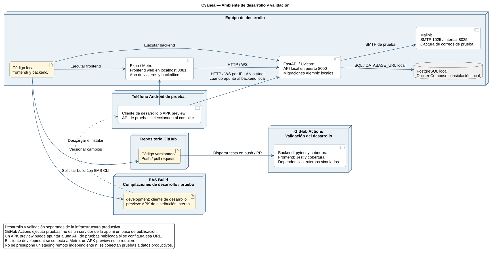
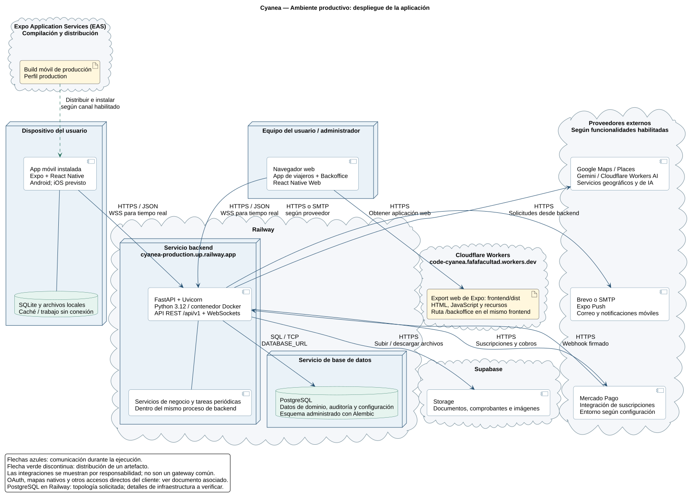
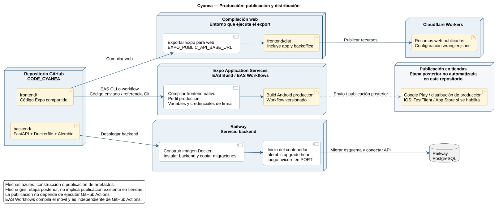

# Despliegue y distribución de Cyanea

La documentación separa el **ambiente de desarrollo y validación** del **ambiente productivo**. Desarrollo reúne la ejecución local, las pruebas de GitHub Actions y las builds móviles de desarrollo o prueba. Producción reúne la web y el backoffice en Cloudflare Workers, el backend y PostgreSQL en Railway, los servicios externos y la distribución móvil con el perfil EAS `production`.

La publicación productiva es independiente de GitHub Actions y no requiere ejecutarlo como paso del despliegue. Los workflows de tests siguen disparándose ante los eventos configurados en el repositorio; esto no los convierte en una dependencia de publicación. EAS Workflows es un servicio de compilación móvil diferente y puede utilizarse en producción.

La ubicación de PostgreSQL dentro de Railway se representa según el alcance solicitado. El repositorio permite identificar componentes y configuración de ejecución, pero no contiene una exportación de la infraestructura de Railway: la versión del servidor, la red privada, el volumen persistente, las réplicas y los backups deben contrastarse con su panel. Los dominios corresponden a los publicados en el README; no se realizó una inspección del entorno remoto para generar estos diagramas.

## Vistas

| Vista | Fuente editable | Diagrama |
| --- | --- | --- |
| Desarrollo y validación: ejecución local, GitHub Actions y builds de prueba | [PlantUML](ambiente-desarrollo.puml) | [SVG](ambiente-desarrollo.svg) |
| Producción: nodos y comunicaciones de la aplicación | [PlantUML](diagrama-despliegue.puml) | [SVG](diagrama-despliegue.svg) |
| Producción: publicación y distribución de artefactos, independiente de GitHub Actions | [PlantUML](compilacion-distribucion.puml) | [SVG](compilacion-distribucion.svg) |

### Ambiente de desarrollo y validación



El desarrollador ejecuta Expo/Metro y FastAPI en su equipo. PostgreSQL puede correr localmente o con Docker Compose; Mailpit permite capturar correos de prueba. El frontend web usa `http://localhost:8081` y la API local `http://127.0.0.1:8000/api/v1`. Un teléfono físico debe utilizar una IP de red o un túnel accesible para ese equipo, en lugar de su propio `localhost`.

GitHub Actions ejecuta pytest y Jest con cobertura al recibir pushes o pull requests. Es una herramienta de validación del código, no un componente de ejecución de Cyanea. EAS puede generar un cliente `development` conectado a Metro o un APK `preview` de instalación interna; este último no necesita Metro para ejecutar su bundle.

### Ambiente productivo: despliegue de la aplicación



### Ambiente productivo: publicación y distribución



## Componentes y responsabilidades

| Nodo | Componentes y responsabilidad | Evidencia en el repositorio |
| --- | --- | --- |
| Navegador del viajero | Ejecuta la versión web de Expo mediante React Native Web. Descarga los recursos de Cloudflare y llama directamente a la API. | [App.js](../../frontend/App.js), [api.js](../../frontend/src/services/api.js) |
| Navegador del administrador | Ejecuta `BackofficeApp` al ingresar a `/backoffice`, con sus pantallas y cliente HTTP propios dentro del mismo frontend publicado. La autorización se valida también en el backend. | [index.js](../../frontend/index.js), [backofficeApi.js](../../frontend/src/services/backofficeApi.js) |
| Dispositivo móvil | Ejecuta el binario de Expo/React Native. SQLite y archivos locales sostienen el funcionamiento sin conexión implementado. Utiliza la misma API que la web. | [database.native.js](../../frontend/src/database/database.native.js), [app.json](../../frontend/app.json) |
| Cloudflare Workers | Publica el export web de `frontend/dist` como recursos estáticos, con recuperación de rutas de SPA. No ejecuta el backend Python ni aloja PostgreSQL. | [wrangler.jsonc](../../frontend/wrangler.jsonc) |
| Railway: backend | Contenedor con Python 3.12, FastAPI y Uvicorn. El arranque del Dockerfile ejecuta `alembic upgrade head` y después inicia Uvicorn en `0.0.0.0` usando `PORT`, con fallback a 8000. Los routers de viajeros y backoffice pertenecen a la misma aplicación. | [Dockerfile](../../backend/Dockerfile), [main.py](../../backend/app/main.py), [router.py](../../backend/app/api/router.py) |
| Railway: PostgreSQL | Conserva datos de negocio, configuración, auditoría y metadatos de documentos. El backend se conecta mediante SQLAlchemy/psycopg y `DATABASE_URL`; Alembic administra la evolución del esquema. No se representa acceso SQL desde los clientes. | [session.py](../../backend/app/db/session.py), [migraciones](../../backend/alembic/versions) |
| Supabase Storage | Conserva binarios de documentos, comprobantes, fotos de perfil y portadas. Los permisos del repositorio se comprueban en la API; PostgreSQL guarda sus metadatos. Algunas imágenes se presentan mediante URL pública; la descarga protegida de documentos pasa por el backend. No se utiliza Supabase como sustituto de la base de datos del dominio en este esquema. | [storage.py](../../backend/app/services/supabase/storage.py), [documentos.py](../../backend/app/api/routes/documentos.py) |
| EAS | Compila y firma la aplicación nativa; produce los artefactos para su distribución. El perfil `preview` declara APK e instalación interna. Existe un workflow para compilar Android con el perfil `production`. EAS Build no es el servidor de ejecución de la aplicación. | [eas.json](../../frontend/eas.json), [workflow Android](../../frontend/.eas/workflows/create-production-builds.yml) |
| GitHub Actions — desarrollo y validación | Ejecuta tests de backend y frontend con cobertura en push y pull request. Está separado del ambiente productivo y su ejecución no es un requisito para publicar la web, el backend ni los binarios móviles. | [backend-tests.yml](../../.github/workflows/backend-tests.yml), [frontend-test.yml](../../.github/workflows/frontend-test.yml) |

Los servicios de negocio, la gestión de conexiones WebSocket y las tareas periódicas se ejecutan dentro de la aplicación FastAPI. Las tareas se inician desde su ciclo de vida: recordatorios, resolución de votaciones, actualización de estados de viajes y finalización de suscripciones. Esta documentación no introduce workers independientes, Redis, una cola de mensajes ni un servicio cron separado.

## Comunicaciones

| Origen → destino | Canal | Uso |
| --- | --- | --- |
| Navegador → Cloudflare Workers | HTTPS | Cargar HTML, JavaScript, imágenes y recursos de la web y el backoffice. |
| Web o móvil → backend Railway | HTTPS / JSON y multipart | API REST bajo `/api/v1`, autenticación y envío de archivos. El frontend usa `EXPO_PUBLIC_API_BASE_URL`. |
| App web o móvil ↔ backend Railway | WSS | Actualizaciones del viaje, gastos y notificaciones. El cliente deriva el host WebSocket de la URL de la API; algunas rutas WebSocket quedan fuera de `/api/v1`. |
| Backend → PostgreSQL | Protocolo PostgreSQL / TCP | Lecturas, escrituras y migraciones. Para esta topología corresponde configurar la conexión entre servicios de Railway, sin publicar credenciales en los clientes. El host, puerto y TLS efectivos dependen de `DATABASE_URL`. |
| Backend → Supabase Storage | HTTPS | Operaciones sobre archivos. La clave de servicio queda en el backend. |
| Backend → Google Maps/Places y Gemini | HTTPS | Búsquedas, rutas, validaciones y funciones de IA según la configuración vigente. |
| Backend → Cloudflare Workers AI | HTTPS | Generación de portadas. Es una integración distinta de Workers como alojamiento de la web. |
| Backend → Brevo o servidor SMTP | HTTPS o SMTP con TLS según configuración | Confirmación de correo, invitaciones y notificaciones. El proveedor se selecciona con `MAIL_PROVIDER`. |
| Backend → Expo Push | HTTPS | Envío de notificaciones móviles si está habilitado. La entrega final depende de las credenciales y servicios push de cada plataforma. EAS Build y Expo Push cumplen funciones diferentes. |
| Backend ↔ Mercado Pago | HTTPS | Crear y consultar suscripciones y cobros; recibir notificaciones en `/api/v1/pagos/mercadopago/webhook`. Representa la integración implementada, sin afirmar que se estén procesando pagos reales en producción. |
| Cliente ↔ Google/Facebook y backend | HTTPS / OAuth | Login social según plataforma y habilitación: el cliente obtiene la respuesta del proveedor y el servidor valida la identidad. Las credenciales y los redirects se configuran por plataforma. |
| Móvil → proveedor de mapas | SDK nativo / red del proveedor | La visualización del mapa nativo también tiene una integración de cliente. El diagrama agrupa las consultas geográficas e IA del servidor; no implica que todos los mapas se descarguen a través de FastAPI. |

Los enlaces de navegación externos, como sitios oficiales de actividades o el checkout de pago, se abren en el navegador correspondiente. Se omiten del diagrama principal para conservar su legibilidad.

## Compilación y configuración por entorno

| Aspecto | Desarrollo y validación | Producción |
| --- | --- | --- |
| Frontend web y backoffice | Expo/Metro local; mismo código y acceso `/backoffice`. | Export web publicado en Cloudflare Workers. |
| Backend | FastAPI/Uvicorn local o contenedor de desarrollo. | Servicio de Railway con la configuración del ambiente productivo. |
| Base de datos | PostgreSQL local con datos de desarrollo y pruebas; tests automatizados con sus fixtures. | PostgreSQL del ambiente alojado en Railway según la topología solicitada. |
| Correo e integraciones | Mailpit, mocks o credenciales de prueba según el tipo de validación. | Proveedores externos habilitados con la configuración correspondiente. |
| Móvil | EAS `development` o `preview`; API de desarrollo/pruebas elegida explícitamente. | EAS `production`; API del ambiente productivo. |
| Validación automatizada | GitHub Actions para tests ante push/PR. | La publicación se realiza mediante los mecanismos de Cloudflare, Railway y EAS, sin requerir GitHub Actions. |

La separación se aplica a los diagramas y a las responsabilidades de cada entorno. No se creó infraestructura nueva ni se presupone que exista un ambiente remoto de staging separado. Los datos, las credenciales y las URLs elegidas para pruebas deben corresponder al ambiente de prueba utilizado.

El código de `frontend/` genera dos clases de artefactos: el export web servido por Cloudflare y los binarios nativos compilados con EAS. El backoffice forma parte del export web; no se distribuye como una aplicación administrativa móvil independiente.

El repositorio define los perfiles EAS `development`, `preview` y `production`. `development` utiliza un cliente de desarrollo; `preview` selecciona el entorno `preview`, distribución interna y formato APK Android; `production` conserva la configuración por defecto del servicio sin fijar explícitamente `buildType`. El workflow `create-production-builds.yml` contiene un job de Android `production`. No contiene jobs de iOS ni de envío a tiendas. La presencia de `bundleIdentifier` y configuración iOS base no acredita una compilación iOS ni una publicación existente.

La generación del export web y su publicación se muestran como pasos lógicos: `wrangler.jsonc` identifica los recursos a servir, pero los workflows de GitHub incluidos en el repositorio solo ejecutan pruebas. No se presupone un pipeline único que bloquee todos los despliegues hasta aprobar esos tests, ni una conexión Git automática de Railway o Cloudflare que no esté documentada en código.

| Entorno de configuración | Valores relevantes | Criterio |
| --- | --- | --- |
| Compilación del frontend web y móvil | `EXPO_PUBLIC_API_BASE_URL`, opciones públicas de login y configuración de plataforma | Los valores `EXPO_PUBLIC_*` utilizados por el cliente se incorporan al bundle. Cambiar el backend de destino requiere regenerar/publicar el artefacto correspondiente. No colocar secretos de servidor en estas variables. |
| Compilación nativa EAS | Perfil/entorno, firma, `GOOGLE_MAPS_ANDROID_API_KEY`, archivo de Google Services cuando corresponda | Las opciones nativas se resuelven en `app.config.js` y `app.json`; deben corresponder al identificador de aplicación y firma utilizados. Las variables de compilación no sustituyen la configuración del backend. |
| Ejecución del backend Railway | `DATABASE_URL`, `CORS_ORIGINS`, `SECRET_KEY`, configuración de correo, Supabase, IA, OAuth, push y Mercado Pago | Se suministran al servicio backend. CORS debe incluir el origen publicado de la web. El contenedor usa `PORT` proporcionado por el entorno. No se copian valores de secretos en esta documentación. |
| Servicio PostgreSQL | Credenciales, red, persistencia y backups del entorno | Se administran en infraestructura. La versión PostgreSQL 16 de `docker-compose.yml` describe el entorno local y no prueba la versión desplegada en Railway. |

URLs públicas de referencia registradas en el proyecto:

- Web: `https://code-cyanea.fafafacultad.workers.dev`.
- Backoffice: `https://code-cyanea.fafafacultad.workers.dev/backoffice`.
- API: `https://cyanea-production.up.railway.app/api/v1`.
- Health del backend: `https://cyanea-production.up.railway.app/health`.

## Límites de la vista

Se representa una instancia lógica de backend. El gestor WebSocket conserva conexiones y bloqueos en memoria y las tareas periódicas se crean por proceso. Aumentar procesos o réplicas requiere revisar su coordinación y la propagación de eventos; el diagrama no presupone que exista esa infraestructura compartida.

La distribución interna por APK se diferencia de publicar en Google Play o App Store. Las tiendas se muestran como una etapa posterior; no hay evidencia de publicación ni automatización de envío en los archivos revisados. Tampoco se incorpora EAS Update como canal de actualizaciones, porque no está configurado en el frontend analizado.

El entorno local de Docker Compose, con PostgreSQL y Mailpit, se representa en su propia vista de desarrollo y queda separado del despliegue productivo. Los dominios publicados se conservan como referencias del alojamiento actual; su nombre no demuestra que haya dos infraestructuras remotas independientes. No se modificaron workflows, perfiles EAS ni servicios remotos, y no se inició ninguna compilación al actualizar esta documentación.

## Edición de los diagramas

Cada SVG se regenera desde su archivo `.puml` con el mismo nombre base. Las fuentes utilizan el motor Smetana integrado en PlantUML para generar los diagramas sin depender de Graphviz ni de includes remotos.

Desde la raíz del repositorio, con Java y una instalación local de PlantUML:

```powershell
java -jar <ruta-local-a-plantuml.jar> -charset UTF-8 -tsvg docs/despliegue/*.puml
```

Las fuentes y los SVG forman parte de la documentación versionada. Las herramientas de render y las previsualizaciones temporales no se incorporan al repositorio.
