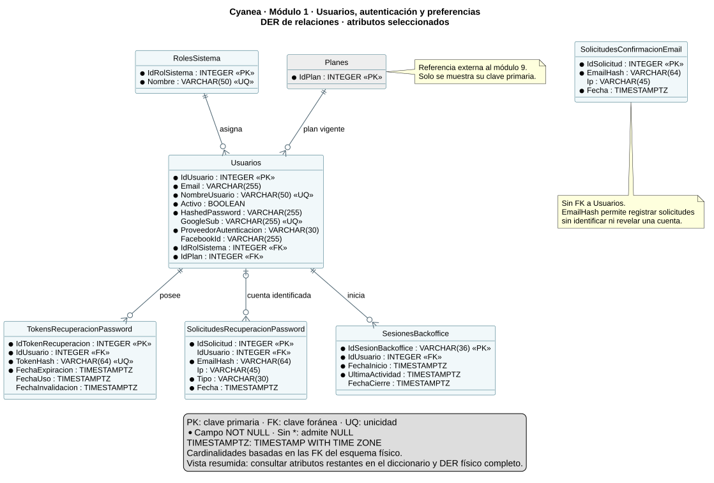

# Modelo de datos del módulo 1 Usuarios autenticación y preferencias

Este módulo reúne la identidad de las cuentas, sus roles globales, la recuperación de contraseña, el control de confirmación de correo y las sesiones administrativas. Incluye las preferencias de privacidad, notificación y consentimiento almacenadas en Usuarios.

## Alcance y referencias

Versión del documento: 1.0. Fecha: 14 de noviembre de 2026. Corte del código: `616ec79`. Esquema PostgreSQL local con Alembic en `b0bcca3ac886`.

Se documentan seis tablas propias y 74 columnas. Planes es una referencia externa al módulo 9, Planes, suscripciones y pagos. Las preferencias de planificación por participación pertenecen al módulo 4. TokensPushUsuarios y los registros de notificaciones y recordatorios pertenecen al módulo 10. Las auditorías, incluidas las de acceso al backoffice, pertenecen al módulo 11.

Las tablas y restricciones físicas se contrastaron con PostgreSQL y las migraciones; las descripciones funcionales, con los modelos y servicios. Este ejemplo describe la implementación vigente y no crea tablas ni modifica datos.

## Diagramas entidad relación



[Ver DER físico completo en SVG](der-fisico.svg).

- [DER de relaciones](der-resumido.puml): todas las entidades del módulo y sus cardinalidades, con atributos seleccionados para facilitar la lectura.
- [DER físico completo](der-fisico.puml): todas las columnas de las seis tablas propias, con tipos, nulabilidad y claves. Planes muestra únicamente su PK por ser una referencia externa.

Los archivos son editables en PlantUML. Pueden abrirse con una extensión compatible o renderizarse localmente con Java y PlantUML. El motor Smetana está indicado en los archivos para evitar depender de Graphviz.

```powershell
java -jar <ruta-a-plantuml.jar> -charset UTF-8 -tsvg docs/modelo-datos/modulo-01-usuarios-autenticacion-preferencias/der-resumido.puml
java -jar <ruta-a-plantuml.jar> -charset UTF-8 -tsvg docs/modelo-datos/modulo-01-usuarios-autenticacion-preferencias/der-fisico.puml
```

Las fuentes PlantUML y las vistas SVG se conservan juntas en esta carpeta. Al modificar un DER se debe regenerar su SVG.

## Entidades y relaciones

| Entidad | Responsabilidad |
|---|---|
| Usuarios | Cuenta, identidad, estado, privacidad, consentimientos y preferencias personales. Las preferencias son columnas de esta tabla, no entidades independientes. |
| RolesSistema | Catálogo de roles globales de acceso. Es distinto de los roles de participación en un viaje. |
| TokensRecuperacionPassword | Tokens de recuperación persistidos por su hash, con vencimiento, uso e invalidación. |
| SolicitudesRecuperacionPassword | Control de frecuencia de solicitudes y registro del restablecimiento de contraseña. Puede registrar solicitudes sin usuario asociado. |
| SolicitudesConfirmacionEmail | Control de frecuencia del reenvío de confirmación mediante hash del correo e IP. No contiene IdUsuario ni una FK a Usuarios. |
| SesionesBackoffice | Sesiones de acceso administrativo para controlar actividad y cierre. Se asigna a este módulo por su responsabilidad de autenticación; la auditoría de accesos pertenece al módulo de administración. |

| Relación física | Cardinalidad y obligatoriedad |
|---|---|
| RolesSistema → Usuarios | Un rol puede estar asignado a cero o muchos usuarios. Cada usuario tiene exactamente un rol. |
| Planes → Usuarios | Un plan puede corresponder a cero o muchos usuarios. Cada usuario tiene exactamente un plan vigente. |
| Usuarios → TokensRecuperacionPassword | Un usuario puede tener cero o muchos tokens. Cada token pertenece a exactamente un usuario. |
| Usuarios → SolicitudesRecuperacionPassword | Un usuario puede tener cero o muchas solicitudes. Cada solicitud puede referenciar cero o un usuario. |
| Usuarios → SesionesBackoffice | Un usuario puede tener cero o muchas sesiones. Cada sesión pertenece a exactamente un usuario. El rol administrador se exige en la aplicación. |

SolicitudesConfirmacionEmail no tiene relaciones por FK. La relación funcional mediante el hash del correo no se representa como una relación física. VersionTerminosAceptada también es un valor de texto, sin FK a la tabla de versiones.

Las FK de estas seis tablas no tienen acciones explícitas ON DELETE u ON UPDATE; rige NO ACTION de PostgreSQL. El DER no implica borrado en cascada.

## Convenciones del diccionario

PK significa clave primaria, FK clave foránea y UQ restricción de unicidad sobre una columna. La columna «Admite NULL» describe nulabilidad física. «Predeterminado BD» distingue valores del servidor de los que asigna la aplicación. Una celda «—» indica que no existe un valor predeterminado en la base.

TIMESTAMPTZ es la abreviatura PostgreSQL de TIMESTAMP WITH TIME ZONE: almacena un instante, no el nombre de una zona horaria. VARCHAR sin longitud no tiene un límite de caracteres declarado. Los índices de respaldo de PK se identifican mediante la restricción primaria y no se duplican en la lista de índices.

## Diccionario de datos

### 1 Usuarios

Cuenta, identidad, estado, privacidad, consentimientos y preferencias personales. Las preferencias son columnas de esta tabla, no entidades independientes.

| Campo | Tipo PostgreSQL | Admite NULL | Clave | Predeterminado BD | Descripción |
|---|---|---|---|---|---|
| IdUsuario | INTEGER | No | PK | IDENTITY ALWAYS | Identificador de la cuenta de usuario. |
| Email | VARCHAR(255) | No | — | — | Correo de la cuenta. La base inspeccionada no tiene una restricción UNIQUE sobre este campo. |
| Nombre | VARCHAR(100) | No | — | — | Nombre de la persona. |
| Apellido | VARCHAR(100) | No | — | — | Apellido de la persona. |
| NombreUsuario | VARCHAR(50) | No | UQ | — | Nombre identificador utilizado para localizar la cuenta; único. |
| FotoUrl | VARCHAR | Sí | — | — | URL de la imagen de perfil. |
| FechaAlta | TIMESTAMPTZ | No | — | now() | Instante de alta de la cuenta. |
| FechaBaja | TIMESTAMPTZ | Sí | — | — | Instante de baja de la cuenta; opcional. |
| Activo | BOOLEAN | No | — | true | Indica si la cuenta está activa; no reemplaza las fechas de baja o suspensión. |
| HashedPassword | VARCHAR(255) | No | — | — | Hash de contraseña. En altas sociales se genera a partir de un secreto aleatorio; no almacena la contraseña del proveedor. |
| EmailConfirmado | BOOLEAN | No | — | false | Indica si el correo fue confirmado según el flujo de autenticación. |
| ConsienteNotificacionesEmail | BOOLEAN | No | — | false | Consentimiento general para recibir notificaciones por correo. |
| RecibeEmailsNuevaVotacion | BOOLEAN | No | — | true | Preferencia de notificación por correo para nuevas votaciones; se evalúa junto con el consentimiento general del canal. |
| RecibeEmailsCambiosViaje | BOOLEAN | No | — | true | Preferencia de notificación por correo para cambios del viaje; se evalúa junto con el consentimiento general del canal. |
| RecibeEmailsRecordatoriosDeuda | BOOLEAN | No | — | true | Preferencia de notificación por correo para recordatorios de deuda; se evalúa junto con el consentimiento general del canal. |
| RecibeEmailsRecordatoriosReserva | BOOLEAN | No | — | true | Preferencia de notificación por correo para recordatorios de reservas o entradas; se evalúa junto con el consentimiento general del canal. |
| GoogleSub | VARCHAR(255) | Sí | UQ | — | Identificador estable de la identidad de Google; único cuando está informado. |
| ProveedorAutenticacion | VARCHAR(30) | No | — | 'local' | Proveedor de acceso: local, google o facebook; valores gestionados por la aplicación, sin CHECK físico. |
| FacebookId | VARCHAR(255) | Sí | — | — | Identificador de la identidad de Facebook; sin restricción UNIQUE física. |
| ConsienteNotificacionesPush | BOOLEAN | No | — | false | Consentimiento general para recibir notificaciones push. |
| RecibePushNuevaVotacion | BOOLEAN | No | — | true | Preferencia de notificación por push para nuevas votaciones; se evalúa junto con el consentimiento general del canal. |
| RecibePushCambiosViaje | BOOLEAN | No | — | true | Preferencia de notificación por push para cambios del viaje; se evalúa junto con el consentimiento general del canal. |
| RecibePushRecordatoriosDeuda | BOOLEAN | No | — | true | Preferencia de notificación por push para recordatorios de deuda; se evalúa junto con el consentimiento general del canal. |
| RecibePushRecordatoriosReserva | BOOLEAN | No | — | true | Preferencia de notificación por push para recordatorios de reservas o entradas; se evalúa junto con el consentimiento general del canal. |
| RecibeEmailsNuevosGastos | BOOLEAN | No | — | true | Preferencia de notificación por correo para nuevos gastos; se evalúa junto con el consentimiento general del canal. |
| RecibeEmailsRecordatoriosActividad | BOOLEAN | No | — | true | Preferencia de notificación por correo para recordatorios de actividades; se evalúa junto con el consentimiento general del canal. |
| RecibePushNuevosGastos | BOOLEAN | No | — | true | Preferencia de notificación por push para nuevos gastos; se evalúa junto con el consentimiento general del canal. |
| RecibePushRecordatoriosActividad | BOOLEAN | No | — | true | Preferencia de notificación por push para recordatorios de actividades; se evalúa junto con el consentimiento general del canal. |
| ConsienteProcesamientoIA | BOOLEAN | No | — | false | Consentimiento de procesamiento de comprobantes con IA. |
| FechaConsentimientoIA | TIMESTAMPTZ | Sí | — | — | Fecha registrada del consentimiento de procesamiento con IA. |
| RecibeEmailsNuevasActividades | BOOLEAN | No | — | true | Preferencia de notificación por correo para nuevas actividades; se evalúa junto con el consentimiento general del canal. |
| RecibePushNuevasActividades | BOOLEAN | No | — | true | Preferencia de notificación por push para nuevas actividades; se evalúa junto con el consentimiento general del canal. |
| FechaConsentimientoNotificacionesEmail | TIMESTAMPTZ | Sí | — | — | Fecha registrada del consentimiento de notificaciones por correo. |
| FechaConsentimientoNotificacionesPush | TIMESTAMPTZ | Sí | — | — | Fecha registrada del consentimiento de notificaciones push. |
| AceptaTerminos | BOOLEAN | No | — | false | Aceptación de Términos y Condiciones registrada para la cuenta. |
| FechaAceptacionTerminos | TIMESTAMPTZ | Sí | — | — | Instante de aceptación de Términos y Condiciones. |
| VersionTerminosAceptada | VARCHAR(30) | Sí | — | — | Número de versión aceptada, almacenado como texto; no es una FK a VersionesTerminos. |
| ConsienteAsistenteIA | BOOLEAN | No | — | false | Consentimiento específico para utilizar el asistente del viaje. |
| FechaConsentimientoAsistenteIA | TIMESTAMPTZ | Sí | — | — | Fecha registrada del consentimiento del asistente. |
| VisibilidadNombre | VARCHAR(20) | No | — | 'participantes' | Visibilidad frente a otros participantes: participantes o privado. Dominio protegido por CHECK. |
| VisibilidadEmail | VARCHAR(20) | No | — | 'participantes' | Visibilidad frente a otros participantes: participantes o privado. Dominio protegido por CHECK. |
| VisibilidadFotoPerfil | VARCHAR(20) | No | — | 'participantes' | Visibilidad frente a otros participantes: participantes o privado. Dominio protegido por CHECK. |
| PermiteBusquedaPorUsuario | BOOLEAN | No | — | true | Habilita que la cuenta se encuentre mediante búsqueda por nombre de usuario. |
| IdRolSistema | INTEGER | No | FK | 1 | Rol de acceso de la cuenta; 1 = viajero y 2 = administrador del sistema. |
| UltimoAcceso | TIMESTAMPTZ | Sí | — | — | Último acceso registrado para la cuenta. |
| IdPlan | INTEGER | No | FK | 1 | Plan vigente de la cuenta; referencia externa a Planes. No identifica una suscripción. |
| FechaCambioPassword | TIMESTAMPTZ | Sí | — | — | Marca temporal utilizada para invalidar sesiones anteriores al cambio de contraseña. |
| MotivoSuspension | VARCHAR(500) | Sí | — | — | Motivo registrado al suspender la cuenta. |
| FechaSuspension | TIMESTAMPTZ | Sí | — | — | Instante de suspensión de la cuenta. |
| FechaCierreSesiones | TIMESTAMPTZ | Sí | — | — | Marca temporal de invalidación de sesiones; se conserva al reactivar una cuenta suspendida. |

Restricciones e índices:

- PK `Usuarios_pkey`: IdUsuario.
- FK `FK_Usuarios_Planes_IdPlan`: IdPlan → Planes(IdPlan).
- FK `Usuarios_IdRolSistema_fkey`: IdRolSistema → RolesSistema(IdRolSistema).
- UNIQUE `UQ_Usuarios_GoogleSub`: GoogleSub.
- UNIQUE `UQ_Usuarios_NombreUsuario`: NombreUsuario.
- CHECK `ck_usuarios_visibilidademail`: el campo admite únicamente `participantes` o `privado`.
- CHECK `ck_usuarios_visibilidadfotoperfil`: el campo admite únicamente `participantes` o `privado`.
- CHECK `ck_usuarios_visibilidadnombre`: el campo admite únicamente `participantes` o `privado`.
- Índice `ix_Usuarios_UltimoAcceso`: (UltimoAcceso).

### 2 RolesSistema

Catálogo de roles globales de acceso. Es distinto de los roles de participación en un viaje.

| Campo | Tipo PostgreSQL | Admite NULL | Clave | Predeterminado BD | Descripción |
|---|---|---|---|---|---|
| IdRolSistema | INTEGER | No | PK | — | Identificador del rol del sistema; los valores maestros se asignan explícitamente. |
| Nombre | VARCHAR(50) | No | UQ | — | Nombre único del rol; valores maestros viajero y administrador_sistema. |

Restricciones e índices:

- PK `RolesSistema_pkey`: IdRolSistema.
- UNIQUE `RolesSistema_Nombre_key`: Nombre.

### 3 TokensRecuperacionPassword

Tokens de recuperación persistidos por su hash, con vencimiento, uso e invalidación.

| Campo | Tipo PostgreSQL | Admite NULL | Clave | Predeterminado BD | Descripción |
|---|---|---|---|---|---|
| IdTokenRecuperacion | INTEGER | No | PK | Secuencia | Identificador autogenerado del token de recuperación. |
| IdUsuario | INTEGER | No | FK | — | Cuenta a la que pertenece el registro. |
| TokenHash | VARCHAR(64) | No | UQ | — | Hash SHA-256 del token de recuperación; único. No contiene el token en claro. |
| FechaCreacion | TIMESTAMPTZ | No | — | now() | Instante de creación del token. |
| FechaExpiracion | TIMESTAMPTZ | No | — | — | Instante hasta el que puede utilizarse el token. |
| FechaUso | TIMESTAMPTZ | Sí | — | — | Instante de utilización; NULL mientras no se haya usado. |
| FechaInvalidacion | TIMESTAMPTZ | Sí | — | — | Instante de invalidación explícita; NULL mientras no se haya invalidado. |

Restricciones e índices:

- PK `TokensRecuperacionPassword_pkey`: IdTokenRecuperacion.
- FK `FK_TokensRecuperacionPassword_Usuarios_IdUsuario`: IdUsuario → Usuarios(IdUsuario).
- UNIQUE `TokensRecuperacionPassword_TokenHash_key`: TokenHash.
- Índice `ix_TokensRecuperacionPassword_IdUsuario`: (IdUsuario).

### 4 SolicitudesRecuperacionPassword

Control de frecuencia de solicitudes y registro del restablecimiento de contraseña. Puede registrar solicitudes sin usuario asociado.

| Campo | Tipo PostgreSQL | Admite NULL | Clave | Predeterminado BD | Descripción |
|---|---|---|---|---|---|
| IdSolicitud | INTEGER | No | PK | Secuencia | Identificador autogenerado del registro de solicitud. |
| IdUsuario | INTEGER | Sí | FK | — | Cuenta asociada; puede ser NULL cuando no se identifica una cuenta. |
| EmailHash | VARCHAR(64) | No | — | — | Hash SHA-256 del correo normalizado; permite controlar solicitudes sin guardar el correo en claro en esta tabla. |
| Ip | VARCHAR(45) | Sí | — | — | Dirección IP de origen, si se encuentra disponible; hasta 45 caracteres para IPv4 o IPv6. |
| Tipo | VARCHAR(30) | No | — | — | Tipo registrado por el servicio: solicitud o cambio_password; sin CHECK físico. |
| Fecha | TIMESTAMPTZ | No | — | now() | Instante del registro, utilizado para controlar frecuencia de solicitudes. |

Restricciones e índices:

- PK `SolicitudesRecuperacionPassword_pkey`: IdSolicitud.
- FK `FK_SolicitudesRecuperacionPassword_Usuarios_IdUsuario`: IdUsuario → Usuarios(IdUsuario).
- Índice `ix_SolicitudesRecuperacionPassword_EmailHash`: (EmailHash).
- Índice `ix_SolicitudesRecuperacionPassword_Ip`: (Ip).

### 5 SolicitudesConfirmacionEmail

Control de frecuencia del reenvío de confirmación mediante hash del correo e IP. No contiene IdUsuario ni una FK a Usuarios.

| Campo | Tipo PostgreSQL | Admite NULL | Clave | Predeterminado BD | Descripción |
|---|---|---|---|---|---|
| IdSolicitud | INTEGER | No | PK | Secuencia | Identificador autogenerado del registro de solicitud. |
| EmailHash | VARCHAR(64) | No | — | — | Hash SHA-256 del correo normalizado; permite controlar solicitudes sin guardar el correo en claro en esta tabla. |
| Ip | VARCHAR(45) | Sí | — | — | Dirección IP de origen, si se encuentra disponible; hasta 45 caracteres para IPv4 o IPv6. |
| Fecha | TIMESTAMPTZ | No | — | now() | Instante del registro, utilizado para controlar frecuencia de solicitudes. |

Restricciones e índices:

- PK `SolicitudesConfirmacionEmail_pkey`: IdSolicitud.
- Índice `IX_SolicitudesConfirmacionEmail_Email_Fecha`: (EmailHash, Fecha).
- Índice `IX_SolicitudesConfirmacionEmail_Ip_Fecha`: (Ip, Fecha).

### 6 SesionesBackoffice

Sesiones de acceso administrativo para controlar actividad y cierre. Se asigna a este módulo por su responsabilidad de autenticación; la auditoría de accesos pertenece al módulo de administración.

| Campo | Tipo PostgreSQL | Admite NULL | Clave | Predeterminado BD | Descripción |
|---|---|---|---|---|---|
| IdSesionBackoffice | VARCHAR(36) | No | PK | — | Identificador de sesión generado por la aplicación como UUID, persistido en VARCHAR(36). |
| IdUsuario | INTEGER | No | FK | — | Cuenta a la que pertenece el registro. |
| FechaInicio | TIMESTAMPTZ | No | — | — | Instante de inicio de sesión en el backoffice. |
| UltimaActividad | TIMESTAMPTZ | No | — | — | Última actividad registrada para controlar inactividad. |
| FechaCierre | TIMESTAMPTZ | Sí | — | — | Instante de cierre; NULL mientras no se haya registrado un cierre. |

Restricciones e índices:

- PK `SesionesBackoffice_pkey`: IdSesionBackoffice.
- FK `SesionesBackoffice_IdUsuario_fkey`: IdUsuario → Usuarios(IdUsuario).

## Reglas funcionales y particularidades del esquema

1. **Roles globales.** RolesSistema usa los identificadores maestros 1 (viajero) y 2 (administrador_sistema). La FK exige la existencia del rol; el acceso al backoffice se valida en el servidor. Los roles de un viaje se documentan en el módulo 2.
2. **Identidad y unicidad.** NombreUsuario y GoogleSub tienen UNIQUE. GoogleSub admite múltiples NULL. Email y FacebookId no tienen UNIQUE en la base inspeccionada; los controles de los servicios no deben confundirse con restricciones físicas. El índice UNIQUE de Email creado en la primera migración fue retirado en `0006_create_dias_cronogramas_table.py`.
3. **Autenticación social.** ProveedorAutenticacion es texto. La aplicación utiliza local, google y facebook; no existe una tabla maestra de proveedores ni un CHECK. Las cuentas sociales conservan HashedPassword NOT NULL con un hash generado a partir de un secreto aleatorio.
4. **Recuperación de contraseña.** El servicio persiste el hash SHA-256 del token. Controla vencimiento, uso e invalidación; su vigencia actual es de 24 horas. SolicitudesRecuperacionPassword permite contar solicitudes aun cuando no existe una cuenta identificada y registra el cambio con Tipo = cambio_password. Los valores de Tipo no están restringidos por CHECK.
5. **Confirmación de correo.** El enlace utiliza un JWT con vigencia de 24 horas. SolicitudesConfirmacionEmail registra intentos admitidos de reenvío para controlar su frecuencia, no el token de confirmación ni cada alta original. No debe inventarse una tabla de tokens de confirmación.
6. **Privacidad y notificaciones.** Las tres visibilidades admiten participantes o privado por CHECK. Los consentimientos generales por canal se evalúan junto con las preferencias por tipo de evento; una preferencia true no equivale a un consentimiento general otorgado.
7. **Aceptación legal.** VersionTerminosAceptada guarda el número de versión como texto, no el identificador de VersionesTerminos. El vínculo funcional con la gestión legal no constituye una FK física.
8. **Sesiones administrativas.** SesionesBackoffice usa un UUID generado por la aplicación, almacenado como VARCHAR(36). No existe una tabla equivalente de sesiones de viajeros en este módulo; sus tokens de acceso son JWT.
9. **Identificadores y valores predeterminados.** Usuarios.IdUsuario es IDENTITY ALWAYS en la base local. Los identificadores de recuperación y confirmación se generan mediante secuencias. RolesSistema.IdRolSistema y SesionesBackoffice.IdSesionBackoffice no tienen generación automática en PostgreSQL.
10. **Baja y suspensión.** Activo, FechaBaja, FechaSuspension y FechaCierreSesiones expresan aspectos diferentes del ciclo de vida. La baja anonimiza la cuenta según los servicios; estas columnas no establecen por sí mismas una política de eliminación en cascada.

## Fuentes del modelo

- [Usuarios](../../../backend/app/models/usuario.py), [roles](../../../backend/app/models/rol_sistema.py), [recuperación de contraseña](../../../backend/app/models/recuperacion_password.py), [solicitudes de confirmación](../../../backend/app/models/solicitud_confirmacion_email.py) y [sesiones administrativas](../../../backend/app/models/sesion_backoffice.py).
- [Migraciones Alembic](../../../backend/alembic/versions), incluidas `0006`, `4f4ab2082d92`, `9f4c2d1a0b3e`, `f1c3a5e7b9d2` y `e1710c0f1a01`.
- [Servicio de recuperación](../../../backend/app/services/auth/password_reset_service.py), [confirmación de correo](../../../backend/app/services/auth/email_confirmation_service.py) y [autenticación administrativa](../../../backend/app/services/backoffice/auth_service.py).
- Metadatos del esquema PostgreSQL local: columnas, PK, FK, UNIQUE, CHECK, índices y valores predeterminados. La inspección no incluye filas ni valores de cuentas.
