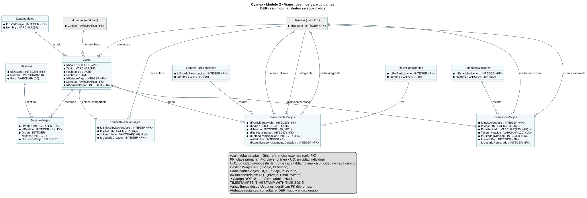

# Modelo de datos del módulo 2 Viajes destinos y participantes

Este módulo contiene la estructura del viaje, sus destinos y recorrido, la pertenencia de los integrantes y las invitaciones personales o compartibles. Permite distinguir la cuenta de una persona de su participación y rol dentro de cada viaje.

## Alcance y referencias

Versión: 1.0. Fecha: 14 de noviembre de 2026. Corte del código: `616ec79`. Esquema PostgreSQL local con Alembic en `b0bcca3ac886`.

Se documentan 10 tablas propias, 70 columnas y 17 claves foráneas. Usuarios pertenece al módulo 1 y Monedas al módulo 6; ambos aparecen en los DER solo con su PK. Planes se consulta a través del administrador para aplicar límites, sin una FK directa desde Viajes.

Los días, las actividades, los tramos de traslado y las rutas diarias corresponden al módulo 3. En este módulo solo se documenta el recorrido base en DestinosViajes; no se duplican las tablas del itinerario. Las preferencias de planificación por participación pertenecen al módulo 4.

La estructura física se contrastó con PostgreSQL, las migraciones y los modelos SQLAlchemy; las reglas funcionales se contrastaron con los servicios. Esta documentación no modifica tablas ni datos.

## Diagramas entidad relación



- DER resumido: [vista SVG](der-resumido.svg) y [fuente PlantUML](der-resumido.puml), con atributos seleccionados y todas las relaciones por FK.
- DER físico completo: [vista SVG](der-fisico.svg) y [fuente PlantUML](der-fisico.puml), con todas las columnas de las tablas propias.

Las vistas SVG pueden ampliarse sin perder nitidez. Sus fuentes están junto al diccionario; al modificar el modelo se deben actualizar los archivos PlantUML y regenerar los SVG. El motor Smetana evita una dependencia adicional de Graphviz.

```powershell
java -jar <ruta-a-plantuml.jar> -charset UTF-8 -tsvg docs/modelo-datos/modulo-02-viajes-destinos-participantes/der-resumido.puml
java -jar <ruta-a-plantuml.jar> -charset UTF-8 -tsvg docs/modelo-datos/modulo-02-viajes-destinos-participantes/der-fisico.puml
```

## Entidades

| Tabla propia | Responsabilidad |
|---|---|
| Viajes | Cabecera del viaje: fechas, estado, moneda, administrador y portada. |
| Destinos | Destinos geográficos reutilizables entre viajes. |
| DestinosViajes | Relación entre viajes y destinos; guarda el orden del recorrido y las noches asignadas. |
| EstadosViajes | Catálogo de estados del ciclo de vida del viaje. |
| ParticipantesViajes | Pertenencia de una cuenta a un viaje, con rol, estado y fechas del ciclo de participación. |
| RolesParticipantes | Catálogo de roles dentro del viaje; no equivale a RolesSistema. |
| EstadosParticipaciones | Catálogo de estados de participación e invitación a cuentas registradas. |
| InvitacionesViajes | Invitaciones personales por correo, con vencimiento y eventual vinculación a una cuenta. |
| EstadosInvitaciones | Catálogo de estados de las invitaciones personales por correo. |
| EnlacesInvitacionViajes | Enlace compartible del viaje; conserva una única fila por viaje y permite renovar o revocar el acceso. |

## Relaciones físicas y cardinalidades

Una FK NOT NULL exige exactamente una fila padre por registro hijo; una FK nullable permite cero o una. La cantidad de hijos posibles es cero o muchos, excepto Viajes → EnlacesInvitacionViajes, cuyo UNIQUE limita a cero o un enlace por viaje.

| Tabla padre | Tabla hija y campo FK | Padre por registro hijo | Hijos por registro padre |
|---|---|---|---|
| EstadosViajes(IdEstadoViaje) | Viajes.IdEstadoViaje | Exactamente uno | Cero o muchos |
| Monedas(Codigo) | Viajes.Moneda | Exactamente uno | Cero o muchos |
| Usuarios(IdUsuario) | Viajes.IdAdministrador | Exactamente uno | Cero o muchos |
| Destinos(IdDestino) | DestinosViajes.IdDestino | Exactamente uno | Cero o muchos |
| Viajes(IdViaje) | DestinosViajes.IdViaje | Exactamente uno | Cero o muchos |
| EstadosParticipaciones(IdEstadoParticipacion) | ParticipantesViajes.IdEstadoParticipacion | Exactamente uno | Cero o muchos |
| RolesParticipantes(IdRolParticipante) | ParticipantesViajes.IdRolParticipante | Exactamente uno | Cero o muchos |
| Usuarios(IdUsuario) | ParticipantesViajes.IdAdministradorAlMomentoDeSalida | Cero o uno | Cero o muchos |
| Usuarios(IdUsuario) | ParticipantesViajes.IdUsuario | Exactamente uno | Cero o muchos |
| Usuarios(IdUsuario) | ParticipantesViajes.InvitadoPor | Cero o uno | Cero o muchos |
| Viajes(IdViaje) | ParticipantesViajes.IdViaje | Exactamente uno | Cero o muchos |
| EstadosInvitaciones(IdEstadoInvitacion) | InvitacionesViajes.IdEstadoInvitacion | Exactamente uno | Cero o muchos |
| Usuarios(IdUsuario) | InvitacionesViajes.IdUsuarioRegistrado | Cero o uno | Cero o muchos |
| Usuarios(IdUsuario) | InvitacionesViajes.InvitadoPor | Exactamente uno | Cero o muchos |
| Viajes(IdViaje) | InvitacionesViajes.IdViaje | Exactamente uno | Cero o muchos |
| Usuarios(IdUsuario) | EnlacesInvitacionViajes.IdUsuarioCreador | Exactamente uno | Cero o muchos |
| Viajes(IdViaje) | EnlacesInvitacionViajes.IdViaje | Exactamente uno | Cero o uno |

Estas son cardinalidades físicas: la exigencia funcional de que un viaje tenga destinos o que el administrador sea un participante aceptado se valida en los servicios. Ninguna FK de estas tablas declara ON DELETE u ON UPDATE; rige NO ACTION de PostgreSQL. Los cascade definidos en relaciones SQLAlchemy no equivalen a ON DELETE CASCADE en la base.

## Convenciones del diccionario

PK significa clave primaria; FK, clave foránea; UQ, unicidad individual. UQ1 identifica una restricción compuesta dentro de la tabla: sus columnas forman una combinación única, sin ser necesariamente únicas por separado. Los nombres exactos de cada restricción se detallan después de los campos.

«Admite NULL» describe la nulabilidad física. «Predeterminado BD» indica defaults del servidor; «—» indica que no existe uno. IDENTITY ALWAYS genera el identificador salvo una operación explícita de sobrescritura; IDENTITY BY DEFAULT admite asignación explícita. TIMESTAMPTZ abrevia TIMESTAMP WITH TIME ZONE y representa instantes. DATE representa fechas sin hora. VARCHAR sin longitud no tiene un límite de caracteres declarado.

## Diccionario de datos

### 1 Viajes

Cabecera del viaje: fechas, estado, moneda, administrador y portada.

| Campo | Tipo PostgreSQL | Admite NULL | Clave | Predeterminado BD | Descripción |
|---|---|---|---|---|---|
| IdViaje | INTEGER | No | PK | IDENTITY ALWAYS | Identificador autogenerado del viaje. |
| Titulo | VARCHAR(150) | No | — | — | Título con el que se identifica el viaje. |
| Descripcion | VARCHAR | Sí | — | — | Descripción general opcional del viaje; VARCHAR sin longitud declarada. |
| FechaInicio | DATE | No | — | — | Primer día del viaje; fecha sin hora. |
| FechaFin | DATE | No | — | — | Último día del viaje, incluido en su duración; debe ser igual o posterior a FechaInicio. |
| IdEstadoViaje | INTEGER | No | FK | — | Estado vigente del viaje; referencia al catálogo EstadosViajes. |
| Moneda | VARCHAR(3) | No | FK | 'ARS' | Código de la moneda base para los gastos y liquidaciones del viaje; referencia a Monedas.Codigo. |
| IdAdministrador | INTEGER | No | FK | — | Cuenta responsable actual del viaje; referencia a Usuarios.IdUsuario. |
| FechaCreacion | TIMESTAMPTZ | No | — | now() | Instante de creación del viaje; predeterminado now() en la base. |
| FechaActualizacion | TIMESTAMPTZ | No | — | now() | Instante de última actualización registrada por los servicios. El default now() no actualiza por sí solo la columna al modificar una fila. |
| GooglePlaceIdPortada | VARCHAR(255) | Sí | — | — | Identificador externo de Google Places utilizado para resolver la portada; no es una FK local. |
| UrlPortadaPersonalizada | VARCHAR(500) | Sí | — | — | URL de una portada seleccionada o personalizada para el viaje. |

Restricciones e índices:

- PK `Viajes_pkey`: (IdViaje).
- FK `FK_Viajes_EstViajes_IdEstadoViaje`: IdEstadoViaje → EstadosViajes(IdEstadoViaje).
- FK `FK_Viajes_Monedas_Codigo`: Moneda → Monedas(Codigo).
- FK `FK_Viajes_Usuarios_IdAdministrador`: IdAdministrador → Usuarios(IdUsuario).
- CHECK `CK_Viajes_Fechas`: `"FechaFin" IS NULL OR "FechaInicio" IS NULL OR "FechaFin" >= "FechaInicio"`.
- Índice `IX_Viajes_Estado_FechaFin`: (IdEstadoViaje, FechaFin).

### 2 Destinos

Destinos geográficos reutilizables entre viajes.

| Campo | Tipo PostgreSQL | Admite NULL | Clave | Predeterminado BD | Descripción |
|---|---|---|---|---|---|
| IdDestino | INTEGER | No | PK | IDENTITY BY DEFAULT | Identificador del destino; IDENTITY BY DEFAULT. |
| Nombre | VARCHAR(200) | No | — | — | Nombre del destino geográfico. |
| Pais | VARCHAR(100) | No | — | — | País del destino, almacenado como texto; no es una FK ni un código de país obligatorio. |
| Lat | DOUBLE PRECISION | Sí | — | — | Latitud opcional. El esquema no define un CHECK de rango geográfico. |
| Lng | DOUBLE PRECISION | Sí | — | — | Longitud opcional. El esquema no define un CHECK de rango geográfico. |
| ProvinciaEstado | VARCHAR(150) | Sí | — | — | Provincia, estado o región del destino, si se conoce. |

Restricciones e índices:

- PK `Destinos_pkey`: (IdDestino).
- Sin índices adicionales a la PK.

### 3 DestinosViajes

Relación entre viajes y destinos; guarda el orden del recorrido y las noches asignadas.

| Campo | Tipo PostgreSQL | Admite NULL | Clave | Predeterminado BD | Descripción |
|---|---|---|---|---|---|
| IdViaje | INTEGER | No | PK, FK | — | Identificador del viaje al que pertenece el registro. |
| IdDestino | INTEGER | No | PK, FK | — | Destino geográfico asociado; referencia al catálogo Destinos. |
| Orden | INTEGER | No | — | 0 | Posición del destino en el recorrido, desde cero, mantenida por la aplicación. No existe UNIQUE por viaje y orden. |
| Noches | INTEGER | Sí | — | — | Noches asignadas al destino. NULL indica recorrido sin armar o un caso donde no aplica la distribución; admite cero por CHECK. |
| NochesEnViaje | INTEGER | No | — | 0 | Noches de traslado hacia el destino siguiente, sin asignación a un destino. La aplicación exige cero en el último destino. |

Restricciones e índices:

- PK `DestinosViajes_pkey`: (IdViaje, IdDestino).
- FK `DestinosViajes_IdDestino_fkey`: IdDestino → Destinos(IdDestino).
- FK `DestinosViajes_IdViaje_fkey`: IdViaje → Viajes(IdViaje).
- CHECK `CK_DestinosViajes_Noches`: `"Noches" IS NULL OR "Noches" >= 0`.
- CHECK `CK_DestinosViajes_NochesEnViaje`: `"NochesEnViaje" >= 0`.
- Sin índices adicionales a la PK.

### 4 EstadosViajes

Catálogo de estados del ciclo de vida del viaje.

| Campo | Tipo PostgreSQL | Admite NULL | Clave | Predeterminado BD | Descripción |
|---|---|---|---|---|---|
| IdEstadoViaje | INTEGER | No | PK | IDENTITY ALWAYS | Identificador autogenerado del estado del viaje. |
| Nombre | VARCHAR(30) | No | — | — | Nombre funcional del valor maestro. La base no declara UNIQUE sobre este campo. |
| Descripcion | VARCHAR(200) | Sí | — | — | Descripción opcional del valor maestro. |
| Activo | BOOLEAN | No | — | true | Disponibilidad del valor maestro para su uso; no representa el estado de un viaje o integrante concreto. |

Restricciones e índices:

- PK `EstadosViajes_pkey`: (IdEstadoViaje).
- Sin índices adicionales a la PK.

### 5 ParticipantesViajes

Pertenencia de una cuenta a un viaje, con rol, estado y fechas del ciclo de participación.

| Campo | Tipo PostgreSQL | Admite NULL | Clave | Predeterminado BD | Descripción |
|---|---|---|---|---|---|
| IdParticipanteViaje | INTEGER | No | PK | IDENTITY ALWAYS | Identificador autogenerado de la participación; otras áreas lo utilizan para referenciar a un integrante del viaje. |
| IdViaje | INTEGER | No | FK, UQ1 | — | Identificador del viaje al que pertenece el registro. |
| IdUsuario | INTEGER | No | FK, UQ1 | — | Cuenta que participa en el viaje; referencia externa a Usuarios.IdUsuario. |
| IdRolParticipante | INTEGER | No | FK | — | Rol de esa participación dentro del viaje. |
| IdEstadoParticipacion | INTEGER | No | FK | — | Estado vigente de la participación, según EstadosParticipaciones. |
| FechaInvitacion | TIMESTAMPTZ | No | — | now() | Instante registrado de invitación o creación de la participación. |
| FechaRespuesta | TIMESTAMPTZ | Sí | — | — | Instante de respuesta a la invitación, cuando corresponde. |
| FechaIncorporacion | TIMESTAMPTZ | Sí | — | — | Instante de incorporación aceptada al viaje; puede reiniciarse al reincorporarse. |
| InvitadoPor | INTEGER | Sí | FK | — | Cuenta que invitó al participante; FK opcional a Usuarios. |
| FechaSalida | TIMESTAMPTZ | Sí | — | — | Instante de salida o expulsión, cuando se registra; no supone eliminación física de la participación. |
| IdAdministradorAlMomentoDeSalida | INTEGER | Sí | FK | — | Cuenta que administraba el viaje al producirse la salida; snapshot por FK, no un historial de transferencias. |
| VencidaPorFinViaje | BOOLEAN | No | — | false | Marca una invitación vencida por finalización del viaje, distinguible del vencimiento por plazo. |

Restricciones e índices:

- PK `ParticipantesViajes_pkey`: (IdParticipanteViaje).
- FK `FK_PartViajes_EstPart_IdEstadoParticipacion`: IdEstadoParticipacion → EstadosParticipaciones(IdEstadoParticipacion).
- FK `FK_PartViajes_RolesPart_IdRolParticipante`: IdRolParticipante → RolesParticipantes(IdRolParticipante).
- FK `FK_ParticipantesViajes_AdminSalida`: IdAdministradorAlMomentoDeSalida → Usuarios(IdUsuario).
- FK `FK_ParticipantesViajes_Usuarios_IdUsuario`: IdUsuario → Usuarios(IdUsuario).
- FK `FK_ParticipantesViajes_Usuarios_InvitadoPor`: InvitadoPor → Usuarios(IdUsuario).
- FK `FK_ParticipantesViajes_Viajes_IdViaje`: IdViaje → Viajes(IdViaje).
- UNIQUE `UX_ParticipantesViajes_IdViaje_IdUsuario` (UQ1): (IdViaje, IdUsuario).

### 6 RolesParticipantes

Catálogo de roles dentro del viaje; no equivale a RolesSistema.

| Campo | Tipo PostgreSQL | Admite NULL | Clave | Predeterminado BD | Descripción |
|---|---|---|---|---|---|
| IdRolParticipante | INTEGER | No | PK | IDENTITY ALWAYS | Identificador autogenerado del rol dentro del viaje. |
| Nombre | VARCHAR(30) | No | — | — | Nombre funcional del valor maestro. La base no declara UNIQUE sobre este campo. |
| Descripcion | VARCHAR(200) | Sí | — | — | Descripción opcional del valor maestro. |
| Activo | BOOLEAN | No | — | true | Disponibilidad del valor maestro para su uso; no representa el estado de un viaje o integrante concreto. |

Restricciones e índices:

- PK `RolesParticipantes_pkey`: (IdRolParticipante).
- Sin índices adicionales a la PK.

### 7 EstadosParticipaciones

Catálogo de estados de participación e invitación a cuentas registradas.

| Campo | Tipo PostgreSQL | Admite NULL | Clave | Predeterminado BD | Descripción |
|---|---|---|---|---|---|
| IdEstadoParticipacion | INTEGER | No | PK | IDENTITY ALWAYS | Identificador autogenerado del estado de participación. |
| Nombre | VARCHAR(30) | No | — | — | Nombre funcional del valor maestro. La base no declara UNIQUE sobre este campo. |
| Descripcion | VARCHAR(200) | Sí | — | — | Descripción opcional del valor maestro. |
| Activo | BOOLEAN | No | — | true | Disponibilidad del valor maestro para su uso; no representa el estado de un viaje o integrante concreto. |

Restricciones e índices:

- PK `EstadosParticipaciones_pkey`: (IdEstadoParticipacion).
- Sin índices adicionales a la PK.

### 8 InvitacionesViajes

Invitaciones personales por correo, con vencimiento y eventual vinculación a una cuenta.

| Campo | Tipo PostgreSQL | Admite NULL | Clave | Predeterminado BD | Descripción |
|---|---|---|---|---|---|
| IdInvitacionViaje | INTEGER | No | PK | IDENTITY ALWAYS | Identificador autogenerado de la invitación personal por correo. |
| IdViaje | INTEGER | No | FK, UQ1 | — | Identificador del viaje al que pertenece el registro. |
| EmailInvitado | VARCHAR(255) | No | UQ1 | — | Correo destinatario, normalizado por el servicio. Forma una restricción UNIQUE compuesta con IdViaje. |
| NombreInvitado | VARCHAR(150) | Sí | — | — | Nombre opcional de la persona invitada. |
| TokenInvitacion | VARCHAR(120) | No | UQ | — | Token de la invitación almacenado como texto y protegido por UNIQUE. No debe confundirse con un hash ni publicarse como dato de ejemplo. |
| FechaInvitacion | TIMESTAMPTZ | No | — | now() | Instante de envío o renovación; se utiliza para el conteo diario de invitaciones por correo. |
| FechaVencimiento | TIMESTAMPTZ | No | — | — | Instante de vencimiento de la invitación personal. |
| FechaAceptacion | TIMESTAMPTZ | Sí | — | — | Instante de aceptación de la invitación, si se produjo. |
| IdEstadoInvitacion | INTEGER | No | FK | — | Estado actual de la invitación por correo. |
| InvitadoPor | INTEGER | No | FK | — | Cuenta que originó la invitación; FK obligatoria a Usuarios. |
| IdUsuarioRegistrado | INTEGER | Sí | FK | — | Cuenta asociada al correo invitado, si ya fue vinculada; FK opcional a Usuarios. |
| VencidaPorFinViaje | BOOLEAN | No | — | false | Marca una invitación vencida por finalización del viaje, distinguible del vencimiento por plazo. |

Restricciones e índices:

- PK `InvitacionesViajes_pkey`: (IdInvitacionViaje).
- FK `FK_InvitacionesViajes_EstadosInvitaciones_IdEstadoInvitacion`: IdEstadoInvitacion → EstadosInvitaciones(IdEstadoInvitacion).
- FK `FK_InvitacionesViajes_Usuarios_IdUsuarioRegistrado`: IdUsuarioRegistrado → Usuarios(IdUsuario).
- FK `FK_InvitacionesViajes_Usuarios_InvitadoPor`: InvitadoPor → Usuarios(IdUsuario).
- FK `FK_InvitacionesViajes_Viajes_IdViaje`: IdViaje → Viajes(IdViaje).
- UNIQUE `UX_InvitacionesViajes_IdViaje_EmailInvitado` (UQ1): (IdViaje, EmailInvitado).
- UNIQUE `UX_InvitacionesViajes_TokenInvitacion`: (TokenInvitacion).

### 9 EstadosInvitaciones

Catálogo de estados de las invitaciones personales por correo.

| Campo | Tipo PostgreSQL | Admite NULL | Clave | Predeterminado BD | Descripción |
|---|---|---|---|---|---|
| IdEstadoInvitacion | INTEGER | No | PK | IDENTITY ALWAYS | Identificador autogenerado del estado de invitación. |
| Nombre | VARCHAR(30) | No | UQ | — | Nombre funcional del valor maestro. Es único en la base. |
| Descripcion | VARCHAR(200) | Sí | — | — | Descripción opcional del valor maestro. |
| Activo | BOOLEAN | No | — | true | Disponibilidad del valor maestro para su uso; no representa el estado de un viaje o integrante concreto. |

Restricciones e índices:

- PK `EstadosInvitaciones_pkey`: (IdEstadoInvitacion).
- UNIQUE `EstadosInvitaciones_Nombre_key`: (Nombre).

### 10 EnlacesInvitacionViajes

Enlace compartible del viaje; conserva una única fila por viaje y permite renovar o revocar el acceso.

| Campo | Tipo PostgreSQL | Admite NULL | Clave | Predeterminado BD | Descripción |
|---|---|---|---|---|---|
| IdEnlaceInvitacionViaje | INTEGER | No | PK | Secuencia | Identificador del enlace compartible, generado mediante secuencia. |
| IdViaje | INTEGER | No | FK, UQ | — | Viaje al que corresponde el enlace. UNIQUE impide más de una fila de enlace por viaje. |
| TokenEnlace | VARCHAR(120) | No | UQ | — | Token aleatorio único del enlace compartible, almacenado como texto; cambia al renovarlo. |
| IdUsuarioCreador | INTEGER | No | FK | — | Cuenta que creó o renovó el enlace; referencia externa a Usuarios.IdUsuario. |
| FechaCreacion | TIMESTAMPTZ | No | — | — | Instante de creación o renovación, asignado por la aplicación. |
| FechaVencimiento | TIMESTAMPTZ | No | — | — | Instante de vencimiento del enlace, asignado por la aplicación. |
| FechaRevocacion | TIMESTAMPTZ | Sí | — | — | Instante de revocación; NULL significa que no se registró revocación, sin garantizar que siga vigente. |

Restricciones e índices:

- PK `EnlacesInvitacionViajes_pkey`: (IdEnlaceInvitacionViaje).
- FK `EnlacesInvitacionViajes_IdUsuarioCreador_fkey`: IdUsuarioCreador → Usuarios(IdUsuario).
- FK `EnlacesInvitacionViajes_IdViaje_fkey`: IdViaje → Viajes(IdViaje).
- UNIQUE `EnlacesInvitacionViajes_IdViaje_key`: (IdViaje).
- UNIQUE `EnlacesInvitacionViajes_TokenEnlace_key`: (TokenEnlace).

## Catálogos funcionales

Los nombres se resuelven mediante los catálogos, sin asumir identificadores numéricos fijos. Los valores siguientes proceden de los scripts de datos maestros y de las migraciones del proyecto.

| Catálogo | Valores funcionales |
|---|---|
| EstadosViajes | borrador, activo, finalizado, cancelado y eliminado. |
| RolesParticipantes | administrador y participante. |
| EstadosParticipaciones | invitado, aceptado, rechazado, expulsado, salio, cancelada y vencida. |
| EstadosInvitaciones | pendiente, aceptada, vencida y cancelada. |

Solo EstadosInvitaciones.Nombre tiene UNIQUE físico entre estos cuatro catálogos. Los nombres de los otros tres no tienen esa restricción en la base inspeccionada. Activo permite deshabilitar valores maestros y no equivale al estado de una instancia del dominio.

## Reglas funcionales y particularidades del esquema

1. **Administración y pertenencia.** Viajes.IdAdministrador apunta a Usuarios, no a ParticipantesViajes. La aplicación mantiene una participación aceptada con rol administrador para esa cuenta. La FK por sí sola no comprueba pertenencia ni unicidad del rol administrador dentro de un viaje.
2. **Transferencia de administración.** El servicio actualiza Viajes.IdAdministrador, los roles de la participación anterior y nueva y FechaActualizacion dentro de la misma transacción. No existe una tabla propia de transferencias de administración ni un historial completo derivable de esas columnas. IdAdministradorAlMomentoDeSalida conserva únicamente la referencia correspondiente a una salida.
3. **Recorrido.** DestinosViajes resuelve la relación N a N entre Viajes y Destinos con PK (IdViaje, IdDestino); no permite repetir el mismo destino como filas distintas dentro de un viaje. Orden no tiene UNIQUE ni CHECK de no negatividad en la base. La aplicación controla su secuencia y calcula los días de cada destino; esas fechas derivadas no se persisten aquí.
4. **Noches.** Los CHECK permiten Noches NULL o mayor o igual a cero y exigen NochesEnViaje mayor o igual a cero. La aplicación aplica reglas adicionales al recorrido armado: noches positivas por destino, suma compatible con las fechas y cero noches en viaje en el último destino. NULL tiene un significado diferente de cero. El total de noches proviene de FechaFin − FechaInicio.
5. **Participación única.** UNIQUE (IdViaje, IdUsuario) conserva una sola participación por cuenta y viaje. La reincorporación reactiva esa fila en los casos permitidos; no se crean duplicados. FechaSalida y el estado permiten conservar referencias de gastos, votos y otras entidades sin eliminar al integrante físicamente.
6. **Invitación a cuentas registradas y por correo.** ParticipantesViajes también representa invitaciones a cuentas existentes con estado invitado. InvitacionesViajes conserva invitaciones externas por correo con UNIQUE (IdViaje, EmailInvitado). Al vincular una invitación vigente durante el registro o login se registra la cuenta, el estado aceptada y FechaAceptacion en InvitacionesViajes; se crea una participación invitado si no existe y se conserva la participación existente si ya la hay. Esa vinculación no equivale a aceptar la participación en el viaje. No existe FK directa entre ambas tablas.
7. **Tokens y vencimientos.** TokenInvitacion y TokenEnlace son textos persistidos, no hashes. La vigencia actual de ambos flujos es de siete días, gestionada por servicios. La presencia del token no garantiza vigencia. El enlace incluido actualmente en el correo dirige al registro con el correo precargado, sin exponer TokenInvitacion en esa URL.
8. **Enlace único por viaje.** EnlacesInvitacionViajes.IdViaje es UNIQUE: hay cero o una fila por viaje. Renovar reemplaza el token y las fechas de esa fila; no agrega una fila por renovación ni conserva un historial de enlaces. La vigencia se calcula usando FechaVencimiento y FechaRevocacion, sin una tabla de estados del enlace.
9. **Finalización y vencimientos.** VencidaPorFinViaje distingue una invitación vencida por el cierre del viaje de un vencimiento por plazo. Los servicios pueden restaurar invitaciones vencidas por finalización al reabrirse el viaje conforme a las reglas del dominio. Los catálogos y las fechas por sí solos no ejecutan esas transiciones.
10. **Moneda, portada y límites.** Moneda tiene FK a Monedas.Codigo y default físico ARS. GooglePlaceIdPortada es una referencia externa a Google, no una FK a lugares locales. Los cupos se calculan desde el plan del administrador actual; no se duplica IdPlan en Viajes.
11. **Restricciones de fechas.** FechaInicio y FechaFin son NOT NULL, aunque CK_Viajes_Fechas también incluya ramas IS NULL. En la práctica física exige FechaFin mayor o igual a FechaInicio. FechaActualizacion tiene default now(), sin un mecanismo de actualización automática declarado por ese default.
12. **Estados y eliminación.** La baja lógica y la finalización no deben interpretarse como DELETE SQL. El esquema documenta referencias NO ACTION; las operaciones de dominio y los cascade del ORM deben evaluarse por separado antes de un borrado físico.

## Fuentes del modelo

- Modelos: [Viajes](../../../backend/app/models/viaje.py), [Destinos](../../../backend/app/models/destino.py), [DestinosViajes](../../../backend/app/models/destino_viaje.py), [EstadosViajes](../../../backend/app/models/estado_viaje.py), [ParticipantesViajes](../../../backend/app/models/participante_viaje.py), [RolesParticipantes](../../../backend/app/models/rol_participante.py), [EstadosParticipaciones](../../../backend/app/models/estado_participacion.py), [InvitacionesViajes](../../../backend/app/models/invitacion_viaje.py), [EstadosInvitaciones](../../../backend/app/models/estado_invitacion.py) y [EnlacesInvitacionViajes](../../../backend/app/models/enlace_invitacion_viaje.py).
- Servicios: [recorrido](../../../backend/app/services/recorrido_viaje.py), [administración del viaje](../../../backend/app/services/administracion_viajes.py), [invitaciones por correo](../../../backend/app/services/invitaciones_correo.py) y [rutas de viajes](../../../backend/app/api/routes/trips.py).
- [Migraciones Alembic](../../../backend/alembic/versions), en particular la estructura inicial, los enlaces compartibles y `b130a1b2c3d4` para orden y noches del recorrido.
- [Datos maestros](../../../backend/scripts/sql/007_datos_maestros.sql) y reglas de [AGENTS.md](../../../AGENTS.md).
- Metadatos PostgreSQL: columnas, PK, FK, UNIQUE, CHECK, índices, identity y defaults. La inspección no incluye filas personales, correos, tokens ni datos de viajes.
