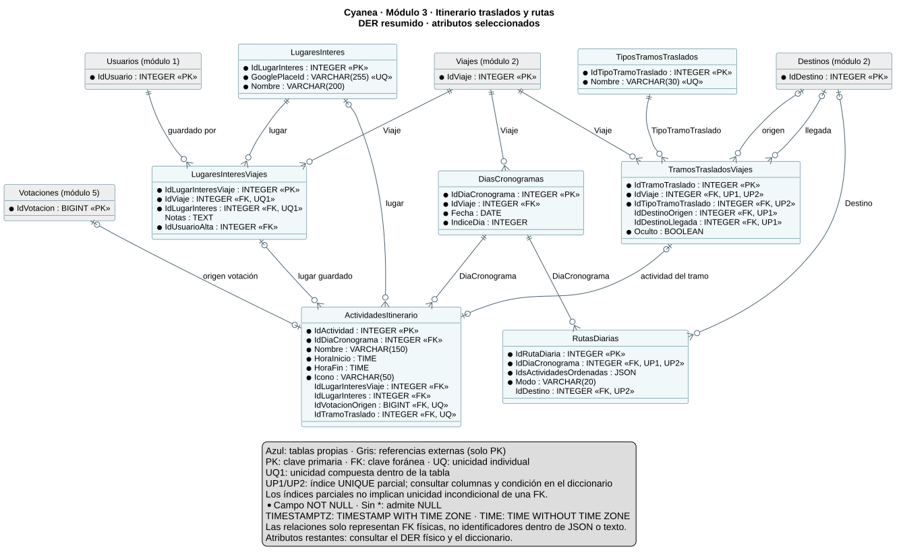

# Modelo de datos del módulo 3 Itinerario traslados y rutas

Este módulo reúne los días y las actividades del itinerario, los lugares utilizados y guardados por viaje, los tramos de traslado y las rutas calculadas. Se incluyen los lugares porque constituyen el soporte geográfico compartido del itinerario y de la exploración.

## Alcance y referencias

Versión: 1.0. Fecha: 14 de noviembre de 2026. Corte del código: `616ec79`. PostgreSQL local con Alembic en `b0bcca3ac886`.

Se documentan **7 tablas propias, 54 columnas y 15 claves foráneas**. Usuarios pertenece al módulo 1; Viajes y Destinos al módulo 2; Votaciones al módulo 5. Se muestran únicamente sus claves primarias. El recorrido base, el orden y las noches por destino se documentan en el módulo 2. Las sugerencias y acciones del asistente pertenecen al módulo 4; los recordatorios al módulo 10 y las tareas de entradas o reservas al módulo 8.

La estructura física se contrastó con PostgreSQL, los modelos y las migraciones; las reglas de aplicación se contrastaron con los servicios. La inspección utiliza metadatos y no incluye filas de usuarios, viajes o conversaciones.

## Diagramas entidad relación



- DER resumido: [vista SVG](der-resumido.svg) y [fuente PlantUML](der-resumido.puml). Incluye todas las tablas y FK, con atributos seleccionados.
- DER físico: [vista SVG](der-fisico.svg) y [fuente PlantUML](der-fisico.puml). Incluye todas las columnas propias.

Los SVG se pueden ampliar sin perder nitidez. Fuentes y vistas se conservan juntas; cada cambio de PlantUML requiere regenerar el SVG. Los diagramas usan Smetana y no requieren Graphviz. Desde la raíz del repositorio:

```powershell
java -jar <ruta-a-plantuml.jar> -charset UTF-8 -tsvg docs/modelo-datos/modulo-03-itinerario-traslados-rutas/der-resumido.puml
java -jar <ruta-a-plantuml.jar> -charset UTF-8 -tsvg docs/modelo-datos/modulo-03-itinerario-traslados-rutas/der-fisico.puml
```

## Entidades

| Tabla propia | Responsabilidad |
|---|---|
| DiasCronogramas | Días del itinerario vinculados al viaje, con fecha e índice de presentación. |
| ActividadesItinerario | Actividades del día, su horario, ubicación, advertencias y posibles vínculos con una votación o un tramo de traslado. |
| TramosTrasladosViajes | Tramos del recorrido que tienen un traslado agendado o una tarjeta oculta; sus fechas se calculan, no se persisten. |
| TiposTramosTraslados | Catálogo de tipos de tramo con identificadores fijos: ida, entre destinos y regreso. |
| RutasDiarias | Resultado persistido del cálculo de rutas por día y, cuando corresponde, destino. |
| LugaresInteres | Catálogo compartido de establecimientos o lugares identificados mediante Google Places. |
| LugaresInteresViajes | Lugares guardados en un viaje, con notas y usuario de alta. |

## Relaciones físicas y cardinalidades

Una FK obligatoria exige exactamente un padre por fila hija; una FK nullable permite cero o uno. El máximo de hijos solo se reduce a uno cuando hay unicidad incondicional de la FK. Los índices parciales se explican por separado y no se generalizan como relaciones 1 a 1.

| Tabla padre y clave | Tabla hija y campo FK | Padres por fila hija | Hijos por fila padre | ON DELETE | ON UPDATE |
|---|---|---|---|---|---|
| Viajes(IdViaje) | DiasCronogramas.IdViaje | Exactamente uno | Cero o muchos | CASCADE | NO ACTION |
| LugaresInteresViajes(IdLugarInteresViaje) | ActividadesItinerario.IdLugarInteresViaje | Cero o uno | Cero o muchos | SET NULL | NO ACTION |
| LugaresInteres(IdLugarInteres) | ActividadesItinerario.IdLugarInteres | Cero o uno | Cero o muchos | SET NULL | NO ACTION |
| TramosTrasladosViajes(IdTramoTraslado) | ActividadesItinerario.IdTramoTraslado | Cero o uno | Cero o uno | CASCADE | NO ACTION |
| Votaciones(IdVotacion) | ActividadesItinerario.IdVotacionOrigen | Cero o uno | Cero o uno | SET NULL | NO ACTION |
| DiasCronogramas(IdDiaCronograma) | ActividadesItinerario.IdDiaCronograma | Exactamente uno | Cero o muchos | CASCADE | NO ACTION |
| Destinos(IdDestino) | TramosTrasladosViajes.IdDestinoLlegada | Cero o uno | Cero o muchos | NO ACTION | NO ACTION |
| Destinos(IdDestino) | TramosTrasladosViajes.IdDestinoOrigen | Cero o uno | Cero o muchos | NO ACTION | NO ACTION |
| TiposTramosTraslados(IdTipoTramoTraslado) | TramosTrasladosViajes.IdTipoTramoTraslado | Exactamente uno | Cero o muchos | NO ACTION | NO ACTION |
| Viajes(IdViaje) | TramosTrasladosViajes.IdViaje | Exactamente uno | Cero o muchos | CASCADE | NO ACTION |
| Destinos(IdDestino) | RutasDiarias.IdDestino | Cero o uno | Cero o muchos | NO ACTION | NO ACTION |
| DiasCronogramas(IdDiaCronograma) | RutasDiarias.IdDiaCronograma | Exactamente uno | Cero o muchos | CASCADE | NO ACTION |
| LugaresInteres(IdLugarInteres) | LugaresInteresViajes.IdLugarInteres | Exactamente uno | Cero o muchos | CASCADE | NO ACTION |
| Usuarios(IdUsuario) | LugaresInteresViajes.IdUsuarioAlta | Exactamente uno | Cero o muchos | NO ACTION | NO ACTION |
| Viajes(IdViaje) | LugaresInteresViajes.IdViaje | Exactamente uno | Cero o muchos | CASCADE | NO ACTION |

Las acciones físicas de las FK son distintas de los cascade del ORM, las bajas lógicas y los permisos de cada operación. Las FK simples tampoco garantizan por sí solas coherencia entre viaje y día cuando ambos se referencian por separado.

## Convenciones del diccionario

PK indica clave primaria; FK, clave foránea; UQ, unicidad individual; UQ1, unicidad compuesta dentro de esa tabla. UP1 y UP2 identifican índices UNIQUE parciales dentro de cada tabla: su condición figura en las restricciones y no implica unicidad individual o global de sus columnas.

«Admite NULL» representa nulabilidad física. «Predeterminado BD» contiene defaults del servidor; «—» indica ausencia de default. Los defaults exclusivamente de aplicación se aclaran en las descripciones y reglas. Las secuencias generan identificadores; no se asumen identificadores fijos salvo en los catálogos que lo requieren. TIMESTAMPTZ abrevia TIMESTAMP WITH TIME ZONE; TIME, TIME WITHOUT TIME ZONE. VARCHAR sin longitud no tiene límite declarado; TEXT no equivale a JSON. Los índices de respaldo de PK y UNIQUE no se repiten como índices adicionales.

## Diccionario de datos

### 1 DiasCronogramas

Días del itinerario vinculados al viaje, con fecha e índice de presentación.

| Campo | Tipo PostgreSQL | Admite NULL | Clave | Predeterminado BD | Descripción |
|---|---|---|---|---|---|
| IdDiaCronograma | INTEGER | No | PK | Secuencia | Identificador autogenerado del día del cronograma. |
| IdViaje | INTEGER | No | FK | — | Viaje al que corresponde el registro; FK al módulo 2. |
| Fecha | DATE | No | — | — | Fecha del día de cronograma, sin hora ni zona horaria. |
| IndiceDia | INTEGER | No | — | — | Número de día usado para ordenar y presentar el itinerario; no tiene CHECK de rango ni UNIQUE físico. |

Restricciones e índices:

- PK `DiasCronogramas_pkey`: (IdDiaCronograma).
- FK `FK_DiasCronogramas_Viajes_IdViaje`: (IdViaje) → Viajes(IdViaje); ON DELETE CASCADE; ON UPDATE NO ACTION.
- Sin índices adicionales a la PK.

### 2 ActividadesItinerario

Actividades del día, su horario, ubicación, advertencias y posibles vínculos con una votación o un tramo de traslado.

| Campo | Tipo PostgreSQL | Admite NULL | Clave | Predeterminado BD | Descripción |
|---|---|---|---|---|---|
| IdActividad | INTEGER | No | PK | Secuencia | Identificador autogenerado de la actividad del itinerario. |
| IdDiaCronograma | INTEGER | No | FK | — | Día del itinerario al que corresponde el registro; FK a DiasCronogramas. |
| Nombre | VARCHAR(150) | No | — | — | Nombre descriptivo de la entidad. |
| Descripcion | TEXT | Sí | — | — | Descripción de la entidad o actividad. |
| HoraInicio | TIME | No | — | — | Hora de inicio o salida, sin zona horaria. |
| HoraFin | TIME | No | — | — | Hora de fin o llegada, sin zona horaria; su interpretación depende de si se trata de un traslado. |
| FechaCreacion | TIMESTAMPTZ | No | — | now() | Instante de creación; default now() del servidor. |
| Icono | VARCHAR(50) | No | — | 'location-dot' | Identificador del icono de categoría; en traslados identifica el medio de transporte. |
| IdLugarInteresViaje | INTEGER | Sí | FK | — | Referencia opcional al lugar guardado dentro de un viaje. |
| IdLugarInteres | INTEGER | Sí | FK | — | Referencia al catálogo compartido de lugares. |
| TipoAdvertenciaHorario | VARCHAR(30) | Sí | — | — | Tipo opcional de advertencia de horario registrada al validar el lugar. |
| AdvertenciaHorario | VARCHAR(300) | Sí | — | — | Mensaje opcional de advertencia sobre el horario de la actividad. |
| GooglePlaceIdEntradas | VARCHAR(255) | Sí | — | — | Identificador externo del lugar ya analizado para entradas o reservas; no es FK local. |
| IdVotacionOrigen | BIGINT | Sí | FK, UQ | — | Votación que originó la actividad; FK opcional y UNIQUE, con ON DELETE SET NULL. |
| IdTramoTraslado | INTEGER | Sí | FK, UQ | — | Tramo del recorrido al que se vincula el traslado; opcional y único en la actividad. |

Restricciones e índices:

- PK `ActividadesItinerario_pkey`: (IdActividad).
- FK `FK_ActIt_LugInteresViajes_IdLugarInteresViaje`: (IdLugarInteresViaje) → LugaresInteresViajes(IdLugarInteresViaje); ON DELETE SET NULL; ON UPDATE NO ACTION.
- FK `FK_ActIt_LugaresInteres_IdLugarInteres`: (IdLugarInteres) → LugaresInteres(IdLugarInteres); ON DELETE SET NULL; ON UPDATE NO ACTION.
- FK `FK_ActIt_TramosTraslados_IdTramoTraslado`: (IdTramoTraslado) → TramosTrasladosViajes(IdTramoTraslado); ON DELETE CASCADE; ON UPDATE NO ACTION.
- FK `FK_ActIt_Votaciones_IdVotacionOrigen`: (IdVotacionOrigen) → Votaciones(IdVotacion); ON DELETE SET NULL; ON UPDATE NO ACTION.
- FK `FK_ActividadesItinerario_DiasCronogramas_IdDiaCronograma`: (IdDiaCronograma) → DiasCronogramas(IdDiaCronograma); ON DELETE CASCADE; ON UPDATE NO ACTION.
- UNIQUE `UX_ActividadesItinerario_IdTramoTraslado`: (IdTramoTraslado).
- UNIQUE `UX_ActividadesItinerario_IdVotacionOrigen`: (IdVotacionOrigen).
- CHECK `CK_ActividadesItinerario_Horarios`: `"HoraFin" > "HoraInicio" OR "IdTramoTraslado" IS NOT NULL`.
- Índice `IX_ActividadesItinerario_IdDiaCronograma`: (IdDiaCronograma).

### 3 TramosTrasladosViajes

Tramos del recorrido que tienen un traslado agendado o una tarjeta oculta; sus fechas se calculan, no se persisten.

| Campo | Tipo PostgreSQL | Admite NULL | Clave | Predeterminado BD | Descripción |
|---|---|---|---|---|---|
| IdTramoTraslado | INTEGER | No | PK | Secuencia | Identificador autogenerado del tramo persistido. |
| IdViaje | INTEGER | No | FK, UP1, UP2 | — | Viaje al que corresponde el registro; FK al módulo 2. |
| IdTipoTramoTraslado | INTEGER | No | FK, UP2 | — | Tipo de tramo, con identificadores fijos 1 ida, 2 entre_destinos y 3 regreso. |
| IdDestinoOrigen | INTEGER | Sí | FK, UP1 | — | Destino de salida del tramo entre destinos; NULL en ida y regreso. |
| IdDestinoLlegada | INTEGER | Sí | FK, UP1 | — | Destino de llegada del tramo entre destinos; NULL en ida y regreso. |
| Oculto | BOOLEAN | No | — | false | Indica si se ocultó la tarjeta del tramo; no equivale por sí solo a un traslado agendado. |

Restricciones e índices:

- PK `TramosTrasladosViajes_pkey`: (IdTramoTraslado).
- FK `FK_TramosTrasladosViajes_Destinos_IdLlegada`: (IdDestinoLlegada) → Destinos(IdDestino); ON DELETE NO ACTION; ON UPDATE NO ACTION.
- FK `FK_TramosTrasladosViajes_Destinos_IdOrigen`: (IdDestinoOrigen) → Destinos(IdDestino); ON DELETE NO ACTION; ON UPDATE NO ACTION.
- FK `FK_TramosTrasladosViajes_TiposTramos_IdTipo`: (IdTipoTramoTraslado) → TiposTramosTraslados(IdTipoTramoTraslado); ON DELETE NO ACTION; ON UPDATE NO ACTION.
- FK `FK_TramosTrasladosViajes_Viajes_IdViaje`: (IdViaje) → Viajes(IdViaje); ON DELETE CASCADE; ON UPDATE NO ACTION.
- CHECK `CK_TramosTrasladosViajes_Destinos`: `"IdTipoTramoTraslado" = 2 AND "IdDestinoOrigen" IS NOT NULL AND "IdDestinoLlegada" IS NOT NULL OR "IdTipoTramoTraslado" <> 2 AND "IdDestinoOrigen" IS NULL AND "IdDestinoLlegada" IS NULL`.
- Índice UNIQUE `UX_TramosTrasladosViajes_Viaje_Par` (UP1): (IdViaje, IdDestinoOrigen, IdDestinoLlegada). Condición: `("IdTipoTramoTraslado" = 2)`.
- Índice UNIQUE `UX_TramosTrasladosViajes_Viaje_Tipo` (UP2): (IdViaje, IdTipoTramoTraslado). Condición: `("IdTipoTramoTraslado" <> 2)`.

### 4 TiposTramosTraslados

Catálogo de tipos de tramo con identificadores fijos: ida, entre destinos y regreso.

| Campo | Tipo PostgreSQL | Admite NULL | Clave | Predeterminado BD | Descripción |
|---|---|---|---|---|---|
| IdTipoTramoTraslado | INTEGER | No | PK | — | Identificador maestro explícito: 1 ida, 2 entre_destinos, 3 regreso; sin generación automática. |
| Nombre | VARCHAR(30) | No | UQ | — | Nombre descriptivo de la entidad. |
| Activo | BOOLEAN | No | — | true | Disponibilidad del valor maestro o lugar; no reemplaza un estado de participación o sugerencia. |

Restricciones e índices:

- PK `TiposTramosTraslados_pkey`: (IdTipoTramoTraslado).
- UNIQUE `TiposTramosTraslados_Nombre_key`: (Nombre).

### 5 RutasDiarias

Resultado persistido del cálculo de rutas por día y, cuando corresponde, destino.

| Campo | Tipo PostgreSQL | Admite NULL | Clave | Predeterminado BD | Descripción |
|---|---|---|---|---|---|
| IdRutaDiaria | INTEGER | No | PK | Secuencia | Identificador autogenerado de la ruta. |
| IdDiaCronograma | INTEGER | No | FK, UP1, UP2 | — | Día del itinerario al que corresponde el registro; FK a DiasCronogramas. |
| PolilineaCodificada | VARCHAR | No | — | — | Polilínea codificada devuelta por el proveedor para dibujar el recorrido. |
| DistanciaMetros | INTEGER | No | — | — | Distancia total de la ruta en metros; INTEGER sin CHECK de no negatividad. |
| DuracionSegundos | INTEGER | No | — | — | Duración estimada de la ruta en segundos; INTEGER sin CHECK de no negatividad. |
| IdsActividadesOrdenadas | JSON | No | — | — | Lista JSON de IdActividad según el orden de la ruta, sin FK para sus elementos. |
| FechaGeneracion | TIMESTAMPTZ | No | — | now() | Instante de generación o actualización de la ruta; onupdate se configura en SQLAlchemy. |
| Modo | VARCHAR(20) | No | — | 'walking' | Modo de transporte de la ruta; default físico walking y dominio validado por el servicio. |
| IdDestino | INTEGER | Sí | FK, UP2 | — | Destino de esta ruta cuando el día se divide por destinos; NULL para una ruta general del día. |

Restricciones e índices:

- PK `RutasDiarias_pkey`: (IdRutaDiaria).
- FK `FK_RutasDiarias_Destinos_IdDestino`: (IdDestino) → Destinos(IdDestino); ON DELETE NO ACTION; ON UPDATE NO ACTION.
- FK `FK_RutasDiarias_DiasCronogramas_IdDiaCronograma`: (IdDiaCronograma) → DiasCronogramas(IdDiaCronograma); ON DELETE CASCADE; ON UPDATE NO ACTION.
- Índice UNIQUE `UX_RutasDiarias_Dia` (UP1): (IdDiaCronograma). Condición: `("IdDestino" IS NULL)`.
- Índice UNIQUE `UX_RutasDiarias_Dia_Destino` (UP2): (IdDiaCronograma, IdDestino). Condición: `("IdDestino" IS NOT NULL)`.

### 6 LugaresInteres

Catálogo compartido de establecimientos o lugares identificados mediante Google Places.

| Campo | Tipo PostgreSQL | Admite NULL | Clave | Predeterminado BD | Descripción |
|---|---|---|---|---|---|
| IdLugarInteres | INTEGER | No | PK | Secuencia | Identificador autogenerado del lugar en el catálogo compartido. |
| GooglePlaceId | VARCHAR(255) | No | UQ | — | Identificador externo de Google Places; único en el catálogo de lugares. |
| Nombre | VARCHAR(200) | No | — | — | Nombre descriptivo de la entidad. |
| Direccion | VARCHAR(255) | No | — | — | Dirección del lugar, almacenada como texto. |
| Lat | DOUBLE PRECISION | No | — | — | Latitud del lugar; DOUBLE PRECISION sin CHECK de rango geográfico en la tabla. |
| Lng | DOUBLE PRECISION | No | — | — | Longitud del lugar; DOUBLE PRECISION sin CHECK de rango geográfico en la tabla. |
| Categoria | VARCHAR(100) | Sí | — | — | Categoría textual del lugar; no tiene una FK a categorías de otros módulos. |
| FotoUrl | VARCHAR(500) | Sí | — | — | URL opcional de una imagen del lugar. |
| MetadataJson | JSON | Sí | — | — | Metadatos opcionales del lugar, en tipo JSON; estructura variable. |
| Activo | BOOLEAN | No | — | true | Disponibilidad del valor maestro o lugar; no reemplaza un estado de participación o sugerencia. |
| FechaAlta | TIMESTAMPTZ | No | — | now() | Instante de incorporación del lugar o registro; default now() del servidor. |

Restricciones e índices:

- PK `LugaresInteres_pkey`: (IdLugarInteres).
- UNIQUE `UQ_LugaresInteres_GooglePlaceId`: (GooglePlaceId).

### 7 LugaresInteresViajes

Lugares guardados en un viaje, con notas y usuario de alta.

| Campo | Tipo PostgreSQL | Admite NULL | Clave | Predeterminado BD | Descripción |
|---|---|---|---|---|---|
| IdLugarInteresViaje | INTEGER | No | PK | Secuencia | Identificador autogenerado del lugar guardado en un viaje. |
| IdViaje | INTEGER | No | FK, UQ1 | — | Viaje al que corresponde el registro; FK al módulo 2. |
| IdLugarInteres | INTEGER | No | FK, UQ1 | — | Referencia al catálogo compartido de lugares. |
| Notas | TEXT | Sí | — | — | Notas opcionales del lugar guardado para ese viaje. |
| IdUsuarioAlta | INTEGER | No | FK | — | Cuenta que guardó el lugar en el viaje; FK a Usuarios. |
| FechaAlta | TIMESTAMPTZ | No | — | now() | Instante de incorporación del lugar o registro; default now() del servidor. |

Restricciones e índices:

- PK `LugaresInteresViajes_pkey`: (IdLugarInteresViaje).
- FK `FK_LugaresInteresViajes_LugaresInteres_IdLugarInteres`: (IdLugarInteres) → LugaresInteres(IdLugarInteres); ON DELETE CASCADE; ON UPDATE NO ACTION.
- FK `FK_LugaresInteresViajes_Usuarios_IdUsuarioAlta`: (IdUsuarioAlta) → Usuarios(IdUsuario); ON DELETE NO ACTION; ON UPDATE NO ACTION.
- FK `FK_LugaresInteresViajes_Viajes_IdViaje`: (IdViaje) → Viajes(IdViaje); ON DELETE CASCADE; ON UPDATE NO ACTION.
- UNIQUE `UQ_LugaresInteresViajes_IdViaje_IdLugarInteres` (UQ1): (IdViaje, IdLugarInteres).

## Campos estructurados y referencias internas

| Campo | Tipo físico | Interpretación |
|---|---|---|
| LugaresInteres.MetadataJson | JSON | Metadatos opcionales del lugar; estructura variable según los servicios de lugares. No hay un esquema JSON impuesto por CHECK en la base. |
| RutasDiarias.IdsActividadesOrdenadas | JSON | Lista ordenada de IdActividad calculada por el servicio de rutas. Los elementos no tienen integridad referencial por FK. |

## Reglas funcionales y particularidades del esquema

1. **Día y pertenencia.** Cada actividad pertenece obligatoriamente a un día. El viaje se obtiene a través de DiasCronogramas; ActividadesItinerario no almacena IdViaje. DiasCronogramas no tiene UNIQUE físico por (IdViaje, Fecha) ni por (IdViaje, IndiceDia); la generación y sincronización de los días corresponde a la aplicación.
2. **Ubicación de actividades.** IdLugarInteres e IdLugarInteresViaje son opcionales. El primero apunta al catálogo de lugares y el segundo a un lugar guardado en un viaje. No existe un CHECK físico de exclusión mutua entre ambos. El servicio de rutas prioriza LugarInteres y utiliza LugarInteresViaje.LugarInteres como alternativa. La pertenencia al mismo viaje requiere validación funcional.
3. **Horarios y traslados.** Las horas son TIME WITHOUT TIME ZONE; la fecha se obtiene del día y del recorrido. CK_ActividadesItinerario_Horarios exige HoraFin > HoraInicio para una actividad común, pero permite otras combinaciones cuando IdTramoTraslado está informado. Un traslado puede llegar otro día o, en ida/regreso con una sola hora, tener inicio y fin iguales. Esas fechas y la validez del tramo se calculan en los servicios.
4. **Identidad de los tramos.** Los identificadores maestros 1 = ida, 2 = entre_destinos y 3 = regreso se usan en los índices parciales. El CHECK exige ambos destinos para el tipo 2 y ambos NULL para los demás tipos. Las FK apuntan a Destinos, no a DestinosViajes, para conservar el par aunque salga del recorrido. El CHECK no verifica que los destinos sean distintos, consecutivos o pertenezcan al viaje; esas reglas corresponden a los servicios.
5. **Tramo y actividad.** Un tramo persistido puede tener cero o una actividad: puede representar solo una tarjeta oculta. IdTramoTraslado es nullable y UNIQUE en ActividadesItinerario; una actividad puede vincular cero o un tramo. Un tramo no agendado ni oculto se deriva del recorrido y no necesita una fila persistida.
6. **Unicidad parcial de tramos.** UX_TramosTrasladosViajes_Viaje_Tipo protege (IdViaje, IdTipoTramoTraslado) cuando el tipo es distinto de 2. UX_TramosTrasladosViajes_Viaje_Par protege (IdViaje, IdDestinoOrigen, IdDestinoLlegada) cuando el tipo es 2. Estas condiciones no se deben representar como UNIQUE incondicionales de columnas individuales.
7. **Rutas por día y destino.** UX_RutasDiarias_Dia permite una sola ruta por día con IdDestino NULL. UX_RutasDiarias_Dia_Destino permite una sola por combinación día/destino cuando IdDestino no es NULL. Por eso DiasCronogramas → RutasDiarias es físicamente 1 a N. La aplicación utiliza una ruta en días normales y puede generar dos en un día de traslado entre destinos; el esquema por sí solo no limita a dos ni impide mezclar una ruta genérica con otras por destino.
8. **Contenido de rutas.** IdsActividadesOrdenadas es JSON con una lista ordenada de identificadores de actividades. No es una tabla de relación ni tiene FK por elemento. PolilineaCodificada es texto; DistanciaMetros y DuracionSegundos son enteros sin CHECK de no negatividad en estas tablas. Modo tiene default físico walking y el servicio admite walking, driving, bicycling y transit, sin CHECK de esos valores en la base.
9. **Lugares compartidos.** GooglePlaceId es único en LugaresInteres. UNIQUE (IdViaje, IdLugarInteres) evita guardar el mismo lugar dos veces en un viaje. Categoria es texto y no referencia a las categorías de gastos, documentos o tareas. GooglePlaceIdEntradas es un identificador externo del lugar ya analizado para recomendaciones de entradas, sin FK local.
10. **Origen de actividades.** IdVotacionOrigen es opcional y UNIQUE: una votación puede originar cero o una actividad. No existe IdSugerenciaActividad en ActividadesItinerario; aceptar directamente una sugerencia crea la actividad y cambia el estado de la sugerencia mediante el servicio, sin agregar una FK entre ambas tablas.
11. **Atributos calculados y actualización.** DiaCronograma.Ruta es una propiedad de compatibilidad que devuelve la primera fila de Rutas, no una columna. RutaDiaria.NombreDestino también se calcula desde la relación con Destinos. FechaGeneracion tiene now() como default del servidor y actualización configurada en SQLAlchemy; no implica un trigger PostgreSQL.
12. **Borrados físicos.** Las acciones ON DELETE se detallan por FK. Borrar un día elimina sus actividades y rutas por CASCADE; borrar un tramo elimina la actividad vinculada por CASCADE, para no dejar un horario inválido sin tramo. Las FK de actividad a lugares y votación usan SET NULL. Estas acciones físicas se distinguen de los permisos, confirmaciones y conservación de tareas que aplican los servicios.

## Fuentes del modelo

- Modelos: [dia_cronograma](../../../backend/app/models/dia_cronograma.py), [actividad_itinerario](../../../backend/app/models/actividad_itinerario.py), [tramo_traslado_viaje](../../../backend/app/models/tramo_traslado_viaje.py), [ruta_diaria](../../../backend/app/models/ruta_diaria.py), [lugar_interes](../../../backend/app/models/lugar_interes.py), [lugar_interes_viaje](../../../backend/app/models/lugar_interes_viaje.py).
- Servicios: [route_generation.py](../../../backend/app/services/route_generation.py), [traslados.py](../../../backend/app/services/traslados.py), [recorrido_viaje.py](../../../backend/app/services/recorrido_viaje.py), [tareas_entradas.py](../../../backend/app/services/tareas_entradas.py).
- [Migraciones Alembic](../../../backend/alembic/versions) y [convenciones del proyecto](../../../AGENTS.md).
- Metadatos del esquema PostgreSQL local: columnas, tipos, PK, FK, UNIQUE, CHECK, índices y predicados, identity y defaults.
