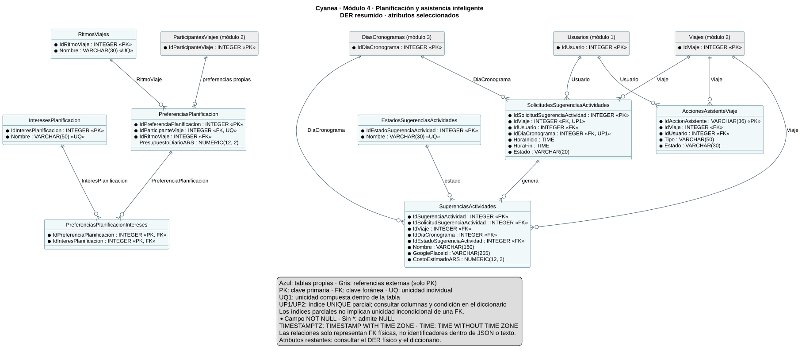

# Modelo de datos del módulo 4 Planificación y asistencia inteligente

Este módulo contiene las preferencias individuales de planificación por viaje, los intereses y ritmos disponibles, las solicitudes y sugerencias de actividades y las acciones propuestas por el asistente del viaje.

## Alcance y referencias

Versión: 1.0. Fecha: 14 de noviembre de 2026. Corte del código: `616ec79`. PostgreSQL local con Alembic en `b0bcca3ac886`.

Se documentan **8 tablas propias, 62 columnas y 13 claves foráneas**. Usuarios pertenece al módulo 1; Viajes y ParticipantesViajes al módulo 2; DiasCronogramas al módulo 3. Esas tablas aparecen solo con su PK. Los lugares, las actividades y las rutas se documentan en el módulo 3; las votaciones en el 5. SolicitudesIA y el monitoreo de costos pertenecen al módulo 11: no deben confundirse con las solicitudes funcionales de sugerencias.

La estructura física se contrastó con PostgreSQL, los modelos y las migraciones; las reglas de aplicación se contrastaron con los servicios. La inspección utiliza metadatos y no incluye filas de usuarios, viajes o conversaciones.

## Diagramas entidad relación



- DER resumido: [vista SVG](der-resumido.svg) y [fuente PlantUML](der-resumido.puml). Incluye todas las tablas y FK, con atributos seleccionados.
- DER físico: [vista SVG](der-fisico.svg) y [fuente PlantUML](der-fisico.puml). Incluye todas las columnas propias.

Los SVG se pueden ampliar sin perder nitidez. Fuentes y vistas se conservan juntas; cada cambio de PlantUML requiere regenerar el SVG. Los diagramas usan Smetana y no requieren Graphviz. Desde la raíz del repositorio:

```powershell
java -jar <ruta-a-plantuml.jar> -charset UTF-8 -tsvg docs/modelo-datos/modulo-04-planificacion-asistencia-inteligente/der-resumido.puml
java -jar <ruta-a-plantuml.jar> -charset UTF-8 -tsvg docs/modelo-datos/modulo-04-planificacion-asistencia-inteligente/der-fisico.puml
```

## Entidades

| Tabla propia | Responsabilidad |
|---|---|
| PreferenciasPlanificacion | Preferencias de una participación concreta en un viaje: ritmo, presupuesto y consideraciones. |
| InteresesPlanificacion | Catálogo de intereses disponibles para planificar actividades. |
| RitmosViajes | Catálogo de ritmos de viaje disponibles para las preferencias. |
| PreferenciasPlanificacionIntereses | Tabla asociativa de preferencias e intereses; resuelve una relación N a N. |
| SolicitudesSugerenciasActividades | Solicitud funcional de generación de sugerencias para un viaje, día y franja horaria, con estado y resultado resumido. |
| SugerenciasActividades | Propuestas generadas con lugar, horario, costo estimado, motivo y estado funcional. |
| EstadosSugerenciasActividades | Catálogo de estados de las sugerencias de actividades. |
| AccionesAsistenteViaje | Acciones mutantes propuestas al usuario por el asistente, con parámetros, confirmación y resultado. |

## Relaciones físicas y cardinalidades

Una FK obligatoria exige exactamente un padre por fila hija; una FK nullable permite cero o uno. El máximo de hijos solo se reduce a uno cuando hay unicidad incondicional de la FK. Los índices parciales se explican por separado y no se generalizan como relaciones 1 a 1.

| Tabla padre y clave | Tabla hija y campo FK | Padres por fila hija | Hijos por fila padre | ON DELETE | ON UPDATE |
|---|---|---|---|---|---|
| ParticipantesViajes(IdParticipanteViaje) | PreferenciasPlanificacion.IdParticipanteViaje | Exactamente uno | Cero o uno | CASCADE | NO ACTION |
| RitmosViajes(IdRitmoViaje) | PreferenciasPlanificacion.IdRitmoViaje | Exactamente uno | Cero o muchos | NO ACTION | NO ACTION |
| InteresesPlanificacion(IdInteresPlanificacion) | PreferenciasPlanificacionIntereses.IdInteresPlanificacion | Exactamente uno | Cero o muchos | NO ACTION | NO ACTION |
| PreferenciasPlanificacion(IdPreferenciaPlanificacion) | PreferenciasPlanificacionIntereses.IdPreferenciaPlanificacion | Exactamente uno | Cero o muchos | CASCADE | NO ACTION |
| DiasCronogramas(IdDiaCronograma) | SolicitudesSugerenciasActividades.IdDiaCronograma | Exactamente uno | Cero o muchos | CASCADE | NO ACTION |
| Usuarios(IdUsuario) | SolicitudesSugerenciasActividades.IdUsuario | Exactamente uno | Cero o muchos | NO ACTION | NO ACTION |
| Viajes(IdViaje) | SolicitudesSugerenciasActividades.IdViaje | Exactamente uno | Cero o muchos | CASCADE | NO ACTION |
| DiasCronogramas(IdDiaCronograma) | SugerenciasActividades.IdDiaCronograma | Exactamente uno | Cero o muchos | CASCADE | NO ACTION |
| EstadosSugerenciasActividades(IdEstadoSugerenciaActividad) | SugerenciasActividades.IdEstadoSugerenciaActividad | Exactamente uno | Cero o muchos | NO ACTION | NO ACTION |
| SolicitudesSugerenciasActividades(IdSolicitudSugerenciaActividad) | SugerenciasActividades.IdSolicitudSugerenciaActividad | Exactamente uno | Cero o muchos | CASCADE | NO ACTION |
| Viajes(IdViaje) | SugerenciasActividades.IdViaje | Exactamente uno | Cero o muchos | CASCADE | NO ACTION |
| Usuarios(IdUsuario) | AccionesAsistenteViaje.IdUsuario | Exactamente uno | Cero o muchos | NO ACTION | NO ACTION |
| Viajes(IdViaje) | AccionesAsistenteViaje.IdViaje | Exactamente uno | Cero o muchos | NO ACTION | NO ACTION |

Las acciones físicas de las FK son distintas de los cascade del ORM, las bajas lógicas y los permisos de cada operación. Las FK simples tampoco garantizan por sí solas coherencia entre viaje y día cuando ambos se referencian por separado.

## Convenciones del diccionario

PK indica clave primaria; FK, clave foránea; UQ, unicidad individual; UQ1, unicidad compuesta dentro de esa tabla. UP1 y UP2 identifican índices UNIQUE parciales dentro de cada tabla: su condición figura en las restricciones y no implica unicidad individual o global de sus columnas.

«Admite NULL» representa nulabilidad física. «Predeterminado BD» contiene defaults del servidor; «—» indica ausencia de default. Los defaults exclusivamente de aplicación se aclaran en las descripciones y reglas. Las secuencias generan identificadores; no se asumen identificadores fijos salvo en los catálogos que lo requieren. TIMESTAMPTZ abrevia TIMESTAMP WITH TIME ZONE; TIME, TIME WITHOUT TIME ZONE. VARCHAR sin longitud no tiene límite declarado; TEXT no equivale a JSON. Los índices de respaldo de PK y UNIQUE no se repiten como índices adicionales.

## Diccionario de datos

### 1 PreferenciasPlanificacion

Preferencias de una participación concreta en un viaje: ritmo, presupuesto y consideraciones.

| Campo | Tipo PostgreSQL | Admite NULL | Clave | Predeterminado BD | Descripción |
|---|---|---|---|---|---|
| IdPreferenciaPlanificacion | INTEGER | No | PK | Secuencia | Identificador autogenerado de la preferencia de planificación. |
| IdParticipanteViaje | INTEGER | No | FK, UQ | — | Participación a la que pertenecen las preferencias; NOT NULL y UNIQUE en PreferenciasPlanificacion. |
| IdRitmoViaje | INTEGER | No | FK | — | Ritmo seleccionado para la planificación, según el catálogo RitmosViajes. |
| PresupuestoDiarioARS | NUMERIC(12, 2) | Sí | — | — | Presupuesto diario por persona en pesos argentinos; opcional, con CHECK > 0 si se informa. |
| Consideraciones | VARCHAR(300) | Sí | — | — | Texto opcional de consideraciones de planificación, hasta 300 caracteres. |
| FechaCreacion | TIMESTAMPTZ | No | — | now() | Instante de creación; default now() del servidor. |
| FechaActualizacion | TIMESTAMPTZ | No | — | now() | Instante de última actualización; default físico now() y onupdate definido por SQLAlchemy. |

Restricciones e índices:

- PK `PreferenciasPlanificacion_pkey`: (IdPreferenciaPlanificacion).
- FK `FK_PrefPlan_PartViajes_IdParticipanteViaje`: (IdParticipanteViaje) → ParticipantesViajes(IdParticipanteViaje); ON DELETE CASCADE; ON UPDATE NO ACTION.
- FK `FK_PrefPlan_RitmosViajes_IdRitmoViaje`: (IdRitmoViaje) → RitmosViajes(IdRitmoViaje); ON DELETE NO ACTION; ON UPDATE NO ACTION.
- UNIQUE `UQ_PreferenciasPlanificacion_IdParticipanteViaje`: (IdParticipanteViaje).
- CHECK `CK_PreferenciasPlanificacion_Presupuesto`: `"PresupuestoDiarioARS" IS NULL OR "PresupuestoDiarioARS" > 0::numeric`.

### 2 InteresesPlanificacion

Catálogo de intereses disponibles para planificar actividades.

| Campo | Tipo PostgreSQL | Admite NULL | Clave | Predeterminado BD | Descripción |
|---|---|---|---|---|---|
| IdInteresPlanificacion | INTEGER | No | PK | Secuencia | Identificador autogenerado del interés de planificación. |
| Nombre | VARCHAR(50) | No | UQ | — | Nombre descriptivo de la entidad. |
| Icono | VARCHAR(50) | No | — | — | Icono de presentación del interés. Default de aplicación star, sin default físico en PostgreSQL. |
| Orden | INTEGER | No | — | — | Orden de presentación del valor maestro. El modelo tiene default de aplicación 1; la base no declara default. |
| Activo | BOOLEAN | No | — | true | Disponibilidad del valor maestro o lugar; no reemplaza un estado de participación o sugerencia. |

Restricciones e índices:

- PK `InteresesPlanificacion_pkey`: (IdInteresPlanificacion).
- UNIQUE `UQ_InteresesPlanificacion_Nombre`: (Nombre).

### 3 RitmosViajes

Catálogo de ritmos de viaje disponibles para las preferencias.

| Campo | Tipo PostgreSQL | Admite NULL | Clave | Predeterminado BD | Descripción |
|---|---|---|---|---|---|
| IdRitmoViaje | INTEGER | No | PK | Secuencia | Identificador autogenerado del ritmo de viaje. |
| Nombre | VARCHAR(30) | No | UQ | — | Nombre descriptivo de la entidad. |
| Descripcion | VARCHAR(150) | No | — | — | Descripción de la entidad o actividad. |
| Orden | INTEGER | No | — | — | Orden de presentación del valor maestro. El modelo tiene default de aplicación 1; la base no declara default. |
| Activo | BOOLEAN | No | — | true | Disponibilidad del valor maestro o lugar; no reemplaza un estado de participación o sugerencia. |

Restricciones e índices:

- PK `RitmosViajes_pkey`: (IdRitmoViaje).
- UNIQUE `UQ_RitmosViajes_Nombre`: (Nombre).

### 4 PreferenciasPlanificacionIntereses

Tabla asociativa de preferencias e intereses; resuelve una relación N a N.

| Campo | Tipo PostgreSQL | Admite NULL | Clave | Predeterminado BD | Descripción |
|---|---|---|---|---|---|
| IdPreferenciaPlanificacion | INTEGER | No | PK, FK | — | Identificador de la fila de preferencias. |
| IdInteresPlanificacion | INTEGER | No | PK, FK | — | Interés de planificación referenciado en la asociación. |

Restricciones e índices:

- PK `PreferenciasPlanificacionIntereses_pkey`: (IdPreferenciaPlanificacion, IdInteresPlanificacion).
- FK `FK_PrefPlanInt_IntPlan_IdInteresPlanificacion`: (IdInteresPlanificacion) → InteresesPlanificacion(IdInteresPlanificacion); ON DELETE NO ACTION; ON UPDATE NO ACTION.
- FK `FK_PrefPlanInt_PrefPlan_IdPreferenciaPlanificacion`: (IdPreferenciaPlanificacion) → PreferenciasPlanificacion(IdPreferenciaPlanificacion); ON DELETE CASCADE; ON UPDATE NO ACTION.
- Sin índices adicionales a la PK.

### 5 SolicitudesSugerenciasActividades

Solicitud funcional de generación de sugerencias para un viaje, día y franja horaria, con estado y resultado resumido.

| Campo | Tipo PostgreSQL | Admite NULL | Clave | Predeterminado BD | Descripción |
|---|---|---|---|---|---|
| IdSolicitudSugerenciaActividad | INTEGER | No | PK | Secuencia | Identificador autogenerado de la solicitud de sugerencias. |
| IdViaje | INTEGER | No | FK, UP1 | — | Viaje al que corresponde el registro; FK al módulo 2. |
| IdUsuario | INTEGER | No | FK | — | Cuenta que solicita o propone la acción; FK al módulo 1. |
| IdDiaCronograma | INTEGER | No | FK, UP1 | — | Día del itinerario al que corresponde el registro; FK a DiasCronogramas. |
| HoraInicio | TIME | No | — | — | Hora de inicio o salida, sin zona horaria. |
| HoraFin | TIME | No | — | — | Hora de fin o llegada, sin zona horaria; su interpretación depende de si se trata de un traslado. |
| Estado | VARCHAR(20) | No | — | — | Estado de procesamiento protegido por CHECK: en_proceso, completada, sin_resultados o fallida. El default en_proceso es de aplicación. |
| CantidadSugerencias | INTEGER | No | — | — | Cantidad de sugerencias registradas como resultado. Default de aplicación 0, sin default ni CHECK físico. |
| CodigoError | VARCHAR(50) | Sí | — | — | Código opcional de error de la generación de sugerencias. |
| FechaSolicitud | TIMESTAMPTZ | No | — | now() | Instante de registro de la solicitud; se utiliza en el conteo diario. |
| FechaFin | TIMESTAMPTZ | Sí | — | — | Instante de finalización del procesamiento de la solicitud; NULL mientras no se registre. |

Restricciones e índices:

- PK `SolicitudesSugerenciasActividades_pkey`: (IdSolicitudSugerenciaActividad).
- FK `FK_SolSugAct_DiasCron_IdDia`: (IdDiaCronograma) → DiasCronogramas(IdDiaCronograma); ON DELETE CASCADE; ON UPDATE NO ACTION.
- FK `FK_SolSugAct_Usuarios_IdUsuario`: (IdUsuario) → Usuarios(IdUsuario); ON DELETE NO ACTION; ON UPDATE NO ACTION.
- FK `FK_SolSugAct_Viajes_IdViaje`: (IdViaje) → Viajes(IdViaje); ON DELETE CASCADE; ON UPDATE NO ACTION.
- CHECK `CK_SolSugAct_Estado`: `"Estado"::text = ANY (ARRAY['en_proceso'::character varying, 'completada'::character varying, 'sin_resultados'::character varying, 'fallida'::character varying]::text[])`.
- CHECK `CK_SolSugAct_Horarios`: `"HoraFin" > "HoraInicio"`.
- Índice `IX_SolSugAct_Viaje_Fecha`: (IdViaje, FechaSolicitud).
- Índice UNIQUE `UX_SolSugAct_EnProceso` (UP1): (IdViaje, IdDiaCronograma). Condición: `(("Estado")::text = 'en_proceso'::text)`.

### 6 SugerenciasActividades

Propuestas generadas con lugar, horario, costo estimado, motivo y estado funcional.

| Campo | Tipo PostgreSQL | Admite NULL | Clave | Predeterminado BD | Descripción |
|---|---|---|---|---|---|
| IdSugerenciaActividad | INTEGER | No | PK | Secuencia | Identificador autogenerado de la sugerencia. |
| IdSolicitudSugerenciaActividad | INTEGER | No | FK | — | Solicitud de generación a la que pertenece la sugerencia. |
| IdViaje | INTEGER | No | FK | — | Viaje al que corresponde el registro; FK al módulo 2. |
| IdDiaCronograma | INTEGER | No | FK | — | Día del itinerario al que corresponde el registro; FK a DiasCronogramas. |
| IdEstadoSugerenciaActividad | INTEGER | No | FK | — | Estado funcional de la sugerencia, según EstadosSugerenciasActividades. |
| Nombre | VARCHAR(150) | No | — | — | Nombre descriptivo de la entidad. |
| Descripcion | TEXT | No | — | — | Descripción de la entidad o actividad. |
| HoraInicio | TIME | No | — | — | Hora de inicio o salida, sin zona horaria. |
| HoraFin | TIME | No | — | — | Hora de fin o llegada, sin zona horaria; su interpretación depende de si se trata de un traslado. |
| GooglePlaceId | VARCHAR(255) | No | — | — | Identificador externo del lugar sugerido; sin FK local ni UNIQUE en esta tabla. |
| LugarNombre | VARCHAR(200) | No | — | — | Nombre del lugar conservado como parte de la sugerencia. |
| LugarDireccion | VARCHAR(255) | No | — | — | Dirección del lugar conservada como parte de la sugerencia. |
| Lat | DOUBLE PRECISION | No | — | — | Latitud del lugar; DOUBLE PRECISION sin CHECK de rango geográfico en la tabla. |
| Lng | DOUBLE PRECISION | No | — | — | Longitud del lugar; DOUBLE PRECISION sin CHECK de rango geográfico en la tabla. |
| SitioWebUrl | VARCHAR(500) | Sí | — | — | URL opcional del sitio web del lugar sugerido. |
| FotoReferencia | VARCHAR(500) | Sí | — | — | Referencia opcional de una foto asociada al lugar sugerido. |
| CostoEstimadoARS | NUMERIC(12, 2) | No | — | — | Costo estimado en pesos argentinos; NUMERIC(12,2), NOT NULL y CHECK >= 0. |
| Motivo | TEXT | No | — | — | Explicación de por qué se recomienda la actividad. |
| FechaCreacion | TIMESTAMPTZ | No | — | now() | Instante de creación; default now() del servidor. |
| DescartadaPorFinViaje | BOOLEAN | No | — | false | Indica descarte debido a finalización del viaje, para distinguirlo de otros descartes. |

Restricciones e índices:

- PK `SugerenciasActividades_pkey`: (IdSugerenciaActividad).
- FK `FK_SugAct_DiasCron_IdDia`: (IdDiaCronograma) → DiasCronogramas(IdDiaCronograma); ON DELETE CASCADE; ON UPDATE NO ACTION.
- FK `FK_SugAct_EstSugAct_IdEstado`: (IdEstadoSugerenciaActividad) → EstadosSugerenciasActividades(IdEstadoSugerenciaActividad); ON DELETE NO ACTION; ON UPDATE NO ACTION.
- FK `FK_SugAct_SolSugAct_IdSolicitud`: (IdSolicitudSugerenciaActividad) → SolicitudesSugerenciasActividades(IdSolicitudSugerenciaActividad); ON DELETE CASCADE; ON UPDATE NO ACTION.
- FK `FK_SugAct_Viajes_IdViaje`: (IdViaje) → Viajes(IdViaje); ON DELETE CASCADE; ON UPDATE NO ACTION.
- CHECK `CK_SugAct_Costo`: `"CostoEstimadoARS" >= 0::numeric`.
- CHECK `CK_SugAct_Horarios`: `"HoraFin" > "HoraInicio"`.
- Índice `IX_SugAct_Viaje_Dia`: (IdViaje, IdDiaCronograma).

### 7 EstadosSugerenciasActividades

Catálogo de estados de las sugerencias de actividades.

| Campo | Tipo PostgreSQL | Admite NULL | Clave | Predeterminado BD | Descripción |
|---|---|---|---|---|---|
| IdEstadoSugerenciaActividad | INTEGER | No | PK | Secuencia | Identificador autogenerado del estado funcional de sugerencia. |
| Nombre | VARCHAR(30) | No | UQ | — | Nombre único del estado de sugerencia: pendiente, aceptada, descartada o en_votacion según los valores sembrados. |

Restricciones e índices:

- PK `EstadosSugerenciasActividades_pkey`: (IdEstadoSugerenciaActividad).
- UNIQUE `EstadosSugerenciasActividades_Nombre_key`: (Nombre).

### 8 AccionesAsistenteViaje

Acciones mutantes propuestas al usuario por el asistente, con parámetros, confirmación y resultado.

| Campo | Tipo PostgreSQL | Admite NULL | Clave | Predeterminado BD | Descripción |
|---|---|---|---|---|---|
| IdAccionAsistente | VARCHAR(36) | No | PK | — | UUID generado por la aplicación y persistido como VARCHAR(36), sin default físico. |
| IdViaje | INTEGER | No | FK | — | Viaje al que corresponde el registro; FK al módulo 2. |
| IdUsuario | INTEGER | No | FK | — | Cuenta que solicita o propone la acción; FK al módulo 1. |
| Tipo | VARCHAR(50) | No | — | — | Tipo de acción propuesta; VARCHAR sin tabla maestra ni CHECK de valores. |
| Estado | VARCHAR(30) | No | — | 'propuesta' | Estado textual de la acción. El flujo registra propuesta y ejecutada, sin CHECK de dominio físico. |
| Etiqueta | VARCHAR(150) | No | — | — | Descripción breve de la acción que se presenta para confirmar. |
| PayloadJson | TEXT | No | — | — | Parámetros y contexto interno serializados como JSON dentro de TEXT; no es una columna JSON nativa. |
| ResultadoJson | TEXT | Sí | — | — | Resultado opcional serializado como JSON dentro de TEXT, sin integridad referencial sobre su contenido. |
| FechaCreacion | TIMESTAMPTZ | No | — | now() | Instante de creación; default now() del servidor. |
| FechaConfirmacion | TIMESTAMPTZ | Sí | — | — | Instante registrado tras confirmar y ejecutar la acción del asistente. |

Restricciones e índices:

- PK `AccionesAsistenteViaje_pkey`: (IdAccionAsistente).
- FK `FK_AccionesAsistenteViaje_Usuarios_IdUsuario`: (IdUsuario) → Usuarios(IdUsuario); ON DELETE NO ACTION; ON UPDATE NO ACTION.
- FK `FK_AccionesAsistenteViaje_Viajes_IdViaje`: (IdViaje) → Viajes(IdViaje); ON DELETE NO ACTION; ON UPDATE NO ACTION.
- Sin índices adicionales a la PK.

## Campos estructurados y referencias internas

| Campo | Tipo físico | Interpretación |
|---|---|---|
| AccionesAsistenteViaje.PayloadJson | TEXT | JSON serializado de parámetros y contexto interno de la acción; puede incluir _userMessage. No tiene esquema ni FK por elemento en PostgreSQL. |
| AccionesAsistenteViaje.ResultadoJson | TEXT nullable | JSON serializado del resultado de ejecución. Puede contener identificadores funcionales sin FK física hacia las entidades creadas. |

## Reglas funcionales y particularidades del esquema

1. **Preferencias por participación.** IdParticipanteViaje es obligatorio y UNIQUE en PreferenciasPlanificacion. Cada participación tiene cero o una fila de preferencias y cada fila pertenece a una participación; no son preferencias globales del usuario. La participación determina tanto el viaje como la cuenta y no se duplica IdUsuario o IdViaje en esta tabla.
2. **Selección de intereses.** PreferenciasPlanificacionIntereses tiene PK compuesta (IdPreferenciaPlanificacion, IdInteresPlanificacion). Impide repetir el mismo interés en una preferencia y no impone una cantidad mínima por sí sola. Borrar una preferencia elimina sus asociaciones por CASCADE; la FK al catálogo de intereses no declara cascada.
3. **Catálogos y presupuesto.** InteresesPlanificacion.Nombre y RitmosViajes.Nombre son únicos. Activo controla disponibilidad y Orden la presentación. El presupuesto diario por persona se expresa en ARS, es opcional y, si se informa, debe ser mayor que cero por CHECK. Consideraciones admite hasta 300 caracteres. Los servicios exigen participación aceptada y viaje editable y eliminan espacios para guardar NULL cuando corresponde.
4. **Default de aplicación y default físico.** Icono y Orden de InteresesPlanificacion, Orden de RitmosViajes y Estado y CantidadSugerencias de SolicitudesSugerenciasActividades tienen defaults de SQLAlchemy en los modelos, pero no defaults físicos en PostgreSQL. El diccionario registra el default de la base; no se debe asumir que un INSERT SQL directo pueda omitir esas columnas NOT NULL.
5. **Estado de solicitud y estado de sugerencia.** La solicitud usa Estado como VARCHAR con CHECK: en_proceso, completada, sin_resultados o fallida. Cada sugerencia usa IdEstadoSugerenciaActividad como FK a EstadosSugerenciasActividades. Sus valores sembrados son pendiente, aceptada, descartada y en_votacion. Son ciclos de vida distintos.
6. **Solicitud en curso.** UX_SolSugAct_EnProceso es UNIQUE parcial para (IdViaje, IdDiaCronograma) únicamente cuando Estado = en_proceso. No prohíbe solicitudes históricas múltiples del mismo día. La relación de solicitudes con el viaje y el día sigue siendo físicamente 1 a N.
7. **Consistencia entre viaje, día y solicitud.** SolicitudesSugerenciasActividades referencia Viajes y DiasCronogramas por separado. SugerenciasActividades referencia además la solicitud. No existen FK compuestas que garanticen que el viaje y día coincidan entre esas referencias. Los servicios deben validar esa coherencia y la autorización de la cuenta solicitante.
8. **Resultados y cuotas.** Una solicitud puede tener cero o muchas sugerencias. CantidadSugerencias es un contador persistido del resultado, sin un CHECK o trigger que lo sincronice automáticamente con el número de filas. Los horarios de solicitud y sugerencia tienen CHECK de fin posterior al inicio; CostoEstimadoARS permite cero. El cupo diario se obtiene del plan del administrador y de los estados contables; no se almacena como contador de cupo en estas tablas.
9. **Completar días libres.** La detección de franjas libres es calculada a partir del itinerario y la ocupación de los traslados. No hay una tabla adicional de franjas libres ni una entidad de solicitud por lote. Cada franja seleccionada crea su propia solicitud funcional y sus sugerencias mediante el mismo núcleo de generación.
10. **Datos del lugar sugerido.** GooglePlaceId, LugarNombre, LugarDireccion, coordenadas y referencias web/foto se conservan en la sugerencia. GooglePlaceId no es una FK a LugaresInteres y no tiene UNIQUE en esta tabla: distintas sugerencias pueden usar el mismo lugar. No existe IdActividad creada como resultado de aceptación en SugerenciasActividades.
11. **Aceptación y votación.** Aceptar una sugerencia crea una ActividadItinerario y cambia su estado mediante el servicio; el DER no agrega una FK inexistente a la actividad. Las propuestas de votación pueden referenciar sugerencias desde el módulo 5; esa relación se documenta en el módulo propietario. DescartadaPorFinViaje identifica descartes producidos por finalización para su eventual restauración al reabrir el viaje.
12. **Propuesta y confirmación del asistente.** El orquestador crea AccionesAsistenteViaje con UUID generado por la aplicación, Estado = propuesta y un payload serializado. Confirmar exige que la acción corresponda a la cuenta y al viaje y que siga propuesta. Tras ejecutar registra Estado = ejecutada, FechaConfirmacion y ResultadoJson. Estado y Tipo son texto sin CHECK; no se inventan estados cancelada o fallida persistidos si el flujo no los registra.
13. **Tipos de acción.** Los tipos actualmente admitidos por el contrato de aplicación son crear_actividad, crear_checklist, registrar_gasto, crear_votacion y generar_ruta_dia. La ejecución utiliza los módulos correspondientes; no hay una FK física a cada entidad creada dentro de PayloadJson o ResultadoJson.
14. **Conversación y datos internos.** No existe una tabla de mensajes de conversación en este módulo. El historial reciente llega en el request; sin embargo, el payload de una acción propuesta puede conservar _userMessage con el mensaje original y los parámetros extraídos. Por ello no debe afirmarse que estas tablas carecen de contenido del usuario. La telemetría de SolicitudesIA es otra entidad, sin el mismo propósito.
15. **JSON serializado y actualización.** PayloadJson y ResultadoJson son TEXT, no JSON ni JSONB; la serialización y lectura se realizan en la aplicación, sin CHECK de sintaxis JSON en PostgreSQL. FechaActualizacion de preferencias tiene default now() y onupdate en SQLAlchemy; no se presupone un trigger físico de actualización.

## Fuentes del modelo

- Modelos: [preferencia_planificacion](../../../backend/app/models/preferencia_planificacion.py), [interes_planificacion](../../../backend/app/models/interes_planificacion.py), [ritmo_viaje](../../../backend/app/models/ritmo_viaje.py), [sugerencia_actividad](../../../backend/app/models/sugerencia_actividad.py), [accion_asistente_viaje](../../../backend/app/models/accion_asistente_viaje.py).
- Servicios: [activity_ai/context.py](../../../backend/app/services/activity_ai/context.py), [activity_ai/franjas_libres.py](../../../backend/app/services/activity_ai/franjas_libres.py), [assistant_ai/orchestrator.py](../../../backend/app/services/assistant_ai/orchestrator.py), [assistant_ai/schemas.py](../../../backend/app/services/assistant_ai/schemas.py).
- [Migraciones Alembic](../../../backend/alembic/versions) y [convenciones del proyecto](../../../AGENTS.md).
- Metadatos del esquema PostgreSQL local: columnas, tipos, PK, FK, UNIQUE, CHECK, índices y predicados, identity y defaults.
