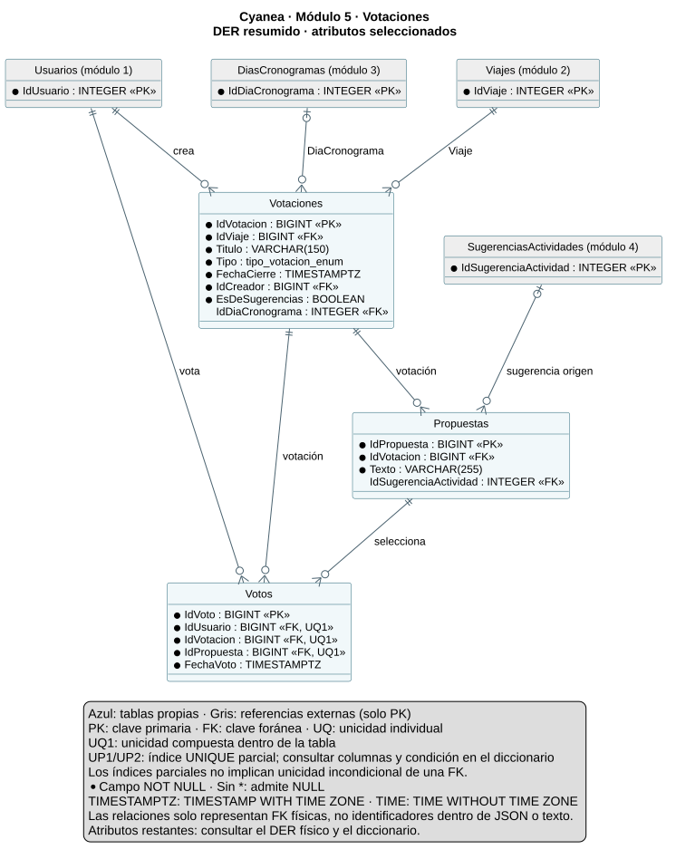

# Modelo de datos del módulo 5 Votaciones

Este módulo permite registrar decisiones grupales mediante votaciones de opción única o múltiple, sus propuestas y las selecciones de cada cuenta. También conserva los datos necesarios para resolver votaciones originadas en sugerencias de actividades.

## Alcance y referencias

Versión: 1.0. Fecha: 14 de noviembre de 2026. Corte del código: `616ec79`. PostgreSQL local con Alembic en `b0bcca3ac886`.

Se documentan **3 tablas propias, 24 columnas y 8 claves foráneas**. Usuarios pertenece al módulo 1; Viajes al módulo 2; DiasCronogramas al módulo 3; SugerenciasActividades al módulo 4. Se muestran solo sus PK. La actividad creada al resolver una votación se documenta en el módulo 3: ActividadesItinerario.IdVotacionOrigen es una FK entrante desde ese módulo, no una columna adicional de Votaciones.

La estructura física se contrastó con PostgreSQL, los modelos y las migraciones; las reglas de aplicación se contrastaron con los servicios. La inspección utiliza metadatos y no incluye filas de usuarios, viajes o conversaciones.

## Diagramas entidad relación



- DER resumido: [vista SVG](der-resumido.svg) y [fuente PlantUML](der-resumido.puml). Incluye todas las tablas y FK, con atributos seleccionados.
- DER físico: [vista SVG](der-fisico.svg) y [fuente PlantUML](der-fisico.puml). Incluye todas las columnas propias.

Los SVG se pueden ampliar sin perder nitidez. Fuentes y vistas se conservan juntas; cada cambio de PlantUML requiere regenerar el SVG. Los diagramas usan Smetana y no requieren Graphviz. Desde la raíz del repositorio:

```powershell
java -jar <ruta-a-plantuml.jar> -charset UTF-8 -tsvg docs/modelo-datos/modulo-05-votaciones/der-resumido.puml
java -jar <ruta-a-plantuml.jar> -charset UTF-8 -tsvg docs/modelo-datos/modulo-05-votaciones/der-fisico.puml
```

## Entidades

| Tabla propia | Responsabilidad |
|---|---|
| Votaciones | Cabecera de la decisión, tipo, creador, fechas y datos de resolución de sugerencias. |
| Propuestas | Opciones de una votación, con orden y posible vínculo a una sugerencia de actividad. |
| Votos | Selecciones de propuestas realizadas por las cuentas; una selección persistida por cada opción elegida. |

## Relaciones físicas y cardinalidades

Una FK obligatoria exige exactamente un padre por fila hija; una FK nullable permite cero o uno. El máximo de hijos solo se reduce a uno cuando hay unicidad incondicional de la FK. Los índices parciales se explican por separado y no se generalizan como relaciones 1 a 1.

| Tabla padre y clave | Tabla hija y campo FK | Padres por fila hija | Hijos por fila padre | ON DELETE | ON UPDATE |
|---|---|---|---|---|---|
| DiasCronogramas(IdDiaCronograma) | Votaciones.IdDiaCronograma | Cero o uno | Cero o muchos | SET NULL | NO ACTION |
| Usuarios(IdUsuario) | Votaciones.IdCreador | Exactamente uno | Cero o muchos | NO ACTION | NO ACTION |
| Viajes(IdViaje) | Votaciones.IdViaje | Exactamente uno | Cero o muchos | NO ACTION | NO ACTION |
| SugerenciasActividades(IdSugerenciaActividad) | Propuestas.IdSugerenciaActividad | Cero o uno | Cero o muchos | SET NULL | NO ACTION |
| Votaciones(IdVotacion) | Propuestas.IdVotacion | Exactamente uno | Cero o muchos | CASCADE | NO ACTION |
| Propuestas(IdPropuesta) | Votos.IdPropuesta | Exactamente uno | Cero o muchos | CASCADE | NO ACTION |
| Usuarios(IdUsuario) | Votos.IdUsuario | Exactamente uno | Cero o muchos | NO ACTION | NO ACTION |
| Votaciones(IdVotacion) | Votos.IdVotacion | Exactamente uno | Cero o muchos | CASCADE | NO ACTION |

Las acciones físicas de las FK son distintas de los cascade del ORM, las bajas lógicas y los permisos de cada operación. Las FK simples tampoco garantizan por sí solas coherencia entre viaje y día cuando ambos se referencian por separado.

## Convenciones del diccionario

PK indica clave primaria; FK, clave foránea; UQ, unicidad individual; UQ1, unicidad compuesta dentro de esa tabla. UP1 y UP2 identifican índices UNIQUE parciales dentro de cada tabla: su condición figura en las restricciones y no implica unicidad individual o global de sus columnas.

«Admite NULL» representa nulabilidad física. «Predeterminado BD» contiene defaults del servidor; «—» indica ausencia de default. Los defaults exclusivamente de aplicación se aclaran en las descripciones y reglas. Las secuencias generan identificadores; no se asumen identificadores fijos salvo en los catálogos que lo requieren. TIMESTAMPTZ abrevia TIMESTAMP WITH TIME ZONE; TIME, TIME WITHOUT TIME ZONE. VARCHAR sin longitud no tiene límite declarado; TEXT no equivale a JSON. Los índices de respaldo de PK y UNIQUE no se repiten como índices adicionales.

## Enumeraciones físicas de PostgreSQL

| Tipo nativo | Valores admitidos |
|---|---|
| tipo_votacion_enum | opcion_unica, opcion_multiple |

El ENUM restringe el valor de su columna y no se representa como una tabla adicional en el DER.

## Diccionario de datos

### 1 Votaciones

Cabecera de la decisión, tipo, creador, fechas y datos de resolución de sugerencias.

| Campo | Tipo PostgreSQL | Admite NULL | Clave | Predeterminado BD | Descripción |
|---|---|---|---|---|---|
| IdVotacion | BIGINT | No | PK | Secuencia | Identificador BIGINT autogenerado por secuencia de la votación. |
| IdViaje | BIGINT | No | FK | — | Viaje al que corresponde el registro; FK al módulo 2. |
| Titulo | VARCHAR(150) | No | — | — | Título de la votación; NOT NULL y CHECK de texto no vacío tras TRIM. |
| Tipo | tipo_votacion_enum | No | — | — | Tipo nativo PostgreSQL tipo_votacion_enum: opcion_unica u opcion_multiple. |
| FechaCierre | TIMESTAMPTZ | No | — | — | Instante de cierre previsto de la votación. |
| IdCreador | BIGINT | No | FK | — | Cuenta que creó la votación; FK a Usuarios, no a la participación. |
| FechaCreacion | TIMESTAMPTZ | No | — | now() | Instante de creación; default now() del servidor. |
| FechaActualizacion | TIMESTAMPTZ | No | — | now() | Instante de última actualización; default físico now() y onupdate configurado en SQLAlchemy, sin presuponer un trigger. |
| FechaCancelacion | TIMESTAMPTZ | Sí | — | — | Instante de cancelación; NULL mientras no se registra una cancelación. |
| EsDeSugerencias | BOOLEAN | No | — | false | Indica si la votación procede de sugerencias de actividades. |
| IdDiaCronograma | INTEGER | Sí | FK | — | Día asociado, opcional; FK con ON DELETE SET NULL. Las votaciones comunes pueden no tener día. |
| EstadoResolucion | VARCHAR(20) | Sí | — | — | Resultado de resolución automática; nullable, con CHECK sobre incorporada, empate, sin_votos, dia_inexistente y empate_vencido. |
| FechaResolucion | TIMESTAMPTZ | Sí | — | — | Instante registrado al resolver la votación de sugerencias, cuando corresponde. |
| FechaLimiteDesempate | TIMESTAMPTZ | Sí | — | — | Límite temporal opcional para resolver un empate. |

Restricciones e índices:

- PK `Votaciones_pkey`: (IdVotacion).
- FK `FK_Votaciones_DiasCron_IdDia`: (IdDiaCronograma) → DiasCronogramas(IdDiaCronograma); ON DELETE SET NULL; ON UPDATE NO ACTION.
- FK `FK_Votaciones_Usuarios_IdCreador`: (IdCreador) → Usuarios(IdUsuario); ON DELETE NO ACTION; ON UPDATE NO ACTION.
- FK `FK_Votaciones_Viajes_IdViaje`: (IdViaje) → Viajes(IdViaje); ON DELETE NO ACTION; ON UPDATE NO ACTION.
- CHECK `CK_Votaciones_EstadoResolucion`: `"EstadoResolucion" IS NULL OR ("EstadoResolucion"::text = ANY (ARRAY['incorporada'::character varying, 'empate'::character varying, 'sin_votos'::character varying, 'dia_inexistente'::character varying, 'empate_vencido'::character varying]::text[]))`.
- CHECK `CK_Votaciones_Titulo`: `TRIM(BOTH FROM "Titulo") <> ''::text`.
- Índice `IX_Votaciones_Resolucion`: (EsDeSugerencias, EstadoResolucion, FechaCierre).

### 2 Propuestas

Opciones de una votación, con orden y posible vínculo a una sugerencia de actividad.

| Campo | Tipo PostgreSQL | Admite NULL | Clave | Predeterminado BD | Descripción |
|---|---|---|---|---|---|
| IdPropuesta | BIGINT | No | PK | Secuencia | Identificador BIGINT autogenerado por secuencia de la propuesta. |
| IdVotacion | BIGINT | No | FK | — | Identificador de la votación a la que pertenece el registro. |
| Texto | VARCHAR(255) | No | — | — | Texto de la propuesta; VARCHAR(255) y CHECK de texto no vacío tras TRIM. |
| Orden | INTEGER | No | — | — | Orden de presentación. Default de SQLAlchemy 1; sin default físico, UNIQUE ni CHECK de rango en PostgreSQL. |
| IdSugerenciaActividad | INTEGER | Sí | FK | — | Sugerencia de actividad que origina la propuesta; FK opcional con ON DELETE SET NULL y sin UNIQUE. |

Restricciones e índices:

- PK `Propuestas_pkey`: (IdPropuesta).
- FK `FK_Propuestas_SugAct_IdSugerencia`: (IdSugerenciaActividad) → SugerenciasActividades(IdSugerenciaActividad); ON DELETE SET NULL; ON UPDATE NO ACTION.
- FK `FK_Propuestas_Votaciones_IdVotacion`: (IdVotacion) → Votaciones(IdVotacion); ON DELETE CASCADE; ON UPDATE NO ACTION.
- CHECK `CK_Propuestas_Texto`: `TRIM(BOTH FROM "Texto") <> ''::text`.
- Índice `IX_Propuestas_IdSugerenciaActividad`: (IdSugerenciaActividad).

### 3 Votos

Selecciones de propuestas realizadas por las cuentas; una selección persistida por cada opción elegida.

| Campo | Tipo PostgreSQL | Admite NULL | Clave | Predeterminado BD | Descripción |
|---|---|---|---|---|---|
| IdVoto | BIGINT | No | PK | Secuencia | Identificador autogenerado del registro de voto a una propuesta. |
| IdUsuario | BIGINT | No | FK, UQ1 | — | Cuenta que emitió la selección; FK a Usuarios, no a ParticipantesViajes. |
| IdVotacion | BIGINT | No | FK, UQ1 | — | Identificador de la votación a la que pertenece el registro. |
| IdPropuesta | BIGINT | No | FK, UQ1 | — | Identificador de la propuesta seleccionada o asociada. |
| FechaVoto | TIMESTAMPTZ | No | — | now() | Instante registrado de emisión de esa selección. |

Restricciones e índices:

- PK `Votos_pkey`: (IdVoto).
- FK `FK_Votos_Propuestas_IdPropuesta`: (IdPropuesta) → Propuestas(IdPropuesta); ON DELETE CASCADE; ON UPDATE NO ACTION.
- FK `FK_Votos_Usuarios_IdUsuario`: (IdUsuario) → Usuarios(IdUsuario); ON DELETE NO ACTION; ON UPDATE NO ACTION.
- FK `FK_Votos_Votaciones_IdVotacion`: (IdVotacion) → Votaciones(IdVotacion); ON DELETE CASCADE; ON UPDATE NO ACTION.
- UNIQUE `UQ_Votos_Usuario_Propuesta` (UQ1): (IdUsuario, IdVotacion, IdPropuesta).

## Tipos enumerados y estados derivados

| Campo | Tipo físico | Interpretación |
|---|---|---|
| Votaciones.Tipo | tipo_votacion_enum | ENUM PostgreSQL nativo: opcion_unica u opcion_multiple. No es una FK a una tabla de tipos. |
| Votaciones.EstadoResolucion | VARCHAR(20) nullable | Estado de resolución protegido por CHECK. No representa el estado abierta/cerrada/cancelada. |
| Estado de consulta de la votación | No persistido | Se calcula desde FechaCancelacion, FechaCierre y la finalización del viaje. No existe una columna Estado para ese fin. |

## Reglas funcionales y particularidades del esquema

1. **Tipo de votación.** tipo_votacion_enum es un ENUM nativo con opcion_unica y opcion_multiple. La base restringe el valor del tipo, pero no valida mediante ese ENUM la cantidad de opciones que selecciona cada usuario.
2. **Estado derivado.** El estado mostrado se calcula: FechaCancelacion informada implica cancelada; si el viaje está finalizado o se alcanzó FechaCierre se muestra cerrada; en caso contrario, abierta. No hay una tabla de estados de votación ni una columna persistida de estado de apertura.
3. **Propuestas y votos.** Cada propuesta pertenece a una votación y puede tener cero o muchos votos. Cada voto referencia una cuenta, una votación y una propuesta. UNIQUE (IdUsuario, IdVotacion, IdPropuesta) impide repetir esa combinación, sin impedir por sí solo seleccionar varias propuestas en una votación de opción única.
4. **Coherencia de la selección.** Las FK a Votaciones y Propuestas son independientes. No existe una FK compuesta que garantice que la propuesta del voto pertenezca a la misma votación. Los servicios verifican pertenencia, selección no vacía, ausencia de duplicados y selección única cuando corresponde.
5. **Autorización de integrantes.** IdCreador e IdUsuario apuntan a Usuarios. No hay FK directa de esos campos a ParticipantesViajes. La pertenencia aceptada al viaje, la posibilidad de editar y los permisos de creador se validan en el servidor.
6. **Modificar el voto.** La modificación opera sobre las selecciones propias con votación abierta. En opción única reemplaza la elección; en múltiple agrega y quita sin dejar la selección vacía. Las opciones conservadas mantienen su FechaVoto. La aplicación bloquea la votación durante la operación; el esquema no contiene un historial adicional de modificaciones de votos.
7. **Edición de la votación.** Los servicios permiten editar o eliminar solo al creador y mientras la votación está abierta. El tipo y las propuestas se protegen cuando ya existen votos. Esas reglas temporales y de autorización no son CHECK físicos.
8. **Votaciones de sugerencias.** EsDeSugerencias identifica el flujo automático. IdDiaCronograma vincula el día y Propuestas.IdSugerenciaActividad vincula la sugerencia. Ambas FK son opcionales con ON DELETE SET NULL. No existe CHECK que obligue a informar esos vínculos cuando EsDeSugerencias es true ni UNIQUE que limite una sugerencia a una sola propuesta en toda la plataforma.
9. **Resolución y empates.** EstadoResolucion admite NULL o incorporada, empate, sin_votos, dia_inexistente y empate_vencido por CHECK. FechaResolucion y FechaLimiteDesempate acompañan la resolución. El estado de resolución se distingue del tipo y del estado derivado de apertura; el proceso automático y el desempate corresponden a los servicios.
10. **Actividad resultante.** ActividadesItinerario.IdVotacionOrigen es nullable y UNIQUE en el módulo 3: una votación puede originar cero o una actividad. Esa FK entrante no cambia las ocho FK salientes de las tablas propias documentadas aquí. No se inventa IdActividad en Votaciones.
11. **Restricciones de texto y orden.** Título y texto de propuesta no pueden quedar vacíos tras TRIM por CHECK. Propuestas.Orden no tiene UNIQUE ni CHECK de rango y su default 1 existe solo en SQLAlchemy. El mínimo funcional de propuestas se valida en los servicios, sin una restricción física que lo garantice.
12. **Borrado y actualización.** Eliminar físicamente una votación elimina propuestas y votos por CASCADE. Eliminar una propuesta elimina sus votos. Eliminar un día o una sugerencia pone en NULL los vínculos opcionales correspondientes. Las FK hacia Usuarios y Viajes usan NO ACTION. FechaActualizacion tiene onupdate de SQLAlchemy; no se presupone un trigger PostgreSQL.

## Fuentes del modelo

- Modelos: [votacion](../../../backend/app/models/votacion.py), [propuesta](../../../backend/app/models/propuesta.py), [voto](../../../backend/app/models/voto.py).
- Servicios: [resolucion_votaciones.py](../../../backend/app/services/resolucion_votaciones.py), [sugerencias_votacion.py](../../../backend/app/services/sugerencias_votacion.py).
- [backend/app/api/routes/votaciones.py](../../../backend/app/api/routes/votaciones.py).
- [Migraciones Alembic](../../../backend/alembic/versions) y [convenciones del proyecto](../../../AGENTS.md).
- Metadatos del esquema PostgreSQL local: columnas, tipos, PK, FK, UNIQUE, CHECK, índices y predicados, identity y defaults.
