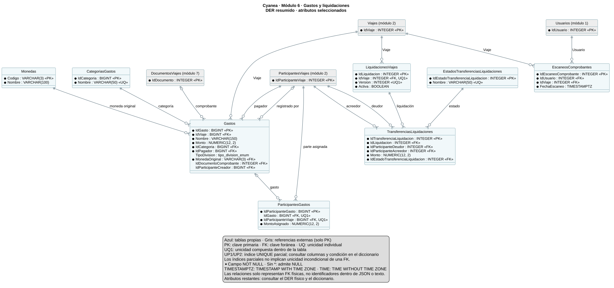

# Modelo de datos del módulo 6 Gastos y liquidaciones

Este módulo registra gastos personales y compartidos, sus importes originales y convertidos, las asignaciones por participante y los planes de liquidación versionados. Incluye los catálogos de monedas, categorías y estados de transferencia y el registro de escaneos exitosos de comprobantes para el cupo de consumo.

## Alcance y referencias

Versión: 1.0. Fecha: 14 de noviembre de 2026. Corte del código: `616ec79`. PostgreSQL local con Alembic en `b0bcca3ac886`.

Se documentan **8 tablas propias, 48 columnas y 15 claves foráneas**. Usuarios pertenece al módulo 1; Viajes y ParticipantesViajes al módulo 2; DocumentosViajes al módulo 7. Aparecen como referencias externas con su PK. Las categorías de gastos son propiedad de este módulo aunque se administren desde el backoffice. Los pagos de suscripción y la pasarela pertenecen al módulo 9; una transferencia de liquidación entre integrantes no es un pago de suscripción.

La estructura física se contrastó con PostgreSQL, los modelos y las migraciones; las reglas de aplicación se contrastaron con los servicios. La inspección utiliza metadatos y no incluye filas de usuarios, viajes o conversaciones.

## Diagramas entidad relación



- DER resumido: [vista SVG](der-resumido.svg) y [fuente PlantUML](der-resumido.puml). Incluye todas las tablas y FK, con atributos seleccionados.
- DER físico: [vista SVG](der-fisico.svg) y [fuente PlantUML](der-fisico.puml). Incluye todas las columnas propias.

Los SVG se pueden ampliar sin perder nitidez. Fuentes y vistas se conservan juntas; cada cambio de PlantUML requiere regenerar el SVG. Los diagramas usan Smetana y no requieren Graphviz. Desde la raíz del repositorio:

```powershell
java -jar <ruta-a-plantuml.jar> -charset UTF-8 -tsvg docs/modelo-datos/modulo-06-gastos-liquidaciones/der-resumido.puml
java -jar <ruta-a-plantuml.jar> -charset UTF-8 -tsvg docs/modelo-datos/modulo-06-gastos-liquidaciones/der-fisico.puml
```

## Entidades

| Tabla propia | Responsabilidad |
|---|---|
| Gastos | Gasto del viaje, pagador, creador, importes, conversión, modalidad de división y documento comprobante opcional. |
| ParticipantesGastos | Asignación del importe de un gasto a una participación del viaje. |
| Monedas | Catálogo de monedas utilizadas como moneda base de viajes y moneda original de gastos. |
| CategoriasGastos | Categorías predefinidas de gastos, con icono y disponibilidad. |
| LiquidacionesViajes | Versiones del plan de liquidación de un viaje y marca de versión activa. |
| TransferenciasLiquidaciones | Transferencias entre participaciones dentro de una versión de liquidación. |
| EstadosTransferenciasLiquidaciones | Catálogo de estados del seguimiento de transferencias. |
| EscaneosComprobantes | Registro del consumo de escaneos exitosos por cuenta y viaje. |

## Relaciones físicas y cardinalidades

Una FK obligatoria exige exactamente un padre por fila hija; una FK nullable permite cero o uno. El máximo de hijos solo se reduce a uno cuando hay unicidad incondicional de la FK. Los índices parciales se explican por separado y no se generalizan como relaciones 1 a 1.

| Tabla padre y clave | Tabla hija y campo FK | Padres por fila hija | Hijos por fila padre | ON DELETE | ON UPDATE |
|---|---|---|---|---|---|
| CategoriasGastos(IdCategoria) | Gastos.IdCategoria | Exactamente uno | Cero o muchos | NO ACTION | NO ACTION |
| DocumentosViajes(IdDocumento) | Gastos.IdDocumentoComprobante | Cero o uno | Cero o muchos | SET NULL | NO ACTION |
| Monedas(Codigo) | Gastos.MonedaOriginal | Exactamente uno | Cero o muchos | NO ACTION | NO ACTION |
| ParticipantesViajes(IdParticipanteViaje) | Gastos.IdPagador | Exactamente uno | Cero o muchos | NO ACTION | NO ACTION |
| ParticipantesViajes(IdParticipanteViaje) | Gastos.IdParticipanteCreador | Cero o uno | Cero o muchos | NO ACTION | NO ACTION |
| Viajes(IdViaje) | Gastos.IdViaje | Exactamente uno | Cero o muchos | NO ACTION | NO ACTION |
| Gastos(IdGasto) | ParticipantesGastos.IdGasto | Cero o uno | Cero o muchos | CASCADE | NO ACTION |
| ParticipantesViajes(IdParticipanteViaje) | ParticipantesGastos.IdParticipanteViaje | Exactamente uno | Cero o muchos | NO ACTION | NO ACTION |
| Viajes(IdViaje) | LiquidacionesViajes.IdViaje | Exactamente uno | Cero o muchos | CASCADE | NO ACTION |
| EstadosTransferenciasLiquidaciones(IdEstadoTransferenciaLiquidacion) | TransferenciasLiquidaciones.IdEstadoTransferenciaLiquidacion | Exactamente uno | Cero o muchos | NO ACTION | NO ACTION |
| LiquidacionesViajes(IdLiquidacion) | TransferenciasLiquidaciones.IdLiquidacion | Exactamente uno | Cero o muchos | CASCADE | NO ACTION |
| ParticipantesViajes(IdParticipanteViaje) | TransferenciasLiquidaciones.IdParticipanteAcreedor | Exactamente uno | Cero o muchos | NO ACTION | NO ACTION |
| ParticipantesViajes(IdParticipanteViaje) | TransferenciasLiquidaciones.IdParticipanteDeudor | Exactamente uno | Cero o muchos | NO ACTION | NO ACTION |
| Usuarios(IdUsuario) | EscaneosComprobantes.IdUsuario | Exactamente uno | Cero o muchos | NO ACTION | NO ACTION |
| Viajes(IdViaje) | EscaneosComprobantes.IdViaje | Exactamente uno | Cero o muchos | NO ACTION | NO ACTION |

Las acciones físicas de las FK son distintas de los cascade del ORM, las bajas lógicas y los permisos de cada operación. Las FK simples tampoco garantizan por sí solas coherencia entre viaje y día cuando ambos se referencian por separado.

## Convenciones del diccionario

PK indica clave primaria; FK, clave foránea; UQ, unicidad individual; UQ1, unicidad compuesta dentro de esa tabla. UP1 y UP2 identifican índices UNIQUE parciales dentro de cada tabla: su condición figura en las restricciones y no implica unicidad individual o global de sus columnas.

«Admite NULL» representa nulabilidad física. «Predeterminado BD» contiene defaults del servidor; «—» indica ausencia de default. Los defaults exclusivamente de aplicación se aclaran en las descripciones y reglas. Las secuencias generan identificadores; no se asumen identificadores fijos salvo en los catálogos que lo requieren. TIMESTAMPTZ abrevia TIMESTAMP WITH TIME ZONE; TIME, TIME WITHOUT TIME ZONE. VARCHAR sin longitud no tiene límite declarado; TEXT no equivale a JSON. Los índices de respaldo de PK y UNIQUE no se repiten como índices adicionales.

## Enumeraciones físicas de PostgreSQL

| Tipo nativo | Valores admitidos |
|---|---|
| tipo_division_enum | igualitaria, personalizada |

El ENUM restringe el valor de su columna y no se representa como una tabla adicional en el DER.

## Diccionario de datos

### 1 Gastos

Gasto del viaje, pagador, creador, importes, conversión, modalidad de división y documento comprobante opcional.

| Campo | Tipo PostgreSQL | Admite NULL | Clave | Predeterminado BD | Descripción |
|---|---|---|---|---|---|
| IdGasto | BIGINT | No | PK | IDENTITY ALWAYS | Identificador BIGINT del gasto, generado como IDENTITY ALWAYS. |
| IdViaje | BIGINT | No | FK | — | Viaje al que corresponde el gasto; su Moneda define la unidad de Monto. |
| Nombre | VARCHAR(150) | No | — | — | Concepto del gasto; VARCHAR(150), NOT NULL y CHECK de texto no vacío tras TRIM. |
| Monto | NUMERIC(12, 2) | No | — | — | Importe convertido a la moneda base del viaje; NUMERIC(12,2) con CHECK > 0. |
| IdCategoria | BIGINT | No | FK | — | Categoría predefinida del gasto; FK a CategoriasGastos. |
| IdPagador | BIGINT | No | FK | — | Participación que pagó el gasto; FK a ParticipantesViajes, no a Usuarios. |
| DividirEntreTodos | BOOLEAN | No | — | true | Indica si se utiliza el conjunto de participantes para repartir el gasto según el flujo funcional; no define por sí solo si es personal o compartido. |
| FechaGasto | DATE | No | — | — | Fecha del gasto, sin hora; puede ser anterior o posterior a las fechas del viaje. |
| FechaCreacion | TIMESTAMPTZ | No | — | now() | Instante de creación; default now() del servidor. |
| FechaActualizacion | TIMESTAMPTZ | No | — | now() | Instante de última actualización; default físico now() y onupdate configurado en SQLAlchemy, sin presuponer un trigger. |
| TipoDivision | tipo_division_enum | Sí | — | — | ENUM nativo tipo_division_enum; igualitaria o personalizada. NULL representa un gasto personal en los servicios. |
| MonedaOriginal | VARCHAR(3) | No | FK | — | Código de la moneda en que se ingresó el gasto; FK a Monedas.Codigo. |
| MontoOriginal | NUMERIC(12, 2) | No | — | — | Importe original en MonedaOriginal. NOT NULL; sin CHECK > 0 físico en esta base, aunque los servicios lo validan. |
| TipoCambio | NUMERIC(12, 6) | No | — | — | Factor de conversión hacia la moneda base del viaje; NUMERIC(12,6). Default de aplicación 1.0, sin default físico ni CHECK positivo. |
| IdDocumentoComprobante | INTEGER | Sí | FK | — | Documento del repositorio asociado al comprobante; FK opcional con ON DELETE SET NULL y sin UNIQUE. |
| IdParticipanteCreador | BIGINT | Sí | FK | — | Participación que registró el gasto; opcional para datos históricos. No debe confundirse con el pagador. |
| FuenteCotizacion | VARCHAR(30) | Sí | — | — | Fuente textual de la conversión: referencia o manual según el servicio. Nullable y sin CHECK de dominio. |
| FechaCotizacion | DATE | Sí | — | — | Fecha de referencia de la cotización utilizada; nullable para datos históricos o casos donde no corresponde. |

Restricciones e índices:

- PK `Gastos_pkey`: (IdGasto).
- FK `FK_Gastos_Categorias_IdCategoria`: (IdCategoria) → CategoriasGastos(IdCategoria); ON DELETE NO ACTION; ON UPDATE NO ACTION.
- FK `FK_Gastos_DocumentosViajes_IdDocumentoComprobante`: (IdDocumentoComprobante) → DocumentosViajes(IdDocumento); ON DELETE SET NULL; ON UPDATE NO ACTION.
- FK `FK_Gastos_Monedas_Codigo`: (MonedaOriginal) → Monedas(Codigo); ON DELETE NO ACTION; ON UPDATE NO ACTION.
- FK `FK_Gastos_ParticipantesViajes_IdPagador`: (IdPagador) → ParticipantesViajes(IdParticipanteViaje); ON DELETE NO ACTION; ON UPDATE NO ACTION.
- FK `FK_Gastos_ParticipantesViajes_IdParticipanteCreador`: (IdParticipanteCreador) → ParticipantesViajes(IdParticipanteViaje); ON DELETE NO ACTION; ON UPDATE NO ACTION.
- FK `FK_Gastos_Viajes_IdViaje`: (IdViaje) → Viajes(IdViaje); ON DELETE NO ACTION; ON UPDATE NO ACTION.
- CHECK `CK_Gastos_Monto`: `"Monto" > 0::numeric`.
- CHECK `CK_Gastos_Nombre`: `TRIM(BOTH FROM "Nombre") <> ''::text`.
- Sin índices adicionales a la PK.

### 2 ParticipantesGastos

Asignación del importe de un gasto a una participación del viaje.

| Campo | Tipo PostgreSQL | Admite NULL | Clave | Predeterminado BD | Descripción |
|---|---|---|---|---|---|
| IdParticipanteGasto | BIGINT | No | PK | IDENTITY ALWAYS | Identificador autogenerado de la asignación de un gasto a una participación. |
| IdGasto | BIGINT | Sí | FK, UQ1 | — | Gasto al que pertenece la asignación; físicamente nullable en ParticipantesGastos. |
| IdParticipanteViaje | BIGINT | No | FK, UQ1 | — | Participación a la que se asigna una parte del gasto; NOT NULL, FK y parte del UNIQUE compuesto. |
| MontoAsignado | NUMERIC(12, 2) | No | — | — | Parte del gasto asignada al participante, en la moneda base del viaje. NOT NULL; el CHECK > 0 del ORM no está presente en PostgreSQL local. |

Restricciones e índices:

- PK `ParticipantesGastos_pkey`: (IdParticipanteGasto).
- FK `FK_ParticipantesGastos_Gastos_IdGasto`: (IdGasto) → Gastos(IdGasto); ON DELETE CASCADE; ON UPDATE NO ACTION.
- FK `FK_ParticipantesGastos_ParticipantesViajes_IdParticipanteViaje`: (IdParticipanteViaje) → ParticipantesViajes(IdParticipanteViaje); ON DELETE NO ACTION; ON UPDATE NO ACTION.
- UNIQUE `UX_ParticipantesGastos_IdGasto_IdParticipanteViaje` (UQ1): (IdGasto, IdParticipanteViaje).

### 3 Monedas

Catálogo de monedas utilizadas como moneda base de viajes y moneda original de gastos.

| Campo | Tipo PostgreSQL | Admite NULL | Clave | Predeterminado BD | Descripción |
|---|---|---|---|---|---|
| Codigo | VARCHAR(3) | No | PK | — | Código de moneda de tres caracteres; PK textual sin generación automática. |
| Nombre | VARCHAR(100) | No | — | — | Nombre de la moneda; VARCHAR(100), sin UNIQUE físico. |

Restricciones e índices:

- PK `Monedas_pkey`: (Codigo).
- Sin índices adicionales a la PK.

### 4 CategoriasGastos

Categorías predefinidas de gastos, con icono y disponibilidad.

| Campo | Tipo PostgreSQL | Admite NULL | Clave | Predeterminado BD | Descripción |
|---|---|---|---|---|---|
| IdCategoria | BIGINT | No | PK | IDENTITY ALWAYS | Identificador BIGINT de la categoría, generado como IDENTITY ALWAYS. |
| Nombre | VARCHAR(50) | No | UQ | — | Nombre único de la categoría de gasto. La normalización adicional se aplica en los servicios de administración. |
| Activo | BOOLEAN | No | — | true | Disponibilidad de la categoría para nuevos gastos; conserva referencias históricas al desactivarse. |
| Icono | VARCHAR(50) | No | — | 'tags' | Nombre del icono FontAwesome utilizado para la categoría; default físico tags. |

Restricciones e índices:

- PK `CategoriasGastos_pkey`: (IdCategoria).
- UNIQUE `CategoriasGastos_Nombre_key`: (Nombre).

### 5 LiquidacionesViajes

Versiones del plan de liquidación de un viaje y marca de versión activa.

| Campo | Tipo PostgreSQL | Admite NULL | Clave | Predeterminado BD | Descripción |
|---|---|---|---|---|---|
| IdLiquidacion | INTEGER | No | PK | Secuencia | Identificador autogenerado de la versión de liquidación. |
| IdViaje | INTEGER | No | FK, UQ1 | — | Viaje al que corresponde el registro; FK al módulo 2. |
| Version | INTEGER | No | UQ1 | — | Número de versión por viaje; UNIQUE compuesto con IdViaje. No tiene CHECK de positividad ni default físico. |
| Activa | BOOLEAN | No | — | true | Identifica una liquidación vigente según los servicios; no existe UNIQUE parcial físico que impida varias activas para el mismo viaje. |
| FechaGeneracion | TIMESTAMPTZ | No | — | now() | Instante de generación de la versión de liquidación; default now() en la base. |

Restricciones e índices:

- PK `LiquidacionesViajes_pkey`: (IdLiquidacion).
- FK `FK_LiqViajes_Viajes_IdViaje`: (IdViaje) → Viajes(IdViaje); ON DELETE CASCADE; ON UPDATE NO ACTION.
- UNIQUE `UX_LiquidacionesViajes_IdViaje_Version` (UQ1): (IdViaje, Version).

### 6 TransferenciasLiquidaciones

Transferencias entre participaciones dentro de una versión de liquidación.

| Campo | Tipo PostgreSQL | Admite NULL | Clave | Predeterminado BD | Descripción |
|---|---|---|---|---|---|
| IdTransferenciaLiquidacion | INTEGER | No | PK | Secuencia | Identificador autogenerado de la transferencia prevista o registrada. |
| IdLiquidacion | INTEGER | No | FK | — | Identificador de la versión de liquidación a la que corresponde una transferencia. |
| IdParticipanteDeudor | INTEGER | No | FK | — | Participación que debe transferir; FK a ParticipantesViajes. |
| IdParticipanteAcreedor | INTEGER | No | FK | — | Participación que debe recibir; FK a ParticipantesViajes. Debe ser distinta de la deudora por CHECK. |
| Monto | NUMERIC(12, 2) | No | — | — | Importe de la transferencia en la moneda base del viaje; NUMERIC(12,2), con CHECK > 0. |
| IdEstadoTransferenciaLiquidacion | INTEGER | No | FK | — | Estado de la transferencia; FK al catálogo EstadosTransferenciasLiquidaciones. |
| FechaCreacion | TIMESTAMPTZ | No | — | now() | Instante de creación; default now() del servidor. |
| FechaConfirmacion | TIMESTAMPTZ | Sí | — | — | Instante de confirmación de recepción. El servicio lo informa para realizada y lo limpia al volver a otro estado. |

Restricciones e índices:

- PK `TransferenciasLiquidaciones_pkey`: (IdTransferenciaLiquidacion).
- FK `FK_TransLiq_Estados_IdEstado`: (IdEstadoTransferenciaLiquidacion) → EstadosTransferenciasLiquidaciones(IdEstadoTransferenciaLiquidacion); ON DELETE NO ACTION; ON UPDATE NO ACTION.
- FK `FK_TransLiq_LiqViajes_IdLiquidacion`: (IdLiquidacion) → LiquidacionesViajes(IdLiquidacion); ON DELETE CASCADE; ON UPDATE NO ACTION.
- FK `FK_TransLiq_PartViajes_IdAcreedor`: (IdParticipanteAcreedor) → ParticipantesViajes(IdParticipanteViaje); ON DELETE NO ACTION; ON UPDATE NO ACTION.
- FK `FK_TransLiq_PartViajes_IdDeudor`: (IdParticipanteDeudor) → ParticipantesViajes(IdParticipanteViaje); ON DELETE NO ACTION; ON UPDATE NO ACTION.
- CHECK `CK_TransferenciasLiquidaciones_Monto`: `"Monto" > 0::numeric`.
- CHECK `CK_TransferenciasLiquidaciones_ParticipantesDistintos`: `"IdParticipanteDeudor" <> "IdParticipanteAcreedor"`.
- Sin índices adicionales a la PK.

### 7 EstadosTransferenciasLiquidaciones

Catálogo de estados del seguimiento de transferencias.

| Campo | Tipo PostgreSQL | Admite NULL | Clave | Predeterminado BD | Descripción |
|---|---|---|---|---|---|
| IdEstadoTransferenciaLiquidacion | INTEGER | No | PK | Secuencia | Identificador autogenerado del estado de transferencia; se resuelve por nombre funcional. |
| Nombre | VARCHAR(50) | No | UQ | — | Nombre único del estado; los flujos vigentes usan pendiente, informada y realizada. |
| Activo | BOOLEAN | No | — | true | Disponibilidad del estado de transferencia como valor maestro. |

Restricciones e índices:

- PK `EstadosTransferenciasLiquidaciones_pkey`: (IdEstadoTransferenciaLiquidacion).
- UNIQUE `UQ_EstadosTransferenciasLiquidaciones_Nombre`: (Nombre).

### 8 EscaneosComprobantes

Registro del consumo de escaneos exitosos por cuenta y viaje.

| Campo | Tipo PostgreSQL | Admite NULL | Clave | Predeterminado BD | Descripción |
|---|---|---|---|---|---|
| IdEscaneoComprobante | INTEGER | No | PK | Secuencia | Identificador autogenerado del escaneo exitoso registrado para el cupo de uso. |
| IdUsuario | INTEGER | No | FK | — | Cuenta cuyo cupo de escaneos se consume; FK a Usuarios. |
| IdViaje | INTEGER | No | FK | — | Viaje al que corresponde el registro; FK al módulo 2. |
| FechaEscaneo | TIMESTAMPTZ | No | — | now() | Instante del escaneo exitoso utilizado para el conteo mensual de la cuenta. |

Restricciones e índices:

- PK `EscaneosComprobantes_pkey`: (IdEscaneoComprobante).
- FK `FK_EscaneosComprobantes_Usuarios_IdUsuario`: (IdUsuario) → Usuarios(IdUsuario); ON DELETE NO ACTION; ON UPDATE NO ACTION.
- FK `FK_EscaneosComprobantes_Viajes_IdViaje`: (IdViaje) → Viajes(IdViaje); ON DELETE NO ACTION; ON UPDATE NO ACTION.
- Índice `IX_EscaneosComprobantes_Usuario_Fecha`: (IdUsuario, FechaEscaneo).

## Tipos enumerados y valores calculados

| Campo | Tipo físico | Interpretación |
|---|---|---|
| Gastos.TipoDivision | tipo_division_enum nullable | ENUM nativo: igualitaria o personalizada. NULL representa gasto personal en el dominio. |
| Balance, pagado, asignado y saldo neto por participante | No persistidos como tabla de balances | Se calculan desde Gastos, ParticipantesGastos y el seguimiento de transferencias. |
| Etapas pre_viaje, en_curso y post_viaje | No persistidas | Se derivan de FechaGasto frente a FechaInicio y FechaFin del viaje para los gastos compartidos. |

## Reglas funcionales y particularidades del esquema

1. **Moneda del importe.** Gastos.Monto está expresado en la moneda base de Viajes.Moneda. MonedaOriginal y MontoOriginal conservan la operación ingresada. TipoCambio representa el factor aplicado para obtener el importe convertido, sujeto a las reglas de conversión y redondeo. No existe una columna MonedaBase en Gastos ni una tabla local de cotizaciones históricas en este módulo.
2. **Cotización utilizada.** FuenteCotizacion y FechaCotizacion son nullable; los gastos anteriores pueden conservar NULL. El servicio utiliza referencia o manual como fuente textual, sin CHECK de dominio. MontoOriginal y TipoCambio son NOT NULL sin CHECK positivo en esta base, aunque los servicios validan los importes. El default 1.0 de TipoCambio es de aplicación, no de PostgreSQL.
3. **Gastos personales y compartidos.** TipoDivision es un ENUM PostgreSQL nativo que admite igualitaria o personalizada y también NULL. Los servicios interpretan NULL como gasto personal; los compartidos utilizan las asignaciones de ParticipantesGastos. DividirEntreTodos no sustituye a TipoDivision como indicador de modalidad.
4. **Asignaciones y diferencia con el ORM.** UNIQUE (IdGasto, IdParticipanteViaje) evita repetir la participación dentro de un gasto identificado. IdGasto es físicamente nullable, por lo que el DER muestra cero o un gasto padre por asignación y la unicidad no evita múltiples combinaciones con IdGasto NULL. La suma de asignaciones respecto de Monto se valida en los servicios, sin un CHECK entre filas. El modelo SQLAlchemy declara CK_ParticipantesGastos_MontoAsignado > 0, pero ese CHECK no está presente en la base local inspeccionada; se documenta la diferencia sin modificar el esquema.
5. **Pagador y creador.** IdPagador es obligatorio y referencia una participación, no una cuenta. IdParticipanteCreador es opcional y permite conservar el origen del registro en datos históricos. Las FK independientes no garantizan que pagador, creador y asignaciones pertenezcan al mismo viaje; esa coherencia corresponde a la aplicación.
6. **Categorías y monedas.** Monedas.Codigo es PK textual de tres caracteres; no existe una FK a un catálogo externo de códigos. CategoriasGastos.Nombre tiene UNIQUE físico y los servicios aplican además normalización de nombre. Desactivar una categoría conserva los gastos históricos; sus permisos y reglas de uso se administran desde el backoffice.
7. **Balance y etapas.** El balance neto se calcula desde gastos y asignaciones, sin persistir una tabla de saldo por participante. Los gastos compartidos se clasifican en pre_viaje, en_curso o post_viaje comparando FechaGasto con las fechas del viaje. Las transferencias ajustan el saldo total; no se distribuyen como pagos por etapa.
8. **Liquidaciones versionadas.** UNIQUE (IdViaje, Version) distingue cada versión. Activa tiene default true, sin un índice UNIQUE parcial que garantice una sola activa por viaje. El servicio desactiva las versiones anteriores al reconstruir el plan y calcula la versión siguiente. Version no tiene CHECK positivo en la base.
9. **Reorganización del plan.** Al reconstruir, el servicio calcula balances ajustados y genera transferencias pendientes. Conserva las transferencias informadas o realizadas, pudiendo reasignarlas a la nueva liquidación activa. Por eso la pertenencia de una transferencia a una versión no debe describirse como un historial inmutable de planes.
10. **Estados de transferencia.** Los valores vigentes son pendiente, informada y realizada. El deudor puede informar que transfirió; el acreedor confirma recepción o rechaza el aviso, devolviendo la deuda a pendiente. El rechazo no se almacena como estado rechazada. FechaConfirmacion se informa al marcar realizada y se limpia al cambiar a otro estado.
11. **Ajuste de saldos y confirmación.** El servicio considera tanto informada como realizada al ajustar los saldos y reconstruir pendientes. Informada sigue representando un aviso del deudor sin confirmación del acreedor. Esta distinción evita interpretar todos los importes descontados del saldo como recepciones confirmadas o cobros de la plataforma.
12. **Restricciones de transferencias.** Monto debe ser positivo y los identificadores de deudor y acreedor deben ser distintos por CHECK. No hay UNIQUE físico por pareja dentro de una liquidación ni FK compuesta para exigir pertenencia al mismo viaje; el plan y las autorizaciones se controlan en los servicios.
13. **Comprobantes y escaneos.** IdDocumentoComprobante es una FK opcional a DocumentosViajes con SET NULL y sin UNIQUE: la base permite que varios gastos referencien un documento. EscaneosComprobantes registra consumos exitosos por usuario y viaje, sin IdGasto, IdDocumento ni almacenamiento de la imagen extraída. Un escaneo exitoso no implica que se haya confirmado y creado un gasto.
14. **Consumo mensual.** El límite se consulta desde el plan y los registros de escaneo del mes calendario argentino. No existe una columna de cupo restante ni una FK desde EscaneosComprobantes a la suscripción. La detección automática de gastos al subir documentos tiene un flujo de consumo distinto y no debe confundirse con estos escaneos personales.
15. **Borrado físico y validación funcional.** Eliminar un gasto elimina sus asignaciones por CASCADE. La aplicación bloquea la eliminación de gastos si existen transferencias realizadas, para preservar la trazabilidad, y reconstruye el plan cuando corresponde. Borrar una liquidación elimina sus transferencias físicamente por CASCADE; ese comportamiento no equivale a autorizarlo desde el dominio. Las demás acciones por FK se detallan en el diccionario.

## Fuentes del modelo

- Modelos: [gasto](../../../backend/app/models/gasto.py), [participantes_gastos](../../../backend/app/models/participantes_gastos.py), [moneda](../../../backend/app/models/moneda.py), [categorias_gastos](../../../backend/app/models/categorias_gastos.py), [liquidacion_viaje](../../../backend/app/models/liquidacion_viaje.py), [transferencia_liquidacion](../../../backend/app/models/transferencia_liquidacion.py), [estado_transferencia_liquidacion](../../../backend/app/models/estado_transferencia_liquidacion.py), [escaneo_comprobante](../../../backend/app/models/escaneo_comprobante.py).
- Servicios: [liquidacion_service.py](../../../backend/app/services/liquidacion_service.py), [currency.py](../../../backend/app/services/currency.py), [limites_planes.py](../../../backend/app/services/limites_planes.py).
- [backend/app/api/routes/gastos.py](../../../backend/app/api/routes/gastos.py).
- [backend/app/api/routes/liquidaciones.py](../../../backend/app/api/routes/liquidaciones.py).
- [Migraciones Alembic](../../../backend/alembic/versions) y [convenciones del proyecto](../../../AGENTS.md).
- Metadatos del esquema PostgreSQL local: columnas, tipos, PK, FK, UNIQUE, CHECK, índices y predicados, identity y defaults.
