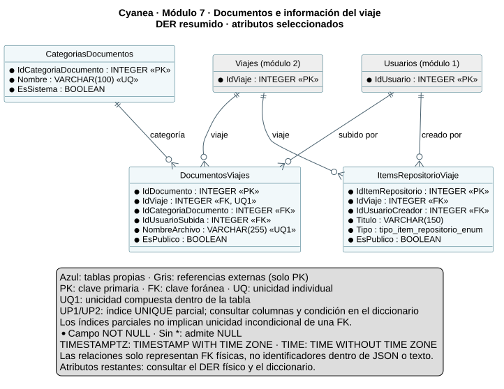

# Modelo de datos del módulo 7 Documentos e información del viaje

Este módulo conserva los metadatos de los archivos del viaje, sus categorías y los elementos de información relevante como enlaces, direcciones y contactos. Los archivos binarios permanecen en almacenamiento externo; la base registra su referencia y los datos necesarios para su consulta.

## Alcance y referencias

Versión: 1.0. Fecha: 14 de noviembre de 2026. Corte del código: `616ec79`. PostgreSQL local con Alembic en `b0bcca3ac886`.

Se documentan **3 tablas propias, 25 columnas y 5 claves foráneas**. Usuarios pertenece al módulo 1 y Viajes al módulo 2; se muestran solo sus PK. DocumentosChecklists es propiedad del módulo 8 y Gastos.IdDocumentoComprobante pertenece al módulo 6: son referencias entrantes hacia DocumentosViajes, sin duplicar sus tablas ni diccionarios aquí. La clasificación de categorías se administra desde el backoffice, pero CategoriasDocumentos pertenece a este módulo.

La estructura física se contrastó con PostgreSQL, los modelos y las migraciones; las reglas de aplicación se contrastaron con los servicios. La inspección utiliza metadatos y no incluye filas de usuarios, viajes o conversaciones.

## Diagramas entidad relación



- DER resumido: [vista SVG](der-resumido.svg) y [fuente PlantUML](der-resumido.puml). Incluye todas las tablas y FK, con atributos seleccionados.
- DER físico: [vista SVG](der-fisico.svg) y [fuente PlantUML](der-fisico.puml). Incluye todas las columnas propias.

Los SVG se pueden ampliar sin perder nitidez. Fuentes y vistas se conservan juntas; cada cambio de PlantUML requiere regenerar el SVG. Los diagramas usan Smetana y no requieren Graphviz. Desde la raíz del repositorio:

```powershell
java -jar <ruta-a-plantuml.jar> -charset UTF-8 -tsvg docs/modelo-datos/modulo-07-documentos-informacion-viaje/der-resumido.puml
java -jar <ruta-a-plantuml.jar> -charset UTF-8 -tsvg docs/modelo-datos/modulo-07-documentos-informacion-viaje/der-fisico.puml
```

## Entidades

| Tabla propia | Responsabilidad |
|---|---|
| DocumentosViajes | Metadatos del documento: viaje, categoría, persona que lo subió, ruta de almacenamiento, tamaño, visibilidad y fechas. |
| CategoriasDocumentos | Catálogo de categorías de documentos, con icono, disponibilidad y marca de categoría del sistema. |
| ItemsRepositorioViaje | Información relevante del viaje, como enlaces, direcciones, contactos y otros textos, con creador y visibilidad. |

## Relaciones físicas y cardinalidades

Una FK obligatoria exige exactamente un padre por fila hija; una FK nullable permite cero o uno. El máximo de hijos solo se reduce a uno cuando hay unicidad incondicional de la FK. Los índices parciales se explican por separado y no se generalizan como relaciones 1 a 1.

| Tabla padre y clave | Tabla hija y campo FK | Padres por fila hija | Hijos por fila padre | ON DELETE | ON UPDATE |
|---|---|---|---|---|---|
| CategoriasDocumentos(IdCategoriaDocumento) | DocumentosViajes.IdCategoriaDocumento | Exactamente uno | Cero o muchos | NO ACTION | NO ACTION |
| Usuarios(IdUsuario) | DocumentosViajes.IdUsuarioSubida | Exactamente uno | Cero o muchos | NO ACTION | NO ACTION |
| Viajes(IdViaje) | DocumentosViajes.IdViaje | Exactamente uno | Cero o muchos | NO ACTION | NO ACTION |
| Usuarios(IdUsuario) | ItemsRepositorioViaje.IdUsuarioCreador | Exactamente uno | Cero o muchos | NO ACTION | NO ACTION |
| Viajes(IdViaje) | ItemsRepositorioViaje.IdViaje | Exactamente uno | Cero o muchos | CASCADE | NO ACTION |

Las acciones físicas de las FK son distintas de los cascade del ORM, las bajas lógicas y los permisos de cada operación. Las FK simples tampoco garantizan por sí solas coherencia entre viaje y día cuando ambos se referencian por separado.

## Convenciones del diccionario

PK indica clave primaria; FK, clave foránea; UQ, unicidad individual; UQ1, unicidad compuesta dentro de esa tabla. UP1 y UP2 identifican índices UNIQUE parciales dentro de cada tabla: su condición figura en las restricciones y no implica unicidad individual o global de sus columnas.

«Admite NULL» representa nulabilidad física. «Predeterminado BD» contiene defaults del servidor; «—» indica ausencia de default. Los defaults exclusivamente de aplicación se aclaran en las descripciones y reglas. Las secuencias generan identificadores; no se asumen identificadores fijos salvo en los catálogos que lo requieren. TIMESTAMPTZ abrevia TIMESTAMP WITH TIME ZONE; TIME, TIME WITHOUT TIME ZONE. VARCHAR sin longitud no tiene límite declarado; TEXT no equivale a JSON. Los índices de respaldo de PK y UNIQUE no se repiten como índices adicionales.

## Enumeraciones físicas de PostgreSQL

| Tipo nativo | Valores admitidos |
|---|---|
| tipo_item_repositorio_enum | enlace, direccion, contacto, otro |

El ENUM limita el valor de Tipo y no se representa como una tabla adicional en el DER.

## Diccionario de datos

### 1 DocumentosViajes

Metadatos del documento: viaje, categoría, persona que lo subió, ruta de almacenamiento, tamaño, visibilidad y fechas.

| Campo | Tipo PostgreSQL | Admite NULL | Clave | Predeterminado BD | Descripción |
|---|---|---|---|---|---|
| IdDocumento | INTEGER | No | PK | Secuencia | Identificador autogenerado del documento, mediante secuencia. |
| IdViaje | INTEGER | No | FK, UQ1 | — | Viaje al que corresponde el registro; FK al módulo 2. |
| IdCategoriaDocumento | INTEGER | No | FK | — | Categoría predefinida del documento; FK a CategoriasDocumentos. |
| IdUsuarioSubida | INTEGER | No | FK | — | Cuenta que cargó el documento; FK a Usuarios y referencia para permisos sobre el archivo. |
| NombreArchivo | VARCHAR(255) | No | UQ1 | — | Nombre visible del archivo, con su extensión; UNIQUE compuesto con IdViaje. |
| UrlArchivo | VARCHAR(500) | No | — | — | Ruta o clave del archivo en el almacenamiento externo, almacenada como VARCHAR(500). El servicio genera la URL de consulta; no contiene los bytes del archivo. |
| FechaSubida | TIMESTAMPTZ | No | — | now() | Instante de carga del documento; default físico now(). |
| EsPublico | BOOLEAN | No | — | true | Visibilidad funcional del documento dentro del viaje: compartido con el grupo o privado para quien lo subió. |
| TamanoBytes | BIGINT | Sí | — | — | Tamaño del archivo en bytes. Nullable para documentos históricos; sin CHECK físico de no negatividad. |
| FechaActualizacion | TIMESTAMPTZ | No | — | now() | Instante de actualización registrado para el documento. Default físico now(), sin onupdate automático en el modelo; el endpoint lo actualiza al reemplazar el archivo. |

Restricciones e índices:

- PK `DocumentosViajes_pkey`: (IdDocumento).
- FK `FK_DocumentosViajes_CategoriasDocumentos_IdCategoriaDocumento`: (IdCategoriaDocumento) → CategoriasDocumentos(IdCategoriaDocumento); ON DELETE NO ACTION; ON UPDATE NO ACTION.
- FK `FK_DocumentosViajes_Usuarios_IdUsuario`: (IdUsuarioSubida) → Usuarios(IdUsuario); ON DELETE NO ACTION; ON UPDATE NO ACTION.
- FK `FK_DocumentosViajes_Viajes_IdViaje`: (IdViaje) → Viajes(IdViaje); ON DELETE NO ACTION; ON UPDATE NO ACTION.
- UNIQUE `uq_documentos_viaje_nombre` (UQ1): (IdViaje, NombreArchivo).

### 2 CategoriasDocumentos

Catálogo de categorías de documentos, con icono, disponibilidad y marca de categoría del sistema.

| Campo | Tipo PostgreSQL | Admite NULL | Clave | Predeterminado BD | Descripción |
|---|---|---|---|---|---|
| IdCategoriaDocumento | INTEGER | No | PK | Secuencia | Identificador autogenerado de la categoría de documentos. |
| Nombre | VARCHAR(100) | No | UQ | — | Nombre único de la categoría de documentos; VARCHAR(100). |
| Icono | VARCHAR(50) | No | — | 'tags' | Nombre del icono FontAwesome de la categoría; default físico tags. |
| Activo | BOOLEAN | No | — | true | Disponibilidad de la categoría para nuevas cargas. Su desactivación conserva los documentos asociados. |
| EsSistema | BOOLEAN | No | — | false | Marca una categoría utilizada por el sistema, como Comprobantes; su protección se aplica en los servicios, sin CHECK específico. |

Restricciones e índices:

- PK `CategoriasDocumentos_pkey`: (IdCategoriaDocumento).
- UNIQUE `UQ_CategoriasDocumentos_Nombre`: (Nombre).

### 3 ItemsRepositorioViaje

Información relevante del viaje, como enlaces, direcciones, contactos y otros textos, con creador y visibilidad.

| Campo | Tipo PostgreSQL | Admite NULL | Clave | Predeterminado BD | Descripción |
|---|---|---|---|---|---|
| IdItemRepositorio | INTEGER | No | PK | Secuencia | Identificador autogenerado del elemento de información relevante. |
| IdViaje | INTEGER | No | FK | — | Viaje al que corresponde el registro; FK al módulo 2. |
| IdUsuarioCreador | INTEGER | No | FK | — | Cuenta que creó el elemento de información; FK a Usuarios. |
| Titulo | VARCHAR(150) | No | — | — | Título del elemento; VARCHAR(150), NOT NULL y CHECK de texto no vacío tras TRIM. |
| Tipo | tipo_item_repositorio_enum | No | — | — | ENUM nativo tipo_item_repositorio_enum: enlace, direccion, contacto u otro. |
| Contenido | TEXT | No | — | — | Contenido del elemento de información, en TEXT; CHECK de texto no vacío tras TRIM. |
| Descripcion | TEXT | Sí | — | — | Descripción opcional del elemento de información, en TEXT. |
| EsPublico | BOOLEAN | No | — | true | Visibilidad funcional del elemento dentro del viaje: compartido o privado para su creador. |
| FechaCreacion | TIMESTAMPTZ | No | — | now() | Instante de creación; default now() del servidor. |
| FechaActualizacion | TIMESTAMPTZ | No | — | now() | Instante de última actualización; default físico now() y onupdate definido por SQLAlchemy. |

Restricciones e índices:

- PK `ItemsRepositorioViaje_pkey`: (IdItemRepositorio).
- FK `FK_ItemsRepositorioViaje_Usuarios_IdCreador`: (IdUsuarioCreador) → Usuarios(IdUsuario); ON DELETE NO ACTION; ON UPDATE NO ACTION.
- FK `FK_ItemsRepositorioViaje_Viajes_IdViaje`: (IdViaje) → Viajes(IdViaje); ON DELETE CASCADE; ON UPDATE NO ACTION.
- CHECK `CK_ItemsRepositorioViaje_Contenido`: `TRIM(BOTH FROM "Contenido") <> ''::text`.
- CHECK `CK_ItemsRepositorioViaje_Titulo`: `TRIM(BOTH FROM "Titulo") <> ''::text`.
- Sin índices adicionales a la PK.

## Tipos enumerados y referencias de almacenamiento

| Campo | Tipo físico | Interpretación |
|---|---|---|
| ItemsRepositorioViaje.Tipo | tipo_item_repositorio_enum | ENUM nativo PostgreSQL con enlace, direccion, contacto y otro. No es una FK a una tabla de tipos. |
| DocumentosViajes.UrlArchivo | VARCHAR(500) | Referencia al objeto en Supabase Storage. La carga vigente persiste la ruta normalizada; el servicio obtiene la URL para consultarlo. |
| Archivo y copia offline | No persistidos como contenido binario en estas tablas | Los bytes están fuera de PostgreSQL. La copia offline utiliza almacenamiento del dispositivo y no agrega una tabla a este modelo del servidor. |

## Reglas funcionales y particularidades del esquema

1. **Metadatos y archivo.** DocumentosViajes registra información del archivo, no un BLOB ni una columna con sus bytes. NombreArchivo es el nombre visible; UrlArchivo es el localizador de almacenamiento y puede diferir por la normalización de caracteres de la ruta. No debe interpretarse ese nombre de columna como garantía de que siempre contiene una URL HTTP completa.
2. **Unicidad dentro del viaje.** UNIQUE (IdViaje, NombreArchivo) impide repetir el mismo nombre de documento dentro de un viaje, incluso si cambia la categoría. No exige unicidad global ni establece por sí solo equivalencia entre nombres con distintas mayúsculas, tildes o normalizaciones. Los endpoints controlan el nombre y capturan los conflictos de integridad.
3. **Visibilidad funcional.** EsPublico indica si el recurso se comparte dentro del contexto del viaje; no significa publicación para toda la plataforma. El servidor combina acceso al viaje con el filtro compartido o propio: documentos privados solo para quien los subió, e información privada solo para su creador. Esta columna no representa por sí misma los permisos del bucket externo.
4. **Autoría y permisos.** IdUsuarioSubida e IdUsuarioCreador apuntan a Usuarios, no a ParticipantesViajes. Las FK no garantizan pertenencia aceptada al viaje. La aplicación comprueba acceso y edición y exige autoría para modificar o eliminar estos recursos según el flujo. Los usuarios que salieron pueden tener consulta histórica limitada por las fechas registradas y las reglas de acceso.
5. **Tamaño y consumo.** TamanoBytes puede ser NULL en documentos anteriores y se considera cero en los contadores vigentes. No tiene CHECK físico de no negatividad. El espacio utilizado se calcula sumando los archivos del viaje; no existe una columna de espacio libre en estas tablas. Los límites se obtienen del plan del administrador, sin persistir IdPlan en DocumentosViajes.
6. **Validación de cargas.** El endpoint de documentos valida categoría activa, nombre y extensión permitida y comprueba el almacenamiento disponible antes de subir el archivo. Esas reglas no constituyen CHECK sobre bytes, extensiones o formato en PostgreSQL, ya que la base no contiene el archivo. Reemplazar un documento actualiza la referencia y tamaño según el flujo de almacenamiento.
7. **Categorías protegidas.** CategoriasDocumentos.Nombre tiene UNIQUE. Activo habilita o deshabilita nuevas cargas. EsSistema identifica categorías que utilizan otros flujos, como Comprobantes; los servicios impiden desactivarlas o eliminarlas. No hay un CHECK que convierta esa protección de negocio en una restricción física sobre DELETE.
8. **Información relevante.** ItemsRepositorioViaje usa tipo_item_repositorio_enum con enlace, direccion, contacto y otro. Titulo y Contenido deben ser no vacíos tras TRIM por CHECK. Contenido se almacena como TEXT, no como JSON ni como una FK a entidades de contacto o dirección. No existe UNIQUE físico de título por viaje.
9. **Documentos de tareas.** DocumentosChecklists, documentada en el módulo 8, permite vincular muchos documentos a muchas tareas. El endpoint de carga acepta IdChecklist como dato del request y crea la asociación después de comprobar que la tarea corresponde al viaje y es visible. IdChecklist no es una columna de DocumentosViajes.
10. **Documentos de gastos.** Gastos.IdDocumentoComprobante referencia DocumentosViajes desde el módulo 6. La relación no es única: el esquema permite que varios gastos apunten al mismo documento. DocumentosViajes no contiene IdGasto ni una columna de comprobante escaneado.
11. **Fechas y reemplazo.** FechaSubida y FechaActualizacion son instantes con default now(). El modelo de DocumentosViajes no tiene onupdate automático; el endpoint registra FechaActualizacion al reemplazar el archivo. ItemsRepositorioViaje sí tiene onupdate de SQLAlchemy. Ninguno de esos defaults implica un trigger PostgreSQL que audite todas las modificaciones.
12. **Borrado y conservación.** Las FK de DocumentosViajes a viaje, categoría y usuario usan NO ACTION. ItemsRepositorioViaje.IdViaje tiene CASCADE físico. La eliminación de un documento debe considerar además el objeto en storage y las referencias entrantes: las asociaciones de tareas se eliminan y el comprobante del gasto se pone en NULL según sus FK. El borrado del archivo externo no lo ejecuta una FK PostgreSQL.

## Fuentes del modelo

- Modelos: [documento_viaje](../../../backend/app/models/documento_viaje.py), [categorias_documento](../../../backend/app/models/categorias_documento.py), [item_repositorio](../../../backend/app/models/item_repositorio.py).
- Servicios: [supabase/storage.py](../../../backend/app/services/supabase/storage.py), [limites_planes.py](../../../backend/app/services/limites_planes.py), [backoffice/categorias_service.py](../../../backend/app/services/backoffice/categorias_service.py).
- [backend/app/api/routes/documentos.py](../../../backend/app/api/routes/documentos.py).
- [backend/app/api/routes/repositorio.py](../../../backend/app/api/routes/repositorio.py).
- [Migraciones Alembic](../../../backend/alembic/versions) y [convenciones del proyecto](../../../AGENTS.md).
- Metadatos del esquema PostgreSQL local: columnas, tipos, PK, FK, UNIQUE, CHECK, índices y predicados, identity y defaults.
