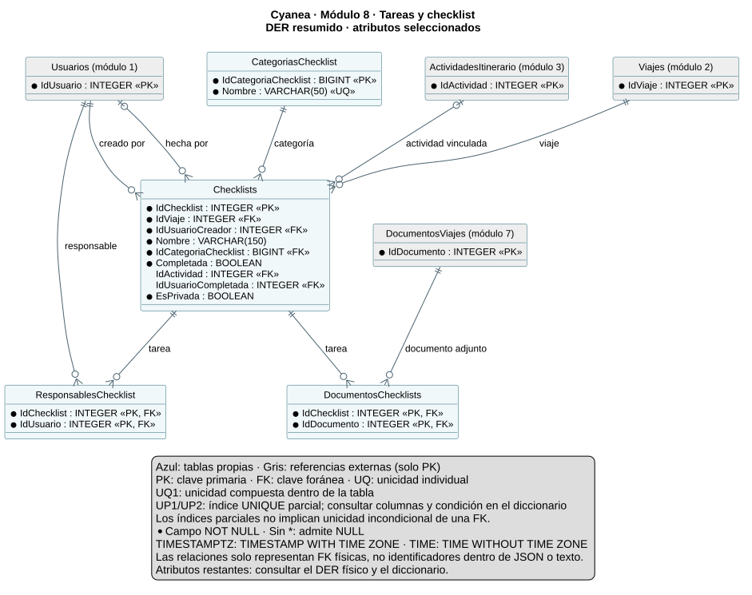

# Modelo de datos del módulo 8 Tareas y checklist

Este módulo organiza las tareas del viaje, sus categorías, responsables, privacidad y estado de cumplimiento. También vincula tareas con actividades y documentos y conserva las marcas necesarias para ofrecer recordatorios de entradas, reservas y carga de documentación.

## Alcance y referencias

Versión: 1.0. Fecha: 14 de noviembre de 2026. Corte del código: `616ec79`. PostgreSQL local con Alembic en `b0bcca3ac886`.

Se documentan **4 tablas propias, 21 columnas y 9 claves foráneas**. Usuarios pertenece al módulo 1; Viajes al módulo 2; ActividadesItinerario al módulo 3 y DocumentosViajes al módulo 7. Se muestran solo sus PK. DocumentosChecklists se documenta aquí como asociación propia del flujo de tareas; no se duplica su diccionario en el módulo de documentos. Las notificaciones y recordatorios enviados pertenecen al módulo 10.

La estructura física se contrastó con PostgreSQL, los modelos y las migraciones; las reglas de aplicación se contrastaron con los servicios. La inspección utiliza metadatos y no incluye filas de usuarios, viajes o conversaciones.

## Diagramas entidad relación



- DER resumido: [vista SVG](der-resumido.svg) y [fuente PlantUML](der-resumido.puml). Incluye todas las tablas y FK, con atributos seleccionados.
- DER físico: [vista SVG](der-fisico.svg) y [fuente PlantUML](der-fisico.puml). Incluye todas las columnas propias.

Los SVG se pueden ampliar sin perder nitidez. Fuentes y vistas se conservan juntas; cada cambio de PlantUML requiere regenerar el SVG. Los diagramas usan Smetana y no requieren Graphviz. Desde la raíz del repositorio:

```powershell
java -jar <ruta-a-plantuml.jar> -charset UTF-8 -tsvg docs/modelo-datos/modulo-08-tareas-checklist/der-resumido.puml
java -jar <ruta-a-plantuml.jar> -charset UTF-8 -tsvg docs/modelo-datos/modulo-08-tareas-checklist/der-fisico.puml
```

## Entidades

| Tabla propia | Responsabilidad |
|---|---|
| Checklists | Una fila por tarea, con creador, categoría, estado, privacidad y posibles vínculos a una actividad. |
| CategoriasChecklist | Catálogo de categorías de tareas, con icono y disponibilidad. |
| ResponsablesChecklist | Asociación N a N entre tareas y cuentas responsables. |
| DocumentosChecklists | Asociación N a N entre tareas y documentos conservados en el repositorio del viaje. |

## Relaciones físicas y cardinalidades

Una FK obligatoria exige exactamente un padre por fila hija; una FK nullable permite cero o uno. El máximo de hijos solo se reduce a uno cuando hay unicidad incondicional de la FK. Los índices parciales se explican por separado y no se generalizan como relaciones 1 a 1.

| Tabla padre y clave | Tabla hija y campo FK | Padres por fila hija | Hijos por fila padre | ON DELETE | ON UPDATE |
|---|---|---|---|---|---|
| ActividadesItinerario(IdActividad) | Checklists.IdActividad | Cero o uno | Cero o muchos | SET NULL | NO ACTION |
| CategoriasChecklist(IdCategoriaChecklist) | Checklists.IdCategoriaChecklist | Exactamente uno | Cero o muchos | NO ACTION | NO ACTION |
| Usuarios(IdUsuario) | Checklists.IdUsuarioCreador | Exactamente uno | Cero o muchos | NO ACTION | NO ACTION |
| Usuarios(IdUsuario) | Checklists.IdUsuarioCompletada | Cero o uno | Cero o muchos | SET NULL | NO ACTION |
| Viajes(IdViaje) | Checklists.IdViaje | Exactamente uno | Cero o muchos | NO ACTION | NO ACTION |
| Checklists(IdChecklist) | ResponsablesChecklist.IdChecklist | Exactamente uno | Cero o muchos | CASCADE | NO ACTION |
| Usuarios(IdUsuario) | ResponsablesChecklist.IdUsuario | Exactamente uno | Cero o muchos | CASCADE | NO ACTION |
| Checklists(IdChecklist) | DocumentosChecklists.IdChecklist | Exactamente uno | Cero o muchos | CASCADE | NO ACTION |
| DocumentosViajes(IdDocumento) | DocumentosChecklists.IdDocumento | Exactamente uno | Cero o muchos | CASCADE | NO ACTION |

Las acciones físicas de las FK son distintas de los cascade del ORM, las bajas lógicas y los permisos de cada operación. Las FK simples tampoco garantizan por sí solas coherencia entre viaje y día cuando ambos se referencian por separado.

## Convenciones del diccionario

PK indica clave primaria; FK, clave foránea; UQ, unicidad individual; UQ1, unicidad compuesta dentro de esa tabla. UP1 y UP2 identifican índices UNIQUE parciales dentro de cada tabla: su condición figura en las restricciones y no implica unicidad individual o global de sus columnas.

«Admite NULL» representa nulabilidad física. «Predeterminado BD» contiene defaults del servidor; «—» indica ausencia de default. Los defaults exclusivamente de aplicación se aclaran en las descripciones y reglas. Las secuencias generan identificadores; no se asumen identificadores fijos salvo en los catálogos que lo requieren. TIMESTAMPTZ abrevia TIMESTAMP WITH TIME ZONE; TIME, TIME WITHOUT TIME ZONE. VARCHAR sin longitud no tiene límite declarado; TEXT no equivale a JSON. Los índices de respaldo de PK y UNIQUE no se repiten como índices adicionales.

## Diccionario de datos

### 1 Checklists

Una fila por tarea, con creador, categoría, estado, privacidad y posibles vínculos a una actividad.

| Campo | Tipo PostgreSQL | Admite NULL | Clave | Predeterminado BD | Descripción |
|---|---|---|---|---|---|
| IdChecklist | INTEGER | No | PK | Secuencia | Identificador autogenerado de una tarea, mediante secuencia. |
| IdViaje | INTEGER | No | FK | — | Viaje al que corresponde el registro; FK al módulo 2. |
| IdUsuarioCreador | INTEGER | No | FK | — | Cuenta que creó la tarea; FK obligatoria a Usuarios. |
| Nombre | VARCHAR(150) | No | — | — | Nombre de la tarea; VARCHAR(150), NOT NULL, sin UNIQUE ni CHECK de texto no vacío en la base. |
| IdCategoriaChecklist | BIGINT | No | FK | — | Categoría de la tarea; FK a CategoriasChecklist. |
| Completada | BOOLEAN | No | — | false | Marca de tarea hecha; default físico false. No tiene un CHECK que obligue a informar IdUsuarioCompletada. |
| FechaCreacion | TIMESTAMPTZ | No | — | now() | Instante de creación; default now() del servidor. |
| Enlace | VARCHAR(500) | Sí | — | — | URL opcional para realizar una compra o reserva, hasta 500 caracteres; no es FK ni documento adjunto. |
| IdActividad | INTEGER | Sí | FK | — | Actividad vinculada a una tarea de entradas o reservas; FK opcional, no única, con ON DELETE SET NULL. |
| GooglePlaceIdEntradas | VARCHAR(255) | Sí | — | — | Identificador externo del lugar para el que se creó el recordatorio; texto opcional, sin FK local ni UNIQUE. |
| IdUsuarioCompletada | INTEGER | Sí | FK | — | Cuenta que marcó la tarea como hecha; FK nullable con ON DELETE SET NULL. La aplicación la limpia al desmarcar. |
| EsPrivada | BOOLEAN | No | — | false | Indica una tarea personal visible solo para su creador. Sus permisos y responsables se validan en los servicios. |
| SugerenciaDocumentoMostrada | BOOLEAN | No | — | false | Marca si ya se ofreció subir un documento después de completar la tarea; una marca por tarea para todo el grupo. |

Restricciones e índices:

- PK `Checklists_pkey`: (IdChecklist).
- FK `FK_Checklists_ActividadesItinerario`: (IdActividad) → ActividadesItinerario(IdActividad); ON DELETE SET NULL; ON UPDATE NO ACTION.
- FK `FK_Checklists_CategoriasChecklist`: (IdCategoriaChecklist) → CategoriasChecklist(IdCategoriaChecklist); ON DELETE NO ACTION; ON UPDATE NO ACTION.
- FK `FK_Checklists_Usuarios_IdUsuario`: (IdUsuarioCreador) → Usuarios(IdUsuario); ON DELETE NO ACTION; ON UPDATE NO ACTION.
- FK `FK_Checklists_Usuarios_IdUsuarioCompletada`: (IdUsuarioCompletada) → Usuarios(IdUsuario); ON DELETE SET NULL; ON UPDATE NO ACTION.
- FK `FK_Checklists_Viajes_IdViaje`: (IdViaje) → Viajes(IdViaje); ON DELETE NO ACTION; ON UPDATE NO ACTION.
- Índice `ix_Checklists_IdActividad`: (IdActividad).

### 2 CategoriasChecklist

Catálogo de categorías de tareas, con icono y disponibilidad.

| Campo | Tipo PostgreSQL | Admite NULL | Clave | Predeterminado BD | Descripción |
|---|---|---|---|---|---|
| IdCategoriaChecklist | BIGINT | No | PK | Secuencia | Identificador BIGINT autogenerado de la categoría del checklist. |
| Nombre | VARCHAR(50) | No | UQ | — | Nombre único de la categoría del checklist; VARCHAR(50). |
| Activo | BOOLEAN | No | — | true | Disponibilidad de la categoría para nuevas tareas; los vínculos históricos se conservan. |
| Icono | VARCHAR(50) | No | — | 'tags' | Nombre del icono FontAwesome de la categoría; default físico tags. |

Restricciones e índices:

- PK `CategoriasChecklist_pkey`: (IdCategoriaChecklist).
- UNIQUE `CategoriasChecklist_Nombre_key`: (Nombre).

### 3 ResponsablesChecklist

Asociación N a N entre tareas y cuentas responsables.

| Campo | Tipo PostgreSQL | Admite NULL | Clave | Predeterminado BD | Descripción |
|---|---|---|---|---|---|
| IdChecklist | INTEGER | No | PK, FK | — | Tarea a la que pertenece el responsable o el vínculo documental; parte de la PK compuesta de la asociación. |
| IdUsuario | INTEGER | No | PK, FK | — | Cuenta asignada como responsable; FK a Usuarios y parte de la PK compuesta. No apunta a ParticipantesViajes. |

Restricciones e índices:

- PK `ResponsablesChecklist_pkey`: (IdChecklist, IdUsuario).
- FK `FK_ResponsablesChecklist_Checklists`: (IdChecklist) → Checklists(IdChecklist); ON DELETE CASCADE; ON UPDATE NO ACTION.
- FK `FK_ResponsablesChecklist_Usuarios`: (IdUsuario) → Usuarios(IdUsuario); ON DELETE CASCADE; ON UPDATE NO ACTION.
- Sin índices adicionales a la PK.

### 4 DocumentosChecklists

Asociación N a N entre tareas y documentos conservados en el repositorio del viaje.

| Campo | Tipo PostgreSQL | Admite NULL | Clave | Predeterminado BD | Descripción |
|---|---|---|---|---|---|
| IdChecklist | INTEGER | No | PK, FK | — | Tarea a la que pertenece el responsable o el vínculo documental; parte de la PK compuesta de la asociación. |
| IdDocumento | INTEGER | No | PK, FK | — | Documento asociado a la tarea; FK al módulo 7 y parte de la PK compuesta. |

Restricciones e índices:

- PK `PK_DocumentosChecklists`: (IdChecklist, IdDocumento).
- FK `FK_DocumentosChecklists_Checklists`: (IdChecklist) → Checklists(IdChecklist); ON DELETE CASCADE; ON UPDATE NO ACTION.
- FK `FK_DocumentosChecklists_DocumentosViajes`: (IdDocumento) → DocumentosViajes(IdDocumento); ON DELETE CASCADE; ON UPDATE NO ACTION.
- Índice `ix_DocumentosChecklists_IdDocumento`: (IdDocumento).

## Asociaciones y valores calculados

| Campo | Tipo físico | Interpretación |
|---|---|---|
| ResponsablesChecklist | PK compuesta (IdChecklist, IdUsuario) | Cada par tarea/cuenta aparece como máximo una vez; la cuenta puede ser responsable de varias tareas y una tarea puede tener varios responsables. |
| DocumentosChecklists | PK compuesta (IdChecklist, IdDocumento) | Cada par tarea/documento aparece como máximo una vez. La asociación no almacena una copia del documento. |
| Progreso del grupo y clasificación de compra o reserva | Calculados por los servicios | No existen tablas de progreso ni de clasificaciones del documento sugerido en este módulo. |

## Reglas funcionales y particularidades del esquema

1. **Una fila por tarea.** Checklists representa tareas individuales. No existe una cabecera de checklist separada ni una tabla adicional de ítems bajo esa cabecera. Las categorías y el viaje proporcionan la agrupación utilizada por la interfaz.
2. **Responsables.** ResponsablesChecklist tiene PK (IdChecklist, IdUsuario), con ambas columnas FK y NOT NULL. Resuelve la relación N a N sin permitir duplicar la misma cuenta en una tarea. La FK apunta a Usuarios, no a ParticipantesViajes. El servidor valida que los responsables elegidos sean integrantes aceptados del viaje con cuenta activa y correo confirmado.
3. **Cumplimiento y autoría.** Completada indica si la tarea está hecha. IdUsuarioCompletada identifica la cuenta que la marcó, sin un CHECK que sincronice ambos campos. El servicio la informa al completar y la limpia al desmarcar. Una tarea del grupo sin responsables queda asignada a quien la completa. No hay FechaCompletada, FechaActualizacion ni tabla de historial de cambios en el esquema actual de este módulo.
4. **Permiso para completar.** En tareas privadas solo su creador puede completarlas. En tareas grupales pueden hacerlo los responsables y, si no hay ninguno, cualquier integrante con acceso de edición. Estas autorizaciones se validan en los servicios, no por las FK ni por un CHECK.
5. **Privacidad.** EsPrivada identifica una tarea visible solo para su creador; no cuenta en el progreso grupal ni genera avisos del grupo. La aplicación establece al creador como único responsable y evita asignarla a otros. No existe una restricción física que imponga esa combinación entre Checklists y ResponsablesChecklist. Las tareas creadas mediante Recordármelo son grupales y no admiten convertirse en privadas según el servicio.
6. **Nombre y categorías.** Checklists.Nombre es NOT NULL sin UNIQUE ni CHECK de texto no vacío. El endpoint verifica duplicados entre las tareas visibles para el usuario dentro del viaje, excluyendo las privadas de otras cuentas. CategoriasChecklist.Nombre sí tiene UNIQUE físico; Activo e Icono pertenecen al catálogo. Las categorías se administran desde el backoffice pero son propiedad de este módulo.
7. **Vínculo con actividades.** IdActividad es nullable, tiene índice no único y ON DELETE SET NULL. Una actividad puede vincular cero o muchas tareas; el esquema no exige una sola por actividad o por lugar. GooglePlaceIdEntradas conserva el identificador externo del lugar para el que se creó la tarea, sin FK a LugaresInteres.
8. **Recordatorio de entradas o reservas.** El flujo Recordármelo crea tareas de la categoría Reservas y entradas con título, enlace opcional, actividad y lugar, inicialmente sin responsables. La aplicación evita duplicar el recordatorio para la misma actividad y lugar. Esa prevención es funcional y no un índice UNIQUE en Checklists. Abrir un enlace no representa una reserva ni un pago persistido por la plataforma.
9. **Cambio de actividad.** Ante cambio de lugar o eliminación de una actividad, los servicios piden confirmación para eliminar las tareas pendientes vinculadas y conservan las completadas, desvinculándolas cuando corresponde. El ON DELETE SET NULL físico no implementa por sí solo esa confirmación ni elimina pendientes: es el comportamiento de respaldo de la FK.
10. **Documentos adjuntos.** DocumentosChecklists tiene PK (IdChecklist, IdDocumento) y un índice adicional por IdDocumento. La base permite muchos documentos por tarea y que un documento se vincule a varias tareas. La FK no comprueba que documento y tarea pertenezcan al mismo viaje; el endpoint de carga valida ese contexto antes de asociarlos.
11. **Conservación al borrar.** Las dos FK de DocumentosChecklists usan CASCADE: borrar la tarea o el documento elimina la asociación, sin eliminar por esa asociación el recurso del otro extremo. Los documentos siguen en el viaje al eliminar una tarea. Las dos FK de ResponsablesChecklist también usan CASCADE, eliminando solo las asociaciones de responsabilidad cuando se borra la tarea o la cuenta.
12. **Visibilidad de documentos adjuntos.** La privacidad de la tarea y la del documento son atributos diferentes. Al serializar una tarea se muestran únicamente documentos compartidos o subidos por la cuenta que consulta. Vincular un documento no cambia automáticamente su visibilidad; EsPublico pertenece al módulo 7.
13. **Sugerencia de cargar documentación.** SugerenciaDocumentoMostrada es una marca por tarea, no por usuario. El servicio puede ofrecer subir entradas, reservas o comprobantes después de completarla, a quien la marcó y mientras no tenga documentos ni una sugerencia ya ofrecida. La marca se persiste al ofrecerla; no implica que se haya subido un archivo ni crea por sí sola una fila en DocumentosViajes.
14. **Clasificación y notificaciones.** La clasificación de la tarea de compra o reserva se calcula mediante los servicios y no agrega una columna de tipo ni una tabla de clasificación persistida. Los avisos se envían por el subsistema de notificaciones. La existencia de Enlace o de la marca de sugerencia no constituye una notificación entregada.
15. **Acceso y borrado físico.** Creador, cuenta que completó y responsables son referencias distintas a Usuarios. La baja lógica o anonimización de la cuenta no equivale a DELETE SQL. Las FK del creador y del viaje usan NO ACTION; la cuenta que completó y la actividad usan SET NULL. Los permisos de edición, eliminación y finalización del viaje se validan antes en los endpoints.

## Fuentes del modelo

- Modelos: [checklist](../../../backend/app/models/checklist.py), [categorias_checklist](../../../backend/app/models/categorias_checklist.py).
- Servicios: [checklist_permisos.py](../../../backend/app/services/checklist_permisos.py), [tareas_entradas.py](../../../backend/app/services/tareas_entradas.py), [documentos_tareas.py](../../../backend/app/services/documentos_tareas.py).
- [backend/app/api/routes/checklists.py](../../../backend/app/api/routes/checklists.py).
- [backend/app/api/routes/documentos.py](../../../backend/app/api/routes/documentos.py).
- [Migraciones Alembic](../../../backend/alembic/versions) y [convenciones del proyecto](../../../AGENTS.md).
- Metadatos del esquema PostgreSQL local: columnas, tipos, PK, FK, UNIQUE, CHECK, índices y predicados, identity y defaults.
