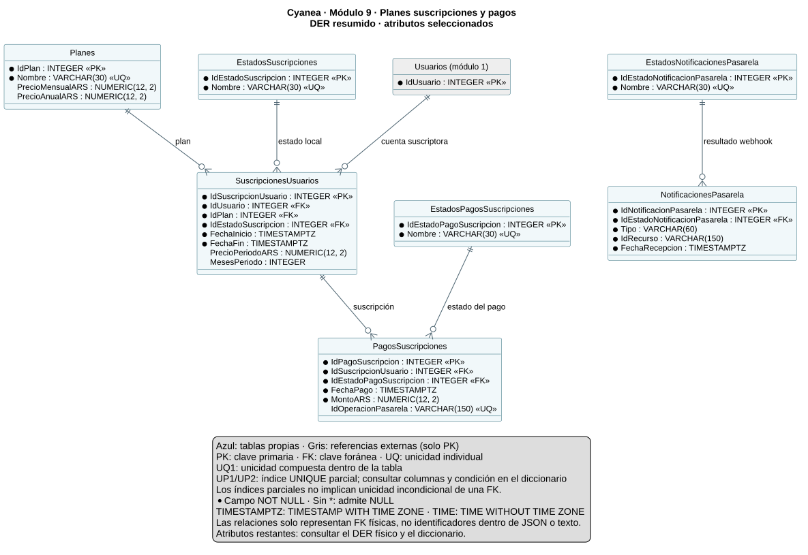

# Modelo de datos del módulo 9 Planes suscripciones y pagos

Este módulo reúne la configuración comercial y los límites de cada plan, las suscripciones de las cuentas, los cobros registrados y la recepción de notificaciones de la pasarela. Distingue el plan vigente del usuario, el estado de la suscripción y el estado de cada pago.

## Alcance y referencias

Versión: 1.0. Fecha: 14 de noviembre de 2026. Corte del código: `616ec79`. PostgreSQL local con Alembic en `b0bcca3ac886`.

Se documentan **7 tablas propias, 51 columnas y 6 claves foráneas**. Usuarios pertenece al módulo 1 y es la única tabla externa referenciada por las FK salientes de este módulo. Usuarios.IdPlan es una FK entrante a Planes desde el módulo 1. AuditoriaPlanes pertenece al módulo 11 y los registros de escaneos exitosos al módulo 6. NotificacionesPasarela registra webhooks de pagos; no es la tabla de avisos a usuarios del módulo 10.

La estructura física se contrastó con PostgreSQL, los modelos y las migraciones; las reglas de aplicación se contrastaron con los servicios. La inspección utiliza metadatos y no incluye filas de usuarios, viajes o conversaciones.

## Diagramas entidad relación



- DER resumido: [vista SVG](der-resumido.svg) y [fuente PlantUML](der-resumido.puml). Incluye todas las tablas y FK, con atributos seleccionados.
- DER físico: [vista SVG](der-fisico.svg) y [fuente PlantUML](der-fisico.puml). Incluye todas las columnas propias.

Los SVG se pueden ampliar sin perder nitidez. Fuentes y vistas se conservan juntas; cada cambio de PlantUML requiere regenerar el SVG. Los diagramas usan Smetana y no requieren Graphviz. Desde la raíz del repositorio:

```powershell
java -jar <ruta-a-plantuml.jar> -charset UTF-8 -tsvg docs/modelo-datos/modulo-09-planes-suscripciones-pagos/der-resumido.puml
java -jar <ruta-a-plantuml.jar> -charset UTF-8 -tsvg docs/modelo-datos/modulo-09-planes-suscripciones-pagos/der-fisico.puml
```

## Entidades

| Tabla propia | Responsabilidad |
|---|---|
| Planes | Catálogo de planes, precios en ARS y cinco límites de consumo. |
| EstadosSuscripciones | Catálogo de estados locales de las suscripciones. |
| SuscripcionesUsuarios | Suscripción de una cuenta, modalidad, tarifa contratada, período registrado y datos mínimos de integración externa. |
| EstadosPagosSuscripciones | Catálogo de estados de cobros o intentos. |
| PagosSuscripciones | Historial financiero mínimo de cobros, sus estados y los períodos a los que se aplican. |
| EstadosNotificacionesPasarela | Catálogo de resultados de procesamiento de webhooks. |
| NotificacionesPasarela | Registro mínimo de recepciones de la pasarela, con recurso, resultado y error opcional. |

## Relaciones físicas y cardinalidades

Una FK obligatoria exige exactamente un padre por fila hija; una FK nullable permite cero o uno. El máximo de hijos solo se reduce a uno cuando hay unicidad incondicional de la FK. Los índices parciales se explican por separado y no se generalizan como relaciones 1 a 1.

| Tabla padre y clave | Tabla hija y campo FK | Padres por fila hija | Hijos por fila padre | ON DELETE | ON UPDATE |
|---|---|---|---|---|---|
| EstadosSuscripciones(IdEstadoSuscripcion) | SuscripcionesUsuarios.IdEstadoSuscripcion | Exactamente uno | Cero o muchos | NO ACTION | NO ACTION |
| Planes(IdPlan) | SuscripcionesUsuarios.IdPlan | Exactamente uno | Cero o muchos | NO ACTION | NO ACTION |
| Usuarios(IdUsuario) | SuscripcionesUsuarios.IdUsuario | Exactamente uno | Cero o muchos | NO ACTION | NO ACTION |
| EstadosPagosSuscripciones(IdEstadoPagoSuscripcion) | PagosSuscripciones.IdEstadoPagoSuscripcion | Exactamente uno | Cero o muchos | NO ACTION | NO ACTION |
| SuscripcionesUsuarios(IdSuscripcionUsuario) | PagosSuscripciones.IdSuscripcionUsuario | Exactamente uno | Cero o muchos | NO ACTION | NO ACTION |
| EstadosNotificacionesPasarela(IdEstadoNotificacionPasarela) | NotificacionesPasarela.IdEstadoNotificacionPasarela | Exactamente uno | Cero o muchos | NO ACTION | NO ACTION |

Las acciones físicas de las FK son distintas de los cascade del ORM, las bajas lógicas y los permisos de cada operación. Las FK simples tampoco garantizan por sí solas coherencia entre viaje y día cuando ambos se referencian por separado.

## Convenciones del diccionario

PK indica clave primaria; FK, clave foránea; UQ, unicidad individual; UQ1, unicidad compuesta dentro de esa tabla. UP1 y UP2 identifican índices UNIQUE parciales dentro de cada tabla: su condición figura en las restricciones y no implica unicidad individual o global de sus columnas.

«Admite NULL» representa nulabilidad física. «Predeterminado BD» contiene defaults del servidor; «—» indica ausencia de default. Los defaults exclusivamente de aplicación se aclaran en las descripciones y reglas. Las secuencias generan identificadores; no se asumen identificadores fijos salvo en los catálogos que lo requieren. TIMESTAMPTZ abrevia TIMESTAMP WITH TIME ZONE; TIME, TIME WITHOUT TIME ZONE. VARCHAR sin longitud no tiene límite declarado; TEXT no equivale a JSON. Los índices de respaldo de PK y UNIQUE no se repiten como índices adicionales.

## Diccionario de datos

### 1 Planes

Catálogo de planes, precios en ARS y cinco límites de consumo.

| Campo | Tipo PostgreSQL | Admite NULL | Clave | Predeterminado BD | Descripción |
|---|---|---|---|---|---|
| IdPlan | INTEGER | No | PK | Secuencia | Identificador del plan. El catálogo usa 1 = gratuito y 2 = pro, aunque la columna física tenga secuencia. |
| Nombre | VARCHAR(30) | No | UQ | — | Nombre único del plan; los valores maestros son gratuito y pro. |
| MaxParticipantesViaje | INTEGER | Sí | — | — | Límite de participantes aceptados por viaje. NULL representa ilimitado; CHECK > 0 si se informa. |
| Activo | BOOLEAN | No | — | true | Disponibilidad del valor maestro o lugar; no reemplaza un estado de participación o sugerencia. |
| MaxViajesActivos | INTEGER | Sí | — | — | Límite de viajes activos administrados. NULL representa ilimitado; sin CHECK positivo físico. |
| MaxSugerenciasDiarias | INTEGER | Sí | — | — | Límite de solicitudes de sugerencias por viaje y día. NULL representa ilimitado; sin CHECK positivo físico. |
| MaxEscaneosMensuales | INTEGER | Sí | — | — | Límite de escaneos exitosos por usuario y mes calendario. NULL representa ilimitado; sin CHECK positivo físico. |
| MaxAlmacenamientoMb | INTEGER | Sí | — | — | Límite de almacenamiento del repositorio por viaje, en MB según el dominio. NULL representa ilimitado; sin CHECK positivo físico. |
| PrecioMensualARS | NUMERIC(12, 2) | Sí | — | — | Tarifa mensual configurada para Pro, en pesos argentinos. Nullable y CHECK > 0 si se informa. |
| PrecioAnualARS | NUMERIC(12, 2) | Sí | — | — | Tarifa anual configurada para Pro, en pesos argentinos. Nullable y CHECK > 0 si se informa. |

Restricciones e índices:

- PK `Planes_pkey`: (IdPlan).
- UNIQUE `Planes_Nombre_key`: (Nombre).
- CHECK `CK_Planes_CupoPositivo`: `"MaxParticipantesViaje" > 0`.
- CHECK `CK_Planes_PrecioAnualARS`: `"PrecioAnualARS" IS NULL OR "PrecioAnualARS" > 0::numeric`.
- CHECK `CK_Planes_PrecioMensualARS`: `"PrecioMensualARS" IS NULL OR "PrecioMensualARS" > 0::numeric`.

### 2 EstadosSuscripciones

Catálogo de estados locales de las suscripciones.

| Campo | Tipo PostgreSQL | Admite NULL | Clave | Predeterminado BD | Descripción |
|---|---|---|---|---|---|
| IdEstadoSuscripcion | INTEGER | No | PK | Secuencia | Identificador autogenerado del estado de suscripción. |
| Nombre | VARCHAR(30) | No | UQ | — | Nombre único: activa, pendiente_pago, cancelada o vencida según los datos maestros. |
| Descripcion | VARCHAR(200) | Sí | — | — | Descripción opcional del estado local de suscripción. |
| Activo | BOOLEAN | No | — | true | Disponibilidad del valor maestro o lugar; no reemplaza un estado de participación o sugerencia. |

Restricciones e índices:

- PK `EstadosSuscripciones_pkey`: (IdEstadoSuscripcion).
- UNIQUE `EstadosSuscripciones_Nombre_key`: (Nombre).

### 3 SuscripcionesUsuarios

Suscripción de una cuenta, modalidad, tarifa contratada, período registrado y datos mínimos de integración externa.

| Campo | Tipo PostgreSQL | Admite NULL | Clave | Predeterminado BD | Descripción |
|---|---|---|---|---|---|
| IdSuscripcionUsuario | INTEGER | No | PK | Secuencia | Identificador autogenerado de la suscripción de la cuenta. |
| IdUsuario | INTEGER | No | FK | — | Cuenta propietaria de la suscripción; FK a Usuarios. |
| IdPlan | INTEGER | No | FK | — | Plan asociado al registro de suscripción o auditoría; FK a Planes. |
| IdEstadoSuscripcion | INTEGER | No | FK | — | Estado local de la suscripción; FK a EstadosSuscripciones. |
| FechaInicio | TIMESTAMPTZ | No | — | — | Inicio del período vigente registrado. Se actualiza al activar o renovar según el servicio. |
| FechaFin | TIMESTAMPTZ | No | — | — | Fin del período registrado; debe ser posterior a FechaInicio por CHECK. |
| FechaCancelacion | TIMESTAMPTZ | Sí | — | — | Instante registrado de cancelación; NULL cuando no se conserva una cancelación vigente. |
| FechaCreacion | TIMESTAMPTZ | No | — | now() | Instante de creación; default now() del servidor. |
| PrecioPeriodoARS | NUMERIC(12, 2) | Sí | — | — | Tarifa contratada conservada por la suscripción. Nullable para datos históricos; CHECK > 0 si se informa. |
| MesesPeriodo | INTEGER | Sí | — | — | Modalidad del período: 1 mensual o 12 anual. Nullable para datos históricos; dominio protegido por CHECK. |
| IdSuscripcionPasarela | VARCHAR(150) | Sí | UQ | — | Identificador externo de suscripción, nullable y UNIQUE. Es texto, no una FK a otra tabla local. |
| EstadoPasarela | VARCHAR(30) | Sí | — | — | Estado textual de la suscripción externa; distinto del estado local, sin CHECK de dominio. |
| FechaAceptacionRenovacion | TIMESTAMPTZ | Sí | — | — | Instante registrado de aceptación de la renovación automática; opcional. |
| FechaAvisoFinalizacion | TIMESTAMPTZ | Sí | — | — | Marca opcional del aviso previo de finalización, utilizada para no reiterarlo en el flujo. |
| FechaFinalizacion | TIMESTAMPTZ | Sí | — | — | Instante de finalización efectivamente procesada; opcional. |
| FechaPendientePago | TIMESTAMPTZ | Sí | — | — | Instante en que un rechazo de renovación llevó la suscripción a pendiente_pago; permite calcular su plazo de regularización. |

Restricciones e índices:

- PK `SuscripcionesUsuarios_pkey`: (IdSuscripcionUsuario).
- FK `FK_SuscUsuarios_EstSusc_IdEstadoSuscripcion`: (IdEstadoSuscripcion) → EstadosSuscripciones(IdEstadoSuscripcion); ON DELETE NO ACTION; ON UPDATE NO ACTION.
- FK `FK_SuscUsuarios_Planes_IdPlan`: (IdPlan) → Planes(IdPlan); ON DELETE NO ACTION; ON UPDATE NO ACTION.
- FK `FK_SuscUsuarios_Usuarios_IdUsuario`: (IdUsuario) → Usuarios(IdUsuario); ON DELETE NO ACTION; ON UPDATE NO ACTION.
- UNIQUE `UQ_SuscripcionesUsuarios_IdSuscripcionPasarela`: (IdSuscripcionPasarela).
- CHECK `CK_SuscripcionesUsuarios_Fechas`: `"FechaFin" > "FechaInicio"`.
- CHECK `CK_SuscripcionesUsuarios_Periodo`: `"MesesPeriodo" IS NULL OR ("MesesPeriodo" = ANY (ARRAY[1, 12]))`.
- CHECK `CK_SuscripcionesUsuarios_Precio`: `"PrecioPeriodoARS" IS NULL OR "PrecioPeriodoARS" > 0::numeric`.
- Índice `IX_SuscripcionesUsuarios_Estado_FechaFin`: (IdEstadoSuscripcion, FechaFin).
- Índice `IX_SuscripcionesUsuarios_FechaPendientePago`: (FechaPendientePago).
- Índice `IX_SuscripcionesUsuarios_Usuario_Estado`: (IdUsuario, IdEstadoSuscripcion).

### 4 EstadosPagosSuscripciones

Catálogo de estados de cobros o intentos.

| Campo | Tipo PostgreSQL | Admite NULL | Clave | Predeterminado BD | Descripción |
|---|---|---|---|---|---|
| IdEstadoPagoSuscripcion | INTEGER | No | PK | Secuencia | Identificador autogenerado del estado de pago. |
| Nombre | VARCHAR(30) | No | UQ | — | Nombre único del estado de pago: aprobado, rechazado o pendiente. |
| Activo | BOOLEAN | No | — | true | Disponibilidad del valor maestro o lugar; no reemplaza un estado de participación o sugerencia. |

Restricciones e índices:

- PK `EstadosPagosSuscripciones_pkey`: (IdEstadoPagoSuscripcion).
- UNIQUE `EstadosPagosSuscripciones_Nombre_key`: (Nombre).

### 5 PagosSuscripciones

Historial financiero mínimo de cobros, sus estados y los períodos a los que se aplican.

| Campo | Tipo PostgreSQL | Admite NULL | Clave | Predeterminado BD | Descripción |
|---|---|---|---|---|---|
| IdPagoSuscripcion | INTEGER | No | PK | Secuencia | Identificador autogenerado del cobro o intento de cobro. |
| IdSuscripcionUsuario | INTEGER | No | FK | — | Suscripción a la que se asocia un pago; FK a SuscripcionesUsuarios. |
| IdEstadoPagoSuscripcion | INTEGER | No | FK | — | Estado del intento de cobro; FK a EstadosPagosSuscripciones. |
| FechaPago | TIMESTAMPTZ | No | — | — | Fecha del cobro o intento registrado, asignada por el servicio; no tiene default físico. |
| MontoARS | NUMERIC(12, 2) | No | — | — | Monto del cobro o intento, en pesos argentinos; NUMERIC(12,2) y CHECK > 0. |
| IdOperacionPasarela | VARCHAR(150) | Sí | UQ | — | Identificador externo de operación, nullable y UNIQUE. Permite actualizar un mismo cobro sin duplicarlo. |
| PeriodoDesde | TIMESTAMPTZ | Sí | — | — | Inicio del período que el cobro paga o intentaba pagar. Nullable para registros históricos. |
| PeriodoHasta | TIMESTAMPTZ | Sí | — | — | Fin del período que el cobro paga o intentaba pagar. Nullable; el CHECK compara las fechas cuando ambas están informadas. |

Restricciones e índices:

- PK `PagosSuscripciones_pkey`: (IdPagoSuscripcion).
- FK `PagosSuscripciones_IdEstadoPagoSuscripcion_fkey`: (IdEstadoPagoSuscripcion) → EstadosPagosSuscripciones(IdEstadoPagoSuscripcion); ON DELETE NO ACTION; ON UPDATE NO ACTION.
- FK `PagosSuscripciones_IdSuscripcionUsuario_fkey`: (IdSuscripcionUsuario) → SuscripcionesUsuarios(IdSuscripcionUsuario); ON DELETE NO ACTION; ON UPDATE NO ACTION.
- UNIQUE `PagosSuscripciones_IdOperacionPasarela_key`: (IdOperacionPasarela).
- CHECK `CK_PagosSuscripciones_MontoPositivo`: `"MontoARS" > 0::numeric`.
- CHECK `CK_PagosSuscripciones_Periodo`: `"PeriodoDesde" IS NULL AND "PeriodoHasta" IS NULL OR "PeriodoHasta" > "PeriodoDesde"`.
- Índice `ix_PagosSuscripciones_FechaPago`: (FechaPago).
- Índice `ix_PagosSuscripciones_IdEstadoPagoSuscripcion`: (IdEstadoPagoSuscripcion).
- Índice `ix_PagosSuscripciones_IdSuscripcionUsuario`: (IdSuscripcionUsuario).

### 6 EstadosNotificacionesPasarela

Catálogo de resultados de procesamiento de webhooks.

| Campo | Tipo PostgreSQL | Admite NULL | Clave | Predeterminado BD | Descripción |
|---|---|---|---|---|---|
| IdEstadoNotificacionPasarela | INTEGER | No | PK | Secuencia | Identificador autogenerado del estado de procesamiento de webhook. |
| Nombre | VARCHAR(30) | No | UQ | — | Nombre único del resultado: procesada, ignorada o error. |
| Activo | BOOLEAN | No | — | true | Disponibilidad del valor maestro o lugar; no reemplaza un estado de participación o sugerencia. |

Restricciones e índices:

- PK `EstadosNotificacionesPasarela_pkey`: (IdEstadoNotificacionPasarela).
- UNIQUE `EstadosNotificacionesPasarela_Nombre_key`: (Nombre).

### 7 NotificacionesPasarela

Registro mínimo de recepciones de la pasarela, con recurso, resultado y error opcional.

| Campo | Tipo PostgreSQL | Admite NULL | Clave | Predeterminado BD | Descripción |
|---|---|---|---|---|---|
| IdNotificacionPasarela | INTEGER | No | PK | Secuencia | Identificador autogenerado de una recepción registrada de webhook. |
| IdEstadoNotificacionPasarela | INTEGER | No | FK | — | Resultado del procesamiento del webhook; FK a EstadosNotificacionesPasarela. |
| Tipo | VARCHAR(60) | No | — | — | Tipo de recurso o evento de la pasarela, en texto; no referencia el tipo de notificación al usuario. |
| IdRecurso | VARCHAR(150) | No | — | — | Identificador del recurso en la pasarela, almacenado como texto sin FK local. |
| IdSolicitudPasarela | VARCHAR(150) | Sí | — | — | Identificador opcional del request de la pasarela; no tiene UNIQUE ni FK. |
| Error | VARCHAR(500) | Sí | — | — | Descripción opcional del error de procesamiento, hasta 500 caracteres; no es el cuerpo completo del webhook. |
| FechaRecepcion | TIMESTAMPTZ | No | — | now() | Instante de registro de recepción; default físico now(). |

Restricciones e índices:

- PK `NotificacionesPasarela_pkey`: (IdNotificacionPasarela).
- FK `NotificacionesPasarela_IdEstadoNotificacionPasarela_fkey`: (IdEstadoNotificacionPasarela) → EstadosNotificacionesPasarela(IdEstadoNotificacionPasarela); ON DELETE NO ACTION; ON UPDATE NO ACTION.
- Índice `IX_NotificacionesPasarela_Estado_Fecha`: (IdEstadoNotificacionPasarela, FechaRecepcion).
- Índice `IX_NotificacionesPasarela_Recurso`: (Tipo, IdRecurso).

## Identificadores externos y valores derivados

| Campo | Tipo físico | Interpretación |
|---|---|---|
| SuscripcionesUsuarios.IdSuscripcionPasarela | VARCHAR(150) nullable y UNIQUE | Identificador de suscripción en la pasarela. No es una FK a PagosSuscripciones o NotificacionesPasarela. |
| PagosSuscripciones.IdOperacionPasarela | VARCHAR(150) nullable y UNIQUE | Identifica un cobro externo. El servicio registra o actualiza una fila por ese cobro. |
| NotificacionesPasarela.IdRecurso e IdSolicitudPasarela | VARCHAR(150) | Referencias externas sin FK. Los webhooks repetidos no se prohíben mediante UNIQUE sobre estas columnas. |
| Ingresos, ahorro anual y consumo disponible | Calculados | No existen tablas de balance de ingresos o cupos restantes en este módulo. |

## Reglas funcionales y particularidades del esquema

1. **Planes y estado de cuenta.** Los valores maestros son gratuito = 1 y pro = 2. El plan efectivo se obtiene de Usuarios.IdPlan, no únicamente de la existencia de una suscripción activa. No hay una restricción física entre esa FK y el estado de la última suscripción; los servicios mantienen las transiciones del dominio.
2. **Límites y precios.** Los cinco límites y las dos tarifas admiten NULL físicamente. Para los límites, NULL representa ilimitado en la lectura de datos heredados. La gestión comercial exige completar valores numéricos positivos y límites Pro mayores o iguales a gratuito; esos controles de conjunto son de aplicación. La base comprueba positividad de MaxParticipantesViaje y de precios informados, sin CHECK positivo sobre los otros cuatro límites.
3. **Tarifa contratada y renovaciones.** crear_periodo copia la tarifa vigente del plan a PrecioPeriodoARS y la modalidad a MesesPeriodo. El flujo actual de renovación mueve FechaInicio/FechaFin y el estado de la misma fila de suscripción; _renovar no vuelve a consultar la tarifa de Planes. No se debe deducir del esquema que editar un precio reescriba automáticamente los cobros futuros. MontoARS y las fechas de cada pago conservan los datos efectivamente registrados por el flujo de cobro.
4. **Períodos e historial.** SuscripcionesUsuarios no es necesariamente una fila nueva por cada renovación: sus fechas pueden avanzar. PagosSuscripciones.PeriodoDesde y PeriodoHasta conservan el período que pagaba o intentaba pagar cada operación. Sus valores pueden ser NULL en datos históricos; no se reconstruyen como si siempre coincidieran con las fechas actuales de la suscripción.
5. **CHECK y valores NULL en pagos.** CK_PagosSuscripciones_Periodo permite ambos extremos NULL o compara PeriodoHasta > PeriodoDesde. Por la lógica SQL de NULL, esa expresión no garantiza por sí sola que los extremos estén ambos informados o ambos ausentes: una sola fecha puede dar UNKNOWN y ser aceptada por CHECK. La coherencia completa requiere el flujo de aplicación.
6. **Estados diferenciados.** Las suscripciones usan activa, pendiente_pago, cancelada y vencida. Los pagos usan aprobado, rechazado y pendiente. El estado de la pasarela se conserva en EstadoPasarela como texto, sin FK al catálogo local. FechaPendientePago permite calcular el plazo de regularización de una renovación rechazada; no es equivalente a FechaCancelacion.
7. **Idempotencia y cobros.** IdOperacionPasarela es UNIQUE cuando está informado. El servicio localiza el cobro por ese identificador y actualiza la fila al cambiar de estado, sin duplicar la aprobación ni renovar dos veces por una recepción repetida. No existe una tabla separada con cada cambio de estado del mismo pago. Los NULL históricos no quedan limitados a una sola fila por UNIQUE.
8. **Recepción de webhooks.** NotificacionesPasarela guarda tipo, recurso, request, resultado y error acotado; no tiene FK a la suscripción ni al pago. Los estados son procesada, ignorada y error. La autenticidad y el resultado financiero se verifican por los servicios contra la pasarela. No existe UNIQUE de recepción por request o recurso; la idempotencia financiera no depende de prohibir estas filas repetidas.
9. **Datos financieros mínimos.** Las tablas no tienen columnas de número de tarjeta, CVV, vencimiento de tarjeta ni cuerpo crudo de la respuesta de la pasarela. El error de procesamiento es texto acotado. Los importes se expresan en ARS por el contrato; no hay FK a Monedas en estas tablas.
10. **Cancelación y finalización.** La cancelación puede mantener los beneficios hasta el fin abonado. El servicio de finalización procesa el retorno al plan gratuito y registra sus marcas temporales y avisos; la base no ejecuta esa transición por un CHECK al llegar la fecha. FechaAvisoFinalizacion y FechaFinalizacion son marcas del proceso, no nuevas entidades de entrega de notificaciones.
11. **Conservación y límites inmediatos.** Los límites se consultan desde la configuración y se aplican a nuevas operaciones sin borrar recursos previos. Los cambios de plan no tienen CASCADE sobre viajes, documentos o gastos. Las FK salientes de este módulo usan NO ACTION; una baja lógica de usuario no equivale a eliminar sus suscripciones y pagos físicamente.
12. **Ingresos y consulta administrativa.** El total aprobado se obtiene de los pagos con estado aprobado para el filtro aplicado, no sumando PrecioPeriodoARS de suscripciones. Las consultas propias se restringen a la cuenta y las del backoffice a administradores. La restricción de rol y la unicidad funcional de una suscripción vigente se validan en los servicios; no hay un índice UNIQUE por usuario y estado activo en PostgreSQL.

## Fuentes del modelo

- Modelos: [plan](../../../backend/app/models/plan.py), [estado_suscripcion](../../../backend/app/models/estado_suscripcion.py), [suscripcion_usuario](../../../backend/app/models/suscripcion_usuario.py), [pago_suscripcion](../../../backend/app/models/pago_suscripcion.py), [notificacion_pasarela](../../../backend/app/models/notificacion_pasarela.py).
- Servicios: [precios_suscripciones.py](../../../backend/app/services/precios_suscripciones.py), [suscripcion_pro.py](../../../backend/app/services/suscripcion_pro.py), [fin_suscripciones.py](../../../backend/app/services/fin_suscripciones.py), [pagos/notificaciones_pasarela.py](../../../backend/app/services/pagos/notificaciones_pasarela.py), [backoffice/planes_service.py](../../../backend/app/services/backoffice/planes_service.py), [backoffice/suscripciones_service.py](../../../backend/app/services/backoffice/suscripciones_service.py).
- [backend/app/api/routes/suscripciones.py](../../../backend/app/api/routes/suscripciones.py).
- [Migraciones Alembic](../../../backend/alembic/versions) y [convenciones del proyecto](../../../AGENTS.md).
- Metadatos del esquema PostgreSQL local: columnas, tipos, PK, FK, UNIQUE, CHECK, índices y predicados, identity y defaults.
