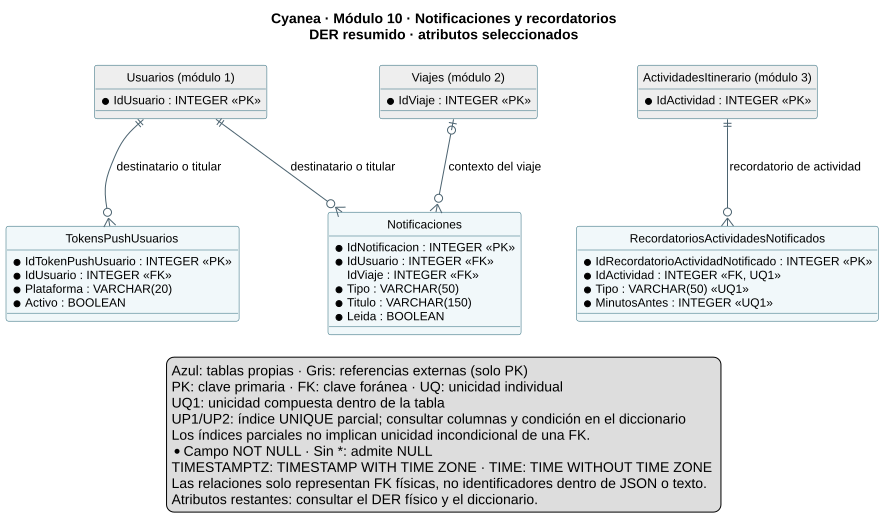

# Modelo de datos del módulo 10 Notificaciones y recordatorios

Este módulo registra los avisos internos destinados a las cuentas, los dispositivos habilitados para push y las marcas que evitan repetir recordatorios de actividades. El envío por correo o push utiliza servicios compartidos y preferencias del usuario.

## Alcance y referencias

Versión: 1.0. Fecha: 14 de noviembre de 2026. Corte del código: `616ec79`. PostgreSQL local con Alembic en `b0bcca3ac886`.

Se documentan **3 tablas propias, 22 columnas y 4 claves foráneas**. Usuarios pertenece al módulo 1, Viajes al módulo 2 y ActividadesItinerario al módulo 3. Los consentimientos y preferencias por canal permanecen en Usuarios y no se duplican aquí. Los avisos de finalización de suscripción usan marcas del módulo 9; NotificacionesPasarela también pertenece al 9 y registra webhooks, no notificaciones a personas.

La estructura física se contrastó con PostgreSQL, los modelos y las migraciones; las reglas de aplicación se contrastaron con los servicios. La inspección utiliza metadatos y no incluye filas de usuarios, viajes o conversaciones.

## Diagramas entidad relación



- DER resumido: [vista SVG](der-resumido.svg) y [fuente PlantUML](der-resumido.puml). Incluye todas las tablas y FK, con atributos seleccionados.
- DER físico: [vista SVG](der-fisico.svg) y [fuente PlantUML](der-fisico.puml). Incluye todas las columnas propias.

Los SVG se pueden ampliar sin perder nitidez. Fuentes y vistas se conservan juntas; cada cambio de PlantUML requiere regenerar el SVG. Los diagramas usan Smetana y no requieren Graphviz. Desde la raíz del repositorio:

```powershell
java -jar <ruta-a-plantuml.jar> -charset UTF-8 -tsvg docs/modelo-datos/modulo-10-notificaciones-recordatorios/der-resumido.puml
java -jar <ruta-a-plantuml.jar> -charset UTF-8 -tsvg docs/modelo-datos/modulo-10-notificaciones-recordatorios/der-fisico.puml
```

## Entidades

| Tabla propia | Responsabilidad |
|---|---|
| Notificaciones | Avisos internos por destinatario, con contenido, viaje opcional y marca de lectura. |
| TokensPushUsuarios | Registro de tokens push de dispositivos asociados a cuentas, con actividad y fechas. |
| RecordatoriosActividadesNotificados | Marca única por actividad, tipo y anticipación para evitar repetir un recordatorio. |

## Relaciones físicas y cardinalidades

Una FK obligatoria exige exactamente un padre por fila hija; una FK nullable permite cero o uno. El máximo de hijos solo se reduce a uno cuando hay unicidad incondicional de la FK. Los índices parciales se explican por separado y no se generalizan como relaciones 1 a 1.

| Tabla padre y clave | Tabla hija y campo FK | Padres por fila hija | Hijos por fila padre | ON DELETE | ON UPDATE |
|---|---|---|---|---|---|
| Usuarios(IdUsuario) | Notificaciones.IdUsuario | Exactamente uno | Cero o muchos | NO ACTION | NO ACTION |
| Viajes(IdViaje) | Notificaciones.IdViaje | Cero o uno | Cero o muchos | NO ACTION | NO ACTION |
| Usuarios(IdUsuario) | TokensPushUsuarios.IdUsuario | Exactamente uno | Cero o muchos | NO ACTION | NO ACTION |
| ActividadesItinerario(IdActividad) | RecordatoriosActividadesNotificados.IdActividad | Exactamente uno | Cero o muchos | CASCADE | NO ACTION |

Las acciones físicas de las FK son distintas de los cascade del ORM, las bajas lógicas y los permisos de cada operación. Las FK simples tampoco garantizan por sí solas coherencia entre viaje y día cuando ambos se referencian por separado.

## Convenciones del diccionario

PK indica clave primaria; FK, clave foránea; UQ, unicidad individual; UQ1, unicidad compuesta dentro de esa tabla. UP1 y UP2 identifican índices UNIQUE parciales dentro de cada tabla: su condición figura en las restricciones y no implica unicidad individual o global de sus columnas.

«Admite NULL» representa nulabilidad física. «Predeterminado BD» contiene defaults del servidor; «—» indica ausencia de default. Los defaults exclusivamente de aplicación se aclaran en las descripciones y reglas. Las secuencias generan identificadores; no se asumen identificadores fijos salvo en los catálogos que lo requieren. TIMESTAMPTZ abrevia TIMESTAMP WITH TIME ZONE; TIME, TIME WITHOUT TIME ZONE. VARCHAR sin longitud no tiene límite declarado; TEXT no equivale a JSON. Los índices de respaldo de PK y UNIQUE no se repiten como índices adicionales.

## Diccionario de datos

### 1 Notificaciones

Avisos internos por destinatario, con contenido, viaje opcional y marca de lectura.

| Campo | Tipo PostgreSQL | Admite NULL | Clave | Predeterminado BD | Descripción |
|---|---|---|---|---|---|
| IdNotificacion | INTEGER | No | PK | Secuencia | Identificador autogenerado de la notificación interna. |
| IdUsuario | INTEGER | No | FK | — | Cuenta destinataria de la notificación; FK obligatoria a Usuarios. |
| IdViaje | INTEGER | Sí | FK | — | Viaje al que se refiere la notificación, si corresponde; FK nullable. |
| Tipo | VARCHAR(50) | No | — | — | Tipo lógico de aviso, almacenado como VARCHAR sin ENUM ni CHECK de valores. |
| Titulo | VARCHAR(150) | No | — | — | Título visible de la notificación interna; VARCHAR(150). |
| Mensaje | TEXT | No | — | — | Texto del aviso; TEXT obligatorio. |
| Leida | BOOLEAN | No | — | false | Marca de lectura del aviso dentro de la aplicación; default false. No representa entrega de email o push. |
| FechaCreacion | TIMESTAMPTZ | No | — | now() | Instante de creación; default now() del servidor. |

Restricciones e índices:

- PK `Notificaciones_pkey`: (IdNotificacion).
- FK `FK_Notificaciones_Usuarios_IdUsuario`: (IdUsuario) → Usuarios(IdUsuario); ON DELETE NO ACTION; ON UPDATE NO ACTION.
- FK `FK_Notificaciones_Viajes_IdViaje`: (IdViaje) → Viajes(IdViaje); ON DELETE NO ACTION; ON UPDATE NO ACTION.
- Sin índices adicionales a la PK.

### 2 TokensPushUsuarios

Registro de tokens push de dispositivos asociados a cuentas, con actividad y fechas.

| Campo | Tipo PostgreSQL | Admite NULL | Clave | Predeterminado BD | Descripción |
|---|---|---|---|---|---|
| IdTokenPushUsuario | INTEGER | No | PK | Secuencia | Identificador autogenerado del registro de dispositivo push. |
| IdUsuario | INTEGER | No | FK | — | Cuenta a la que está asociado el token push. |
| Token | VARCHAR(255) | No | UQ | — | Token del proveedor de push, almacenado como texto y protegido por UNIQUE global. No es un token de inicio de sesión. |
| Plataforma | VARCHAR(20) | No | — | — | Plataforma del dispositivo, en VARCHAR(20), sin CHECK o ENUM físico. |
| DispositivoId | VARCHAR(120) | Sí | — | — | Identificador opcional del dispositivo, sin UNIQUE físico. |
| Activo | BOOLEAN | No | — | true | Disponibilidad del valor maestro o lugar; no reemplaza un estado de participación o sugerencia. |
| FechaAlta | TIMESTAMPTZ | No | — | now() | Instante de alta del registro push; default now(). |
| FechaActualizacion | TIMESTAMPTZ | No | — | now() | Instante de última actualización; default físico now() y onupdate definido por SQLAlchemy. |
| FechaBaja | TIMESTAMPTZ | Sí | — | — | Instante opcional de desactivación del registro push. |

Restricciones e índices:

- PK `TokensPushUsuarios_pkey`: (IdTokenPushUsuario).
- FK `FK_TokensPushUsuarios_Usuarios_IdUsuario`: (IdUsuario) → Usuarios(IdUsuario); ON DELETE NO ACTION; ON UPDATE NO ACTION.
- UNIQUE `UX_TokensPushUsuarios_Token`: (Token).

### 3 RecordatoriosActividadesNotificados

Marca única por actividad, tipo y anticipación para evitar repetir un recordatorio.

| Campo | Tipo PostgreSQL | Admite NULL | Clave | Predeterminado BD | Descripción |
|---|---|---|---|---|---|
| IdRecordatorioActividadNotificado | INTEGER | No | PK | Secuencia | Identificador autogenerado de la marca de recordatorio. |
| IdActividad | INTEGER | No | FK, UQ1 | — | Actividad que origina el recordatorio; FK con ON DELETE CASCADE, parte de la unicidad compuesta. |
| Tipo | VARCHAR(50) | No | UQ1 | — | Tipo de recordatorio; el flujo de inicio utiliza inicio_actividad. Texto sin CHECK. |
| MinutosAntes | INTEGER | No | UQ1 | — | Anticipación del recordatorio, en minutos; parte del UNIQUE compuesto, sin CHECK de rango físico. |
| FechaNotificacion | TIMESTAMPTZ | No | — | now() | Instante de registro de la marca del recordatorio; no es una confirmación de recepción por cada destinatario. |

Restricciones e índices:

- PK `RecordatoriosActividadesNotificados_pkey`: (IdRecordatorioActividadNotificado).
- FK `FK_RecordatoriosActNotif_ActividadesItinerario_IdActividad`: (IdActividad) → ActividadesItinerario(IdActividad); ON DELETE CASCADE; ON UPDATE NO ACTION.
- UNIQUE `UX_RecordatoriosActividadesNotificados_Actividad_Tipo_Minutos` (UQ1): (IdActividad, Tipo, MinutosAntes).

## Tipos lógicos y datos no persistidos

| Campo | Tipo físico | Interpretación |
|---|---|---|
| Notificaciones.Tipo y RecordatoriosActividadesNotificados.Tipo | VARCHAR(50) | Valores lógicos de aplicación; no son ENUM PostgreSQL ni FK a una tabla de tipos. |
| TokensPushUsuarios.Token | VARCHAR(255) UNIQUE | Identificador del proveedor de push. No representa un JWT de sesión y no debe incluirse como valor real en ejemplos. |
| Tickets de push, metadata de navegación y entrega por canal | No persistidos en estas tablas | Se procesan en los servicios y no se dibujan como columnas o relaciones adicionales. |

## Reglas funcionales y particularidades del esquema

1. **Destinatario y contexto.** Cada Notificacion pertenece a una cuenta. IdViaje es opcional y aporta contexto; la notificación puede ser de la cuenta sin referir un viaje. Las FK no comprueban que el destinatario sea integrante de ese viaje, por lo que el flujo de origen debe seleccionar destinatarios válidos.
2. **Lectura y entrega.** Leida indica consulta del aviso dentro de la aplicación. No es confirmación de entrega de un correo o push. No hay FechaLectura, estado de entrega por canal, número de reintentos ni tabla de mensajes de correo en este módulo.
3. **Tipos y preferencias.** Tipo es texto sin catálogo persistido ni CHECK. NotificationType es una enumeración de código utilizada por los servicios, no un ENUM nativo de la base. Los consentimientos generales y las preferencias de eventos por correo/push se documentan en Usuarios, módulo 1; deben evaluarse junto con el estado de la cuenta antes de despachar.
4. **Dispositivos y unicidad.** Token tiene UNIQUE global. Una cuenta puede tener varios registros de dispositivo; DispositivoId no es único y puede ser NULL. La base no impone una sola fila activa por cuenta o dispositivo. Activo y FechaBaja se mantienen mediante la aplicación, sin CHECK que obligue a que ambos reflejen siempre el mismo estado.
5. **Token inválido.** El dispatcher puede desactivar un token que el proveedor informa como DeviceNotRegistered y registrar su FechaBaja. Eso no equivale a suspender la cuenta ni a revocar sus sesiones; los tokens de acceso y las sesiones administrativas pertenecen al módulo 1.
6. **Marca de recordatorio.** UNIQUE (IdActividad, Tipo, MinutosAntes) evita repetir una marca para esa combinación. No contiene IdUsuario: representa el control del recordatorio de la actividad, no un recibo por destinatario. MinutosAntes y Tipo no tienen CHECK de rango o dominio en PostgreSQL.
7. **Despacho y alcance de la marca.** El scheduler registra la marca antes de despachar el aviso. Su existencia no garantiza recepción efectiva por cada participante ni éxito del proveedor externo. El servicio de inicio usa Tipo = inicio_actividad y considera la fecha del día y la hora de la actividad; no crea una cola de entregas individuales en esta tabla.
8. **Traslados y cambios de actividad.** El scheduler excluye los traslados de ida porque su hora representa la llegada. Las reglas de edición y movimiento de actividades pueden limpiar marcas para volver a programar recordatorios. La FK a ActividadesItinerario tiene CASCADE: borrar la actividad elimina sus marcas físicas.
9. **Notificaciones transaccionales.** Correos de confirmación, invitación, renovación o advertencias de IA pueden tener servicios y marcas propias. No debe asumirse que cada correo enviado produce necesariamente una fila en Notificaciones o RecordatoriosActividadesNotificados.
10. **Consulta y seguridad.** Los endpoints restringen la consulta y las marcas de lectura al destinatario autenticado. El contenido puede incluir texto de un viaje; no debe confundirse esta tabla funcional con los registros anonimizados de auditoría. Los tokens push son datos técnicos persistidos y no se exponen como credenciales de acceso a la aplicación.
11. **Fechas y borrado.** FechaActualizacion de TokensPushUsuarios tiene default now() y onupdate de SQLAlchemy, sin presuponer un trigger. Las FK de Notificaciones y TokensPushUsuarios a Usuarios y Viajes usan NO ACTION. Los cascade de relaciones del ORM son un comportamiento distinto y no deben interpretarse como ON DELETE CASCADE físico.

## Fuentes del modelo

- Modelos: [notificacion](../../../backend/app/models/notificacion.py), [token_push_usuario](../../../backend/app/models/token_push_usuario.py), [recordatorio_actividad_notificado](../../../backend/app/models/recordatorio_actividad_notificado.py).
- Servicios: [notifications/dispatcher.py](../../../backend/app/services/notifications/dispatcher.py), [notifications/service.py](../../../backend/app/services/notifications/service.py), [notifications/push.py](../../../backend/app/services/notifications/push.py), [notifications/activity_reminders.py](../../../backend/app/services/notifications/activity_reminders.py).
- [backend/app/api/routes/notificaciones.py](../../../backend/app/api/routes/notificaciones.py).
- [Migraciones Alembic](../../../backend/alembic/versions) y [convenciones del proyecto](../../../AGENTS.md).
- Metadatos del esquema PostgreSQL local: columnas, tipos, PK, FK, UNIQUE, CHECK, índices y predicados, identity y defaults.
