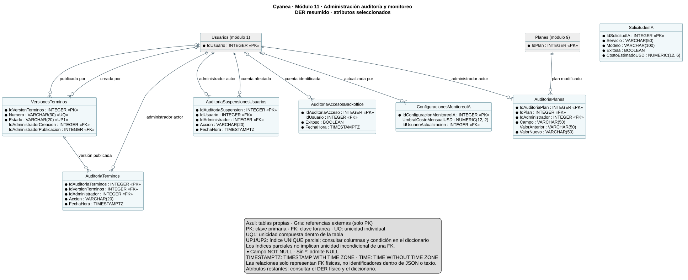

# Modelo de datos del módulo 11 Administración auditoría y monitoreo

Este módulo conserva los registros de acciones administrativas, las versiones de Términos y Condiciones y los metadatos de consumo de los proveedores de IA. Proporciona trazabilidad y monitoreo para el backoffice sin duplicar las entidades de usuarios, planes, pagos o categorías que administra.

## Alcance y referencias

Versión: 1.0. Fecha: 14 de noviembre de 2026. Corte del código: `616ec79`. PostgreSQL local con Alembic en `b0bcca3ac886`.

Se documentan **7 tablas propias, 56 columnas y 10 claves foráneas**. Usuarios pertenece al módulo 1 y Planes al módulo 9. RolesSistema y SesionesBackoffice siguen documentados en el módulo 1; las categorías, suscripciones y pagos permanecen en sus módulos propietarios. Las métricas del panel y la consulta unificada de auditoría se calculan sobre las tablas existentes y no agregan tablas de dashboard o eventos generales.

La estructura física se contrastó con PostgreSQL, los modelos y las migraciones; las reglas de aplicación se contrastaron con los servicios. La inspección utiliza metadatos y no incluye filas de usuarios, viajes o conversaciones.

## Diagramas entidad relación



- DER resumido: [vista SVG](der-resumido.svg) y [fuente PlantUML](der-resumido.puml). Incluye todas las tablas y FK, con atributos seleccionados.
- DER físico: [vista SVG](der-fisico.svg) y [fuente PlantUML](der-fisico.puml). Incluye todas las columnas propias.

Los SVG se pueden ampliar sin perder nitidez. Fuentes y vistas se conservan juntas; cada cambio de PlantUML requiere regenerar el SVG. Los diagramas usan Smetana y no requieren Graphviz. Desde la raíz del repositorio:

```powershell
java -jar <ruta-a-plantuml.jar> -charset UTF-8 -tsvg docs/modelo-datos/modulo-11-administracion-auditoria-monitoreo/der-resumido.puml
java -jar <ruta-a-plantuml.jar> -charset UTF-8 -tsvg docs/modelo-datos/modulo-11-administracion-auditoria-monitoreo/der-fisico.puml
```

## Entidades

| Tabla propia | Responsabilidad |
|---|---|
| AuditoriaAccesosBackoffice | Intentos de acceso administrativo, con resultado, identidad identificada opcional y datos técnicos históricos. |
| AuditoriaSuspensionesUsuarios | Acciones de suspensión o reactivación, con cuenta afectada y administrador. |
| VersionesTerminos | Versiones del contenido legal, su estado de publicación y cuentas administrativas asociadas. |
| AuditoriaTerminos | Publicaciones de versiones de Términos y Condiciones. |
| AuditoriaPlanes | Cambios de configuración de planes, por campo y con valores anterior y nuevo. |
| SolicitudesIA | Metadatos técnicos de una llamada a un proveedor de IA, sin contenidos de prompts o viajes. |
| ConfiguracionesMonitoreoIA | Umbral mensual de costo y marcas de la última alerta de monitoreo. |

## Relaciones físicas y cardinalidades

Una FK obligatoria exige exactamente un padre por fila hija; una FK nullable permite cero o uno. El máximo de hijos solo se reduce a uno cuando hay unicidad incondicional de la FK. Los índices parciales se explican por separado y no se generalizan como relaciones 1 a 1.

| Tabla padre y clave | Tabla hija y campo FK | Padres por fila hija | Hijos por fila padre | ON DELETE | ON UPDATE |
|---|---|---|---|---|---|
| Usuarios(IdUsuario) | AuditoriaAccesosBackoffice.IdUsuario | Cero o uno | Cero o muchos | NO ACTION | NO ACTION |
| Usuarios(IdUsuario) | AuditoriaSuspensionesUsuarios.IdAdministrador | Exactamente uno | Cero o muchos | NO ACTION | NO ACTION |
| Usuarios(IdUsuario) | AuditoriaSuspensionesUsuarios.IdUsuario | Exactamente uno | Cero o muchos | NO ACTION | NO ACTION |
| Usuarios(IdUsuario) | VersionesTerminos.IdAdministradorCreacion | Cero o uno | Cero o muchos | NO ACTION | NO ACTION |
| Usuarios(IdUsuario) | VersionesTerminos.IdAdministradorPublicacion | Cero o uno | Cero o muchos | NO ACTION | NO ACTION |
| Usuarios(IdUsuario) | AuditoriaTerminos.IdAdministrador | Exactamente uno | Cero o muchos | NO ACTION | NO ACTION |
| VersionesTerminos(IdVersionTerminos) | AuditoriaTerminos.IdVersionTerminos | Exactamente uno | Cero o muchos | NO ACTION | NO ACTION |
| Usuarios(IdUsuario) | AuditoriaPlanes.IdAdministrador | Exactamente uno | Cero o muchos | NO ACTION | NO ACTION |
| Planes(IdPlan) | AuditoriaPlanes.IdPlan | Exactamente uno | Cero o muchos | NO ACTION | NO ACTION |
| Usuarios(IdUsuario) | ConfiguracionesMonitoreoIA.IdUsuarioActualizacion | Cero o uno | Cero o muchos | NO ACTION | NO ACTION |

Las acciones físicas de las FK son distintas de los cascade del ORM, las bajas lógicas y los permisos de cada operación. Las FK simples tampoco garantizan por sí solas coherencia entre viaje y día cuando ambos se referencian por separado.

## Convenciones del diccionario

PK indica clave primaria; FK, clave foránea; UQ, unicidad individual; UQ1, unicidad compuesta dentro de esa tabla. UP1 y UP2 identifican índices UNIQUE parciales dentro de cada tabla: su condición figura en las restricciones y no implica unicidad individual o global de sus columnas.

«Admite NULL» representa nulabilidad física. «Predeterminado BD» contiene defaults del servidor; «—» indica ausencia de default. Los defaults exclusivamente de aplicación se aclaran en las descripciones y reglas. Las secuencias generan identificadores; no se asumen identificadores fijos salvo en los catálogos que lo requieren. TIMESTAMPTZ abrevia TIMESTAMP WITH TIME ZONE; TIME, TIME WITHOUT TIME ZONE. VARCHAR sin longitud no tiene límite declarado; TEXT no equivale a JSON. Los índices de respaldo de PK y UNIQUE no se repiten como índices adicionales.

## Diccionario de datos

### 1 AuditoriaAccesosBackoffice

Intentos de acceso administrativo, con resultado, identidad identificada opcional y datos técnicos históricos.

| Campo | Tipo PostgreSQL | Admite NULL | Clave | Predeterminado BD | Descripción |
|---|---|---|---|---|---|
| IdAuditoriaAcceso | INTEGER | No | PK | Secuencia | Identificador autogenerado del evento de acceso al backoffice. |
| Email | VARCHAR(255) | No | — | — | Correo histórico informado en el intento de acceso. La consulta unificada de auditoría no lo expone como identidad histórica. |
| IdUsuario | INTEGER | Sí | FK | — | Cuenta identificada en el intento, si corresponde; FK nullable. |
| Exitoso | BOOLEAN | No | — | — | Resultado del intento de acceso: true exitoso, false fallido. |
| Motivo | VARCHAR(40) | No | — | — | Código textual del resultado de acceso, hasta 40 caracteres; sin CHECK de dominio. |
| DireccionIp | VARCHAR(45) | Sí | — | — | Dirección IP registrada, opcional y hasta 45 caracteres. |
| UserAgent | VARCHAR(255) | Sí | — | — | Identificación opcional del cliente que realizó el acceso; hasta 255 caracteres. |
| FechaHora | TIMESTAMPTZ | No | — | — | Instante del evento de auditoría, asignado por el servicio; sin default físico. |

Restricciones e índices:

- PK `AuditoriaAccesosBackoffice_pkey`: (IdAuditoriaAcceso).
- FK `AuditoriaAccesosBackoffice_IdUsuario_fkey`: (IdUsuario) → Usuarios(IdUsuario); ON DELETE NO ACTION; ON UPDATE NO ACTION.
- Índice `IX_AuditoriaAccesosBackoffice_Email_FechaHora`: (Email, FechaHora).
- Índice `ix_AuditoriaAccesosBackoffice_Email`: (Email).
- Índice `ix_AuditoriaAccesosBackoffice_FechaHora`: (FechaHora).

### 2 AuditoriaSuspensionesUsuarios

Acciones de suspensión o reactivación, con cuenta afectada y administrador.

| Campo | Tipo PostgreSQL | Admite NULL | Clave | Predeterminado BD | Descripción |
|---|---|---|---|---|---|
| IdAuditoriaSuspension | INTEGER | No | PK | Secuencia | Identificador autogenerado del evento de suspensión o reactivación. |
| IdUsuario | INTEGER | No | FK | — | Cuenta afectada por la suspensión o reactivación; FK obligatoria a Usuarios. |
| IdAdministrador | INTEGER | No | FK | — | Cuenta que realizó la acción administrativa; FK a Usuarios. El rol no se verifica mediante la FK. |
| Accion | VARCHAR(20) | No | — | — | Acción textual SUSPENSION o REACTIVACION según el servicio; sin CHECK de dominio. |
| Motivo | VARCHAR(500) | Sí | — | — | Motivo opcional de la acción administrativa, hasta 500 caracteres. |
| DireccionIp | VARCHAR(45) | Sí | — | — | Dirección IP registrada, opcional y hasta 45 caracteres. |
| FechaHora | TIMESTAMPTZ | No | — | — | Instante del evento de auditoría, asignado por el servicio; sin default físico. |

Restricciones e índices:

- PK `AuditoriaSuspensionesUsuarios_pkey`: (IdAuditoriaSuspension).
- FK `AuditoriaSuspensionesUsuarios_IdAdministrador_fkey`: (IdAdministrador) → Usuarios(IdUsuario); ON DELETE NO ACTION; ON UPDATE NO ACTION.
- FK `AuditoriaSuspensionesUsuarios_IdUsuario_fkey`: (IdUsuario) → Usuarios(IdUsuario); ON DELETE NO ACTION; ON UPDATE NO ACTION.
- Índice `ix_AuditoriaSuspensionesUsuarios_FechaHora`: (FechaHora).
- Índice `ix_AuditoriaSuspensionesUsuarios_IdUsuario`: (IdUsuario).

### 3 VersionesTerminos

Versiones del contenido legal, su estado de publicación y cuentas administrativas asociadas.

| Campo | Tipo PostgreSQL | Admite NULL | Clave | Predeterminado BD | Descripción |
|---|---|---|---|---|---|
| IdVersionTerminos | INTEGER | No | PK | Secuencia | Identificador autogenerado de la versión de Términos y Condiciones. |
| Numero | VARCHAR(30) | No | UQ | — | Número o etiqueta de versión, único en VersionesTerminos; VARCHAR(30). |
| Titulo | VARCHAR(200) | No | — | — | Título de la versión de Términos y Condiciones; VARCHAR(200). |
| Contenido | TEXT | No | — | — | Contenido legal de la versión, en TEXT obligatorio; no es contenido de los viajes. |
| Estado | VARCHAR(20) | No | UP1 | 'borrador' | Estado textual: borrador, vigente o historica en los servicios. Default borrador; sin CHECK del conjunto de valores. |
| FechaCreacion | TIMESTAMPTZ | No | — | — | Instante de creación asignado por el servicio, sin default físico. |
| FechaPublicacion | TIMESTAMPTZ | Sí | — | — | Instante de publicación de la versión; nullable. |
| IdAdministradorCreacion | INTEGER | Sí | FK | — | Cuenta administradora que creó la versión, si se conoce; FK nullable. |
| IdAdministradorPublicacion | INTEGER | Sí | FK | — | Cuenta administradora que publicó la versión, si se conoce; FK nullable. |

Restricciones e índices:

- PK `VersionesTerminos_pkey`: (IdVersionTerminos).
- FK `VersionesTerminos_IdAdministradorCreacion_fkey`: (IdAdministradorCreacion) → Usuarios(IdUsuario); ON DELETE NO ACTION; ON UPDATE NO ACTION.
- FK `VersionesTerminos_IdAdministradorPublicacion_fkey`: (IdAdministradorPublicacion) → Usuarios(IdUsuario); ON DELETE NO ACTION; ON UPDATE NO ACTION.
- UNIQUE `VersionesTerminos_Numero_key`: (Numero).
- Índice UNIQUE `UX_VersionesTerminos_Vigente` (UP1): (Estado). Condición: `(("Estado")::text = 'vigente'::text)`.

### 4 AuditoriaTerminos

Publicaciones de versiones de Términos y Condiciones.

| Campo | Tipo PostgreSQL | Admite NULL | Clave | Predeterminado BD | Descripción |
|---|---|---|---|---|---|
| IdAuditoriaTerminos | INTEGER | No | PK | Secuencia | Identificador autogenerado del evento de publicación de términos. |
| IdVersionTerminos | INTEGER | No | FK | — | Versión de Términos y Condiciones afectada; FK a VersionesTerminos. |
| NumeroVersion | VARCHAR(30) | No | — | — | Número de versión conservado en el evento; texto histórico, no una FK adicional. |
| IdAdministrador | INTEGER | No | FK | — | Cuenta que realizó la acción administrativa; FK a Usuarios. El rol no se verifica mediante la FK. |
| Accion | VARCHAR(20) | No | — | — | Acción textual PUBLICACION según el servicio; sin CHECK de dominio. |
| DireccionIp | VARCHAR(45) | Sí | — | — | Dirección IP registrada, opcional y hasta 45 caracteres. |
| FechaHora | TIMESTAMPTZ | No | — | — | Instante del evento de auditoría, asignado por el servicio; sin default físico. |

Restricciones e índices:

- PK `AuditoriaTerminos_pkey`: (IdAuditoriaTerminos).
- FK `AuditoriaTerminos_IdAdministrador_fkey`: (IdAdministrador) → Usuarios(IdUsuario); ON DELETE NO ACTION; ON UPDATE NO ACTION.
- FK `AuditoriaTerminos_IdVersionTerminos_fkey`: (IdVersionTerminos) → VersionesTerminos(IdVersionTerminos); ON DELETE NO ACTION; ON UPDATE NO ACTION.
- Índice `ix_AuditoriaTerminos_FechaHora`: (FechaHora).
- Índice `ix_AuditoriaTerminos_IdVersionTerminos`: (IdVersionTerminos).

### 5 AuditoriaPlanes

Cambios de configuración de planes, por campo y con valores anterior y nuevo.

| Campo | Tipo PostgreSQL | Admite NULL | Clave | Predeterminado BD | Descripción |
|---|---|---|---|---|---|
| IdAuditoriaPlan | INTEGER | No | PK | Secuencia | Identificador autogenerado del cambio de configuración de un plan. |
| IdPlan | INTEGER | No | FK | — | Plan asociado al registro de suscripción o auditoría; FK a Planes. |
| IdAdministrador | INTEGER | No | FK | — | Cuenta que realizó la acción administrativa; FK a Usuarios. El rol no se verifica mediante la FK. |
| Campo | VARCHAR(50) | No | — | — | Nombre del campo del plan modificado, en VARCHAR(50), sin FK a un catálogo de columnas. |
| ValorAnterior | VARCHAR(50) | Sí | — | — | Representación textual del valor anterior; nullable para configuraciones históricas sin valor. |
| ValorNuevo | VARCHAR(50) | No | — | — | Representación textual del valor nuevo, obligatoria. Los tipos numéricos se interpretan en el servicio. |
| DireccionIp | VARCHAR(45) | Sí | — | — | Dirección IP registrada, opcional y hasta 45 caracteres. |
| FechaHora | TIMESTAMPTZ | No | — | — | Instante del evento de auditoría, asignado por el servicio; sin default físico. |

Restricciones e índices:

- PK `AuditoriaPlanes_pkey`: (IdAuditoriaPlan).
- FK `AuditoriaPlanes_IdAdministrador_fkey`: (IdAdministrador) → Usuarios(IdUsuario); ON DELETE NO ACTION; ON UPDATE NO ACTION.
- FK `AuditoriaPlanes_IdPlan_fkey`: (IdPlan) → Planes(IdPlan); ON DELETE NO ACTION; ON UPDATE NO ACTION.
- Índice `ix_AuditoriaPlanes_FechaHora`: (FechaHora).

### 6 SolicitudesIA

Metadatos técnicos de una llamada a un proveedor de IA, sin contenidos de prompts o viajes.

| Campo | Tipo PostgreSQL | Admite NULL | Clave | Predeterminado BD | Descripción |
|---|---|---|---|---|---|
| IdSolicitudIA | INTEGER | No | PK | Secuencia | Identificador autogenerado del registro técnico de una llamada a un proveedor de IA. |
| Fecha | TIMESTAMPTZ | No | — | now() | Instante de la llamada registrada, con default físico now(). |
| Servicio | VARCHAR(50) | No | — | — | Funcionalidad que originó el consumo de IA, en texto, sin tabla maestra ni FK. |
| Modelo | VARCHAR(100) | No | — | — | Nombre del modelo del proveedor utilizado; VARCHAR(100), sin FK local. |
| Exitosa | BOOLEAN | No | — | — | Resultado de la llamada al proveedor; obligatorio. |
| DuracionMs | INTEGER | Sí | — | — | Duración de la llamada en milisegundos, opcional; sin CHECK físico de no negatividad. |
| TokensEntrada | INTEGER | Sí | — | — | Cantidad de tokens de entrada informada por el proveedor, si se conoce; sin CHECK físico de rango. |
| TokensSalida | INTEGER | Sí | — | — | Cantidad de tokens de salida informada por el proveedor, si se conoce; sin CHECK físico de rango. |
| Imagenes | INTEGER | Sí | — | — | Cantidad de imágenes contabilizada en la llamada, si corresponde; sin CHECK físico de rango. |
| CostoEstimadoUSD | NUMERIC(12, 6) | No | — | 0 | Costo estimado en dólares conservado por llamada, NUMERIC(12,6) con default 0; sin CHECK físico positivo. |

Restricciones e índices:

- PK `SolicitudesIA_pkey`: (IdSolicitudIA).
- Índice `IX_SolicitudesIA_Servicio_Fecha`: (Servicio, Fecha).
- Índice `ix_SolicitudesIA_Fecha`: (Fecha).

### 7 ConfiguracionesMonitoreoIA

Umbral mensual de costo y marcas de la última alerta de monitoreo.

| Campo | Tipo PostgreSQL | Admite NULL | Clave | Predeterminado BD | Descripción |
|---|---|---|---|---|---|
| IdConfiguracionMonitoreoIA | INTEGER | No | PK | Secuencia | Identificador físico con secuencia. El servicio utiliza la fila de id 1 como configuración global; la base no obliga a una sola fila. |
| UmbralCostoMensualUSD | NUMERIC(12, 2) | Sí | — | — | Umbral mensual en dólares; NULL deshabilita la alerta, o debe ser > 0 por CHECK. |
| FechaActualizacion | TIMESTAMPTZ | Sí | — | — | Instante opcional de actualización de la configuración, asignado por el servicio. |
| IdUsuarioActualizacion | INTEGER | Sí | FK | — | Cuenta que actualizó el umbral, si se conoce; FK nullable a Usuarios. |
| PeriodoUltimaAlerta | VARCHAR(7) | Sí | — | — | Período textual AAAA-MM de la última alerta; VARCHAR(7), sin CHECK de formato. |
| UmbralUltimaAlertaUSD | NUMERIC(12, 2) | Sí | — | — | Umbral utilizado en la última alerta, para evitar reenvíos del mismo período y valor. |
| FechaUltimaAlerta | TIMESTAMPTZ | Sí | — | — | Instante registrado de la última alerta de costo enviada. |

Restricciones e índices:

- PK `ConfiguracionesMonitoreoIA_pkey`: (IdConfiguracionMonitoreoIA).
- FK `FK_ConfiguracionesMonitoreoIA_Usuarios_IdUsuarioActualizacion`: (IdUsuarioActualizacion) → Usuarios(IdUsuario); ON DELETE NO ACTION; ON UPDATE NO ACTION.
- CHECK `CK_ConfiguracionesMonitoreoIA_Umbral`: `"UmbralCostoMensualUSD" IS NULL OR "UmbralCostoMensualUSD" > 0::numeric`.
- Sin índices adicionales a la PK.

## Valores históricos y consultas derivadas

| Campo | Tipo físico | Interpretación |
|---|---|---|
| AuditoriaPlanes.ValorAnterior y ValorNuevo | VARCHAR(50) | Valores históricos representados como texto; no son columnas numéricas tipadas del catálogo de planes. |
| Consulta unificada de auditoría | Subconsulta SQL UNION ALL | Combina cuatro orígenes con sus IDs; no es una tabla física nueva ni un identificador común persistido. |
| Métricas, costo mensual y estado de umbral | Calculados | Se obtienen de los registros de dominio y SolicitudesIA; los gráficos y porcentajes no se persisten aquí. |

## Reglas funcionales y particularidades del esquema

1. **Cuatro orígenes de auditoría.** El servicio unifica AuditoriaAccesosBackoffice, AuditoriaSuspensionesUsuarios, AuditoriaTerminos y AuditoriaPlanes mediante UNION ALL. Cada origen conserva su PK; el identificador presentado al cliente combina origen e id. No existe una tabla AuditoriaGeneral en el modelo.
2. **Identidad y privacidad.** El acceso puede no identificar una cuenta, por lo que IdUsuario es nullable en AuditoriaAccesosBackoffice. Las otras auditorías distinguen la cuenta afectada de quien ejecutó la acción. La consulta usa la identidad actual y presenta como anonimizados a usuarios dados de baja. El Email histórico, UserAgent, IP y motivos libres persistidos no deben confundirse con los campos expuestos por la API unificada, que filtra esa información.
3. **Resultado de eventos.** Solo AuditoriaAccesosBackoffice tiene Exitoso físico. El resultado exitoso de publicaciones, cambios de planes y suspensiones se deriva del origen registrado. No se agregan columnas de resultado en las otras tablas para igualar la presentación del listado.
4. **Consulta sin modificación.** La API de auditoría es de solo lectura y valida el rol administrador en el servidor. La prohibición funcional de editar o eliminar eventos no se representa como una FK o CHECK de inmutabilidad. Las tablas no contienen una columna que impida por sí sola UPDATE/DELETE a un operador de base con privilegios.
5. **Cambio de planes.** Cada fila de AuditoriaPlanes describe un campo modificado de un plan, el administrador y sus valores anterior/nuevo. ValorAnterior puede ser NULL. Campo es texto y los valores también: no hay una FK a un catálogo de atributos. La configuración y sus filas de auditoría se guardan por el servicio en la misma transacción.
6. **Versiones legales.** Numero es único. Estado utiliza borrador, vigente e historica en los servicios, sin CHECK de ese dominio. UX_VersionesTerminos_Vigente es UNIQUE parcial sobre Estado cuando vale vigente: limita a una versión vigente, sin impedir múltiples borradores o históricas. No garantiza por sí mismo la existencia de alguna versión vigente.
7. **Publicación y aceptación.** Publicar cambia la versión vigente anterior a historica y registra la nueva publicación y su auditoría. Los administradores de creación y publicación pueden ser NULL en datos históricos. AuditoriaTerminos conserva NumeroVersion como texto además de su FK. La aceptación del usuario se guarda en Usuarios.VersionTerminosAceptada del módulo 1 como número textual, sin FK a VersionesTerminos.
8. **Consumo de proveedores.** SolicitudesIA conserva servicio, modelo, éxito, duración, cantidades y costo estimado. No tiene FK a Usuarios o Viajes ni columnas de prompt, imagen o respuesta cruda. No es la solicitud funcional de sugerencias del módulo 4 ni el historial de mensajes del asistente. Su ausencia de relaciones en el DER es deliberada.
9. **Costo estimado.** CostoEstimadoUSD es NUMERIC(12,6), con default 0 y sin CHECK no negativo físico. Se calcula con los precios configurados al registrar la llamada; no representa una factura del proveedor ni se recalcula el pasado al cambiar referencias. DuracionMs, tokens e imágenes son opcionales y no tienen CHECK de rango en PostgreSQL.
10. **Configuración global.** El servicio utiliza IdConfiguracionMonitoreoIA = 1 como fila global. El esquema tiene PK con secuencia y no impone un singleton ni CHECK de id 1. UmbralCostoMensualUSD admite NULL para deshabilitar la alerta o un valor positivo por CHECK. IdUsuarioActualizacion es opcional y no prueba por sí solo rol administrador.
11. **Alertas de costo.** El costo se agrupa por mes calendario argentino. Los servicios calculan advertencia cuando se supera el 80% y superado al superar el 100% del umbral. PeriodoUltimaAlerta y UmbralUltimaAlertaUSD permiten no repetir la misma alerta mensual y valor; no existe una FK al período ni un historial de todas las alertas en otra tabla de este módulo.
12. **Administración sin duplicación.** El backoffice consulta y administra entidades de otros módulos: usuarios, categorías, planes, suscripciones y pagos. Esa superficie de interfaz no cambia la propiedad de sus tablas. Las tendencias, estacionalidad e ingresos del dashboard se calculan desde el modelo existente, sin una tabla persistida de KPI.
13. **Borrados y fechas.** Todas las FK salientes de estas siete tablas usan NO ACTION. La conservación de auditoría se distingue de la baja lógica de una cuenta. Las fechas de auditoría y de creación legal las asignan los servicios, sin default físico en esos campos; Fecha de SolicitudesIA sí tiene default now().

## Fuentes del modelo

- Modelos: [auditoria_acceso_backoffice](../../../backend/app/models/auditoria_acceso_backoffice.py), [auditoria_suspension_usuario](../../../backend/app/models/auditoria_suspension_usuario.py), [version_terminos](../../../backend/app/models/version_terminos.py), [auditoria_terminos](../../../backend/app/models/auditoria_terminos.py), [auditoria_plan](../../../backend/app/models/auditoria_plan.py), [solicitud_ia](../../../backend/app/models/solicitud_ia.py), [configuracion_monitoreo_ia](../../../backend/app/models/configuracion_monitoreo_ia.py).
- Servicios: [backoffice/auditoria_service.py](../../../backend/app/services/backoffice/auditoria_service.py), [backoffice/monitoreo_ia_service.py](../../../backend/app/services/backoffice/monitoreo_ia_service.py), [backoffice/planes_service.py](../../../backend/app/services/backoffice/planes_service.py), [backoffice/suspension_service.py](../../../backend/app/services/backoffice/suspension_service.py), [terminos_service.py](../../../backend/app/services/terminos_service.py), [registro_ia.py](../../../backend/app/services/registro_ia.py).
- [backend/app/api/routes/backoffice.py](../../../backend/app/api/routes/backoffice.py).
- [Migraciones Alembic](../../../backend/alembic/versions) y [convenciones del proyecto](../../../AGENTS.md).
- Metadatos del esquema PostgreSQL local: columnas, tipos, PK, FK, UNIQUE, CHECK, índices y predicados, identity y defaults.
